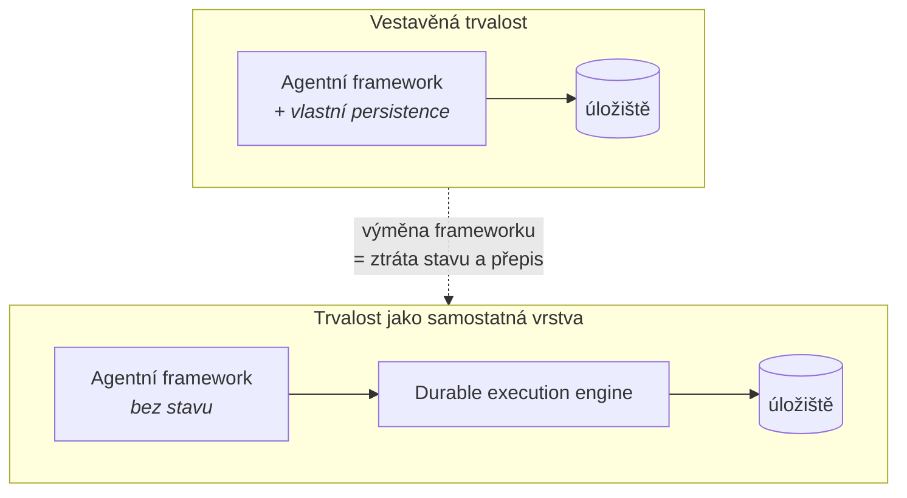

# Durable execution

## Proč to je samostatná vrstva

Dlouhoběžící agent potřebuje, aby rozpracovaný běh přežil pád procesu, restart clusteru
a čekání na lidské rozhodnutí v řádu dnů. To je **durable execution** – běh se průběžně
zapisuje do trvalého úložiště a po restartu pokračuje z posledního bodu, ne od začátku.

Skoro každý agentní framework si tuhle vrstvu dělá po svém. A právě tady bývá licenční hranice
mezi zdarma a placeným (viz [licencni-vzorce.md](licencni-vzorce.md)).

## Architektonický tah: vytáhnout ji z frameworku ven

| | Vestavěná trvalost | Samostatná vrstva |
|---|---|---|
| Výměna frameworku | Přepis včetně stavové logiky | Změna adaptéru |
| Licenční riziko | Soustředěné do jednoho projektu | Rozdělené, každá vrstva ověřená zvlášť |
| Provoz | Jeden systém | Dva systémy k provozování |
| Vhodné pro | Prototyp, jednoduchý use-case | Produkt dodávaný zákazníkovi |

Cenou je jeden systém navíc v provozu. Pro platformu, která má přežít výměnu frameworku
a licenční změnu, se to vyplatí.

## Kandidáti (ověřeno 2026-10-20)

| Engine | Licence | OSI? | Governance | Kde je stav |
|---|---|---|---|---|
| **Temporal** | **MIT** (server, v1.31.4 2026-10-12); SDK MIT | Ano | Temporal Technologies, jeden vendor, **CLA povinná** (`CONTRIBUTING.md`: *„All contributors also need to fill out the Temporal CLA“*); top 10 přispěvatelů serveru jsou zaměstnanci | Vlastní cluster; provozně těžší |
| **Dapr Workflows** | **Apache-2.0** | Ano | **CNCF Graduated** (od 10/2024) | **V tvém state storu – 28 providerů, dokumentovaný append-only formát** |
| **Restate** | **BUSL 1.1** (runtime, v1.8.0 2026-10-14), **MIT** (SDK) | **Ne** (runtime) | Restate Software Inc. / Restate GmbH, jeden vendor | Vlastní binárník, nejmenší provozní stopa. **Change Date 4 roky po vydání → Apache-2.0.** Additional Use Grant **výslovně povoluje** jakékoli produkční nasazení s vlastními workflow i interní managed platformu; zakazuje jen *„Public Restate Platform Service“* (třetí strany registrují vlastní deploymenty přes Restate API) |
| **Inngest** | **SSPL** (v1.46.0 2026-10-06) + *Grant of Future License*: **Apache-2.0 tři roky po zpřístupnění** každé verze | **Ne** (do uplynutí lhůty) | Inngest Inc., jeden vendor | Restriktivní u poskytování služby; verze starší tří let jsou Apache-2.0 |
| **DBOS** | **MIT** (Python `dbos` 3.3.0 2026-10-15 i TS, OSI classifier) | Ano | DBOS Inc., jeden vendor; **bez CLA v `CONTRIBUTING.md`**; bus factor **~1** (jeden autor ≈ 65 % commitů) | **V tvém Postgresu** – checkpointy, fronty, scheduling vše v Postgresu, žádný vlastní server. Hostovaný *Conductor* / DBOS Cloud existuje, jeho nutnost pro produkci neověřena |
| **Azure Durable Task Scheduler** | SDK **MIT**, backend **proprietární Azure služba** | **Ne** (backend) | Microsoft, jeden vendor, CLA | **Uvnitř Azure služby**; emulátor jen pro vývoj. `durabletask` 1.12.0 (2026-10-12) se dál popisuje jako SDK pro DTS |
| **DurableTask MSSQL provider** | **MIT** (v1.8.1, repo živé, push 2026-10-19) | Ano | Microsoft, jeden vendor | **V tvém MS SQL** – *„cloud or your own infrastructure"*; **jen .NET** |

**Pozn. Adam:** kombinace „OSI licence + nadace + graduated" má dnes jen **Dapr**.
Temporal je licenčně čistý (MIT), ale je to jeden vendor s CLA (ověřeno 2026-10-20) – platí u něj
riziko relicencování popsané v [licencni-vzorce.md](licencni-vzorce.md). Rozdíl je v tom,
že MIT verzi už nikdo nevezme zpátky; relicencování by se týkalo budoucích verzí.
**DBOS** je druhý OSI kandidát bez vlastního serveru – nejlevnější provoz v poli (jen Postgres),
ale bus factor ~1 a jeden vendor. **Restate** má po přečtení grantu užší problém, než se zdálo:
náš scénář (produkt u zákazníka, workflow píšeme my nebo zákazník) grant výslovně povoluje;
otázka na právníka zůstává, ale je konkrétní – zda zákazník, který dostane produkt s Restate
uvnitř, je „Licensee“ s vlastními workflow. **Inngest** vypadá jinak než před měsícem: SSPL
je dočasná, každá verze se po třech letech stane Apache-2.0 – pro produkt s dlouhým životním
cyklem to je zajímavé jen tehdy, když uneseme tříletý skluz za upstreamem.

### Durable engine jako substrát pod cizí agentní smyčkou – kdo to má first-party
*Ověřeno 2026-10-20 z PyPI metadat a release notes.*

| Engine | First-party integrace cizí smyčky | Claude Agent SDK |
|---|---|---|
| **Temporal** (Python SDK 1.34.0, 2026-09-30) | extras `openai-agents`, `langgraph`, `google-adk`, `strands-agents`, `deepagents`, `pydantic` | ❌ ne |
| **Dapr Agents** 1.0.7+ | `ClaudeAgentExecutor` + `DaprSessionStore` (viz [`dapr-agents.md`](dapr-agents.md)); docs odkazují na BUSL `diagrid` balíčky pro Pydantic AI a OpenAI Agents | ✅ Apache-2.0 |
| **MAF** 1.22 | `agent-framework-claude` (beta), ale durable jen přes DTS nebo vlastní `CheckpointStorage` | ⚠️ smyčka ano, trvalost ne |
| **DBOS**, **Restate**, **Inngest** | žádná agentní integrace nalezena | ❌ |

**Pozn. Adam:** vzor „durable vrstva ven, smyčka cizí“ přestal být teoretický. Pro Anthropic stack
je dnes jediná hotová OSS cesta Dapr; Temporal pokrývá OpenAI, LangGraph, ADK a Strands, ne Claude.
Kdo chce Temporal + Claude Agent SDK, píše adaptér sám.
**Rozhodnutí (Adam, 2026-10-21):** Claude Agent SDK je kandidát na smyčku platformy a Dapr je pro něj
preferovaný substrát, protože je cesta hotová. Viz [`overview.md`](overview.md).

## Když monetizovaná není licence, ale backend

MAF Durable Extension je **celý MIT** – repozitář, PyPI i .NET balíček. Přesto je jeho
durable execution nepřenositelná, protože jediný produkční backend, na který se SDK umí
připojit, je **placená Azure služba** (Durable Task Scheduler, `*.durabletask.io`).
Emulátor podle dokumentace *„isn't suitable for production use"*.

**License gate to nenajde – všechno je MIT.** Odhalí se to jen tím, že si přečteš,
na co se runtime připojuje. Detail viz čtvrtý vzorec v [licencni-vzorce.md](licencni-vzorce.md).

### Zpřesnění po ověření kódu (2026-09-29)

Past **není ve frameworku, ale v dokumentované cestě a v Python SDK**. MAF registruje
generické buildery `Microsoft.DurableTask` a storage provider určuje volající delegát.
Cesta ven existuje – [`Microsoft.DurableTask.SqlServer`](https://github.com/microsoft/durabletask-mssql)
(MIT, živý) persistuje stav do MS SQL kdekoliv – **ale jen na .NET**. Python balíček
`durabletask` je popsaný jako *„requires Azure Durable Task Scheduler, it is not a generic
gRPC sidecar connector"*.

Netherite jako alternativa **odpadá** – podpora končí **2028-03-31**.

A směr vývoje jde proti: `microsoft/durabletask-go` uvádí *„DTS is the only supported
runtime. This SDK does not include a storage backend."* `dapr/durabletask-go` je fork,
který si embeddable engine s vlastními backendy ponechal.

**Pozn. Adam:** obranný vzor „vytlačit durable vrstvu ven" tedy platí dál, jen z jiného
důvodu – ne že vytlačovat není kam, ale že jediná cesta ven zamyká do .NET a jede proti
směru ekosystému.

## Vztah k agentním frameworkům

**Dapr Agents** (Apache-2.0, GA březen 2026) staví přímo na durable execution Dapru –
trvalost tedy není doplněk, ale vlastnost runtimu, a je ve stejné licenci jako zbytek.
To je dnes nejčistší kombinace, jakou lze složit.

Návrh na přesun Dapr Agents pod **Agentic AI Foundation** (pod jménem *Durable Agents*)
byl podán **2026-06-02**, hlasování TC uzavřeno 2026-09-03 a **zamítnut 2026-09-11**.
Projekt zůstává pod Dapr / CNCF / Linux Foundation.

Struktura governance se tím nezhoršuje. Zhoršuje se ale obrázek o **neutralitě vrstvy** –
odůvodnění komise je architektonicky důležitější než výsledek a je to trojí nezávislé
potvrzení rizika „jak drahé je vzít stav jinam":

1. Záruky trvalosti jsou demonstrované **jen nad Dapr Workflow** – *„every guarantee it
   offers is currently expressed through Dapr Workflow"*.
2. **Rozhodující bod:** žádná jiná durable-execution komunita o to nestojí; deklarovaný
   Temporal provider nestačil.
3. Projekt *„reads more as an agent framework than as a substrate"*.

Governance ani security posture zpochybněné nebyly. Resubmise je možná bez čekací lhůty –
**sledovat, jestli přibude druhý durable backend**, je to přímý indikátor ceny odchodu.

> ⚠️ **Pozor na zdroj zralosti.** CNCF Graduated se vztahuje na **Dapr runtime**, ne na
> Dapr Agents: repozitář sub-projektu vznikl 2025-01-02, tedy dva měsíce **po** graduaci
> (2024-10-30). Sub-projekt navíc nemá vlastní support ani versioning policy.

### Provozní past Dapru

Scheduler má ve výchozím nastavení **embedded etcd** a *„scaling the Scheduler service
replicas up or down is not possible without incurring data loss"*. Drží přitom reminders,
které probouzejí pozastavená workflow – tedy i čekající schvalovací body.
Pro produkt dodávaný zákazníkovi zvážit **externí etcd** (`--etcd-embed=false` +
`--etcd-client-endpoints`; flag ověřen v docs i v `cmd/scheduler/options/options.go`, 2026-10-20)
a zálohování podle stanoveného RPO. Věta o ztrátě dat při škálování v docs trvá; Dapr 1.19
(rc.4 2026-10-16) mění jen retenci etcd revizí (10 000 místo 1 000 000).

### Verzování workflow v Dapru (1.17+) – ověřeno 2026-10-29

Replay historie proti změněnému kódu orchestrátoru = `NonDeterminismError` → instance FAILED (Python worker porovnává i jméno úlohy;
v SUSPENDED se eventy bufferují, nesoulad vyplave až po resume – přesně nález P3-5 na AKS). Dapr 1.17 (2026-02-27) přinesl
**named versioning + patches** (Python, Java, .NET, Go):

| Mechanismus | Co dělá | API (dapr-ext-workflow 1.18.3) | Zdroj |
|---|---|---|---|
| Pojmenované verze | více verzí pod jedním jménem workflow; verze, pod kterou instance začala, je v historii (`OrchestratorStarted.version`, backend ji tam zapíše z odpovědi workeru – durabletask-go `orchestration.go` v0.12.6 = daprd 1.18.9) a replay volá vždy ji; nové instance = `is_latest` | `@wfr.versioned_workflow(name=, version_name=, is_latest=)` / `register_versioned_workflow` | docs v1.18 `workflow-versioning.md`, `workflow-protocol-versioning.md`, release notes 1.17 |
| Chybějící verze | instance **STALLED** (`ExecutionStalled reason=VERSION_NAME_MISMATCH`), pokračuje, až se replika s verzí připojí | – | tamtéž (STALLED na AKS neměřeno) |
| Patch | `if ctx.is_patched("p1"): …` – při prvním průchodu se patch zapíše do historie, replay drží původní větev | `ctx.is_patched(name)` | tamtéž |
| Resolver | neverzovaná registrace téhož jména má **přednost** před verzovanými; historie bez verze → latest; chybějící verze → `VersionNotRegisteredException` | `_Registry.get_orchestrator` (vendored durabletask) | kód SDK v1.18.3 |
| Co verzování **neřeší** | změna typů vstupu/výstupu workflow a aktivit (docs: „doesn't address changing the types of inputs and outputs“); výběr verze při startu instance (Python 1.18.3 nemá parametr, protokol to umožňuje) | – | docs v1.18 |
| Rerun (1.16+), `continue_as_new` | rerun = nová instance ze stejné historie a **stejného kódu** (ne nástroj na změnu kódu; v SDK až `dapr` 1.19.0); `continue_as_new` zahodí nevyřízené čekání (eventy/timery) a volá ho jen orchestrátor | `rerun_workflow_from_event` (1.19 SDK), `ctx.continue_as_new(new_input, save_events=)` | docs 1.17 howto-manage-workflow, `task.py` |

Důsledek pro návrh (změřeno P3-6 E6, `tools/harness_p1_k8s`): orchestrátor jako **vzácně měněný verzovaný modul** (aktivity jménem,
verze = hash obsahu, snímky starých verzí v repu do dojetí instancí), změny do **aktivit** (replay jejich tělo neběží; mění se jen kontrakt),
vstupy jako dlouho žijící kontrakt (jen přidávat volitelná pole). Temporal má stejný problém a stejný tvar řešení (`patched`/worker versioning).
SDK: `dapr-ext-workflow` končí na 1.18.3 (2026-07-15), od `dapr` 1.19.0 (2026-10-22) jsou ext balíčky součástí jádra (`pip install dapr[workflow]`,
kompatibilita s daprd 1.18.9 neověřena); durabletask je vendored v `dapr/ext/workflow/_durabletask` (MIT kód Microsoftu uvnitř Apache balíčku – jen SBOM).
Dapr 1.18 navíc: start s ID aktivní instance = conflict (uvolnění purge/retention), purge od 1.17 maže i reminder Scheduleru, tagged timer pro nekonečný
`wait_for_external_event`, `WorkflowAccessPolicy` (cross-app operace; lokální start nepokryje → „drain“ přes policy nejde).

### Google ADK: store konverzace ≠ durable execution

Rozdíl, který se snadno přehlédne. ADK `DatabaseSessionService` (extra `[db]`, dialekty
sqlite / Postgres / MySQL / MSSQL / Spanner) ukládá **session, eventy a stav jako JSON**
a přežije restart procesu. **Není to durable execution engine.**

Obnovení běhu dělá `ResumabilityConfig(is_resumable=True)` – a to je jiná liga:

- třída je `@experimental`, výchozí hodnota `False` (re-ověřeno v `main` 2026-10-20, beze změny)
- docstring: *„we only guarantee an **at-least-once** behavior once resumed"*
- dokumentace: nástroje *„are run at least once, and may run more than once when resuming"*
- dočasný in-memory stav se ztrácí; maximální horizont čekání nedokumentovaný

**Pozn. Adam:** pro schvalovací bod v regulovaném procesu to znamená **idempotency key
na naší straně**. Neidempotentní akce za schvalovacím bodem se při obnovení může
provést podruhé. Je to zároveň dobrá připomínka, že „přežije restart" a „obnoví se
korektně" jsou dvě různá tvrzení.

→ **Změřeno 2026-10-21 na Dapr Agents 1.0.9** (`tools/harness_dapr_claude/`): přesně tohle.
Restart při *čekání* na schválení je exactly-once, restart *během* schváleného nástroje
spustí nástroj podruhé bez nové otázky člověku. Platí tedy pro Dapr Workflow stejně jako
pro ADK; rozdíl je jen v tom, že u Dapru je to dokumentovaná vlastnost aktivit.

## Otevřené otázky
- [~] DBOS – licence, governance, provozní model. → 2026-10-20: MIT, DBOS Inc., bez CLA, bus factor ~1,
      stav v Postgresu. **Zbývá:** role hostovaného Conductoru (je nutný pro HA/recovery, nebo jen
      pohodlí?) a zda má agentní integrace.
- [x] ~~Temporal: vyžaduje CLA?~~ → **ano, povinná** (CONTRIBUTING.md, 2026-10-20). Struktura přispěvatelů:
      top 10 na serveru jsou zaměstnanci Temporalu; podíl mimo vendora nekvantifikován.
- [ ] Jak se durable execution snáší s protokolovou hranicí A2A – kde končí běh jednoho agenta.
- [ ] Praktický dopad BUSL u Restate na dodávku produktu on-prem (otázka na právníka). → 2026-10-20
      zúženo: grant povoluje produkční nasazení s vlastními workflow i interní platformu; ptát se jen
      na postavení zákazníka jako „Licensee“ a na Change Date (4 roky → Apache-2.0).
- [ ] Temporal + Claude Agent SDK: kolik práce je adaptér, když SDK má extras jen pro OpenAI Agents,
      LangGraph, ADK a Strands.
- [ ] ADK resume: chová se kagentí `KAgentSessionService` při at-least-once obnovení
      stejně jako `DatabaseSessionService`? Netestováno.
- [ ] Lze MAF workflow spustit nad Dapr Workflow nebo Temporalem bez `agent-framework-durabletask`?
- [ ] `continue_as_new` a verze: drží nová inkarnace instance `version.name`, nebo se resolvuje znovu na latest? V docs ani kódu nenalezeno.
- [ ] `dapr` 1.19.0 SDK (rerun, `get_workflow_history`, `list_workflow_instance_ids`) proti daprd 1.18.9 – podporovaná kombinace? Do té doby list/history jen CLI.
- [ ] STALLED při odebrání verze změřit (E6 měří jen běh dvou registrovaných verzí); jak ho zobrazit v GUI (dnes Running/Pozastaveno/FAILED).
- [~] Změřit harnessem: pozastavení na lidské rozhodnutí → restart clusteru → obnovení
      po 14 dnech. Ani jeden kandidát nemá dokumentovaný maximální horizont čekání.
      → 2026-10-21: Dapr Agents změřeno pro krátkou pauzu (viz dapr-agents.md), 14 dní zbývá.

## Changelog
- 2026-10-29: verzování workflow v Dapru 1.17+ (named versions v historii instance, STALLED místo FAILED, patches, limity) – ověřeno z docs v1.18, SDK 1.18.3 a durabletask-go v0.12.6; změřeno P3-6 E6 na AKS; otevřené otázky k `continue_as_new`, SDK 1.19 a STALLED.
- 2026-10-24: P1-5 kind – Dapr Workflow 1.18.9 v clusteru s `state.postgresql`: pod aplikace smazán uprostřed zakázky (čekání na HITL), nový pod obnovil instanci ze stavu v Postgresu a zakázka doběhla (`tools/harness_p1_k8s` P15c). Bez operátoru a sentry (daprd jako sidecar, komponenty z ConfigMapy).
- 2026-09-27: první verze.
- 2026-10-21: harness na Dapr Agents potvrdil at-least-once při restartu během nástroje.
- 2026-09-29: doplněn Google ADK – store konverzace není durable execution, resume je
  experimentální a at-least-once.
- 2026-09-29: ověřeno, že MAF backend nevynucuje; doplněn MSSQL provider jako cestu
  mimo Azure (jen .NET) a vyřazen Netherite (konec podpory 2028-03-31).
- 2026-09-29: doplněn Azure Durable Task Scheduler a vzorec „monetizovaný backend".
- 2026-09-28: opraveno datum a odůvodnění zamítnutí v AAIF; doplněno, že CNCF Graduated
  se nevztahuje na Dapr Agents; přidána provozní past Scheduleru.
- 2026-10-20: re-verifikace kandidátů. Temporal CLA potvrzena; Restate BUSL grant a Change Date
  přečteny (scénář produktu u zákazníka povolen); Inngest má Apache-2.0 po třech letech; DBOS
  doplněn (MIT, Postgres-native, bus factor ~1); nová tabulka first-party integrací cizích smyček
  (Temporal extras, Dapr `ClaudeAgentExecutor`, MAF `agent-framework-claude`); flag Scheduleru ověřen.
