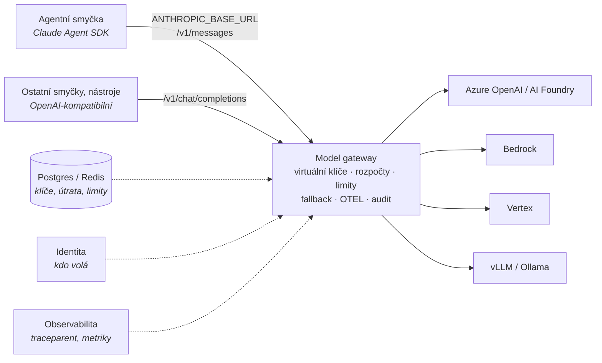

# Mapa model gateway a FinOps

Kontext: **jediný šev mezi agenty a poskytovateli modelů.** Agentní smyčka platformy je
Claude Agent SDK, trvalost Dapr Agents (viz [`../platforma/cilova-architektura.md`](../platforma/cilova-architektura.md)).
Gateway proto musí nést **Anthropic Messages API** bez ztráty (prompt caching, tool use, streaming),
a zároveň být místem, kde se vynucují rozpočty, limity a audit. Kritéria v [kriteria.md](kriteria.md).

## Co gateway v platformě dělá a nedělá

Dělá: jednotný endpoint, klíče, rozpočty, rate limity, fallback, metriky, logování na vyžádání.
Nedělá: orchestraci, paměť, MCP registry (pokud to umí, je to bonus, ne důvod volby – viz G6).

## Široké síto – kolo 1

Vyřazovací kritéria A1–A5 z [kriteria.md](kriteria.md). Ověřeno 2026-10-22 z `LICENSE`,
package registry a zdrojů dokumentace v GitHubu (renderované weby docs nebyly z prostředí
dostupné – čteny byly jejich zdrojové repozitáře, tedy stejný primární zdroj před renderem).

| Kandidát | Licence proxy | Enterprise hranice | Governance | Phone-home | Stav | Typ | Release | Výsledek |
|---|---|---|---|---|---|---|---|---|
| **[agentgateway](agentgateway.md)** | Apache-2.0 (LICENSE, `Cargo.toml`), bez `enterprise/` | V repu žádná; komerční nabídka Solo.io mimo repo (neověřeno) | **Linux Foundation** (`CHARTER.md`, TSC), ne CNCF; **ani CLA, ani DCO** | Žádné SDK v `Cargo.lock`; model catalog embedovaný, refresh z webu jen ručně z UI | Rozpočty Postgres/SQLite, **DDL v repu**; request log store s migracemi | Vlastní **Rust L7 proxy** + Go controller (Gateway API) | v1.6.0 (2026-10-02), v1.7.0-alpha.1 (2026-10-21), minor ~měsíčně | **postupuje** |
| **[Envoy AI Gateway → Agent Router](agent-router.md)** | Apache-2.0, bez `enterprise/` | Žádná v repu | **Agentic AI Foundation** (LF Projects), `Technical_Charter.pdf`; **DCO**; maintaineři Tetrate, Bloomberg, KServe | Nic nenalezeno | Jen rate-limit countery v Redisu; **žádný ledger útraty ani virtuální klíče** | **Envoy** (Envoy Gateway + Go extproc, CRD) | v1.2.0 (2026-10-07), cyklus 2–3 měsíce | **postupuje** – FinOps by se musel dostavět |
| **[LiteLLM](litellm.md)** | MIT **s carve-outem**: `enterprise/` pod BerriAI Enterprise license; PyPI `litellm` 1.106.2 MIT, **`litellm-enterprise` 0.1.78 `LicenseRef-Proprietary` je závislostí proxy** v `pyproject.toml` | SSO (zdarma do 5 uživatelů), JWT auth, audit log, RBAC, IP ACL, secret managery, **tag-based budgets**, model budgets per key, spend reports, 7 guardrail integrací, enforced params | Berri AI, žádná nadace, **CLA**; ~81 % commitů vendor + bot | Licenční klíč: offline RSA podpis, síť jen jako fallback; telemetrie off by default; **ceník modelů se stahuje z GitHub `main` při startu** (nutné `LITELLM_LOCAL_MODEL_COST_MAP=True`) | Postgres (Prisma schéma v repu, ~100 modelů), Redis | Python (FastAPI) + Rust fast-path | v1.106.2 (2026-10-21), téměř denně | **postupuje s výhradou** (A1: proprietární balíček v dependency tree; A3: ceník z GitHubu) |
| **[Bifrost](bifrost.md)** (Maxim AI) | Apache-2.0, bez `enterprise/`; **Enterprise = uzavřený binár z privátních registrů** (`featureflags.EnterpriseOnly`) | SSO/OIDC, **RBAC**, teams, access profiles, **audit log**, **guardrails** (12 integrací), alerting, secret management, log exports, **clustering/HA**, adaptive routing, circuit breaker; Enterprise nepodporuje SQLite | Maxim AI, žádná nadace; CLA/DCO nenalezeno; prakticky všechny commity Maxim | Žádné SDK; **ceník z `getbifrost.ai/datasheet`, bez něj „Bifrost cannot start“** – `file://` override zdokumentován v air-gapped guide | config SQLite/Postgres, logy SQLite/Postgres/ClickHouse; schéma v Go migratoru, ne DDL | Go app server | v2.3.2 (2026-10-20), patch každé 2–3 dny | **postupuje s výhradou** (HA, RBAC, audit a guardrails v uzavřeném bináru) |
| **Higress** (Alibaba) | Apache-2.0, bez `enterprise/`; komerční produkt Alibaba Cloud | Žádná v repu | **CNCF Sandbox**, Incubation nepodáno; CLA/DCO nenalezeno; ~36 % commitů Alibaba, top jednotlivec 35 % | Nic nalezeno v názvech souborů (hlubší grep neproveden) | K8s CRD (Istio); token limity a kvóty v **Redisu**; žádný ledger útraty | **Envoy + Istio**, Wasm pluginy | v2.2.5 (2026-10-04), ~6–8 týdnů | **rezerva** pro Envoy/Istio prostředí – FinOps tenký |
| **Kong AI Gateway (OSS)** | Apache-2.0 (`Kong/kong`) | **Od 3.10 neexistuje CE verze** – OSS linie končí 3.9.x (3.9.4 = CVE patch 2026-10-12); token budgety, semantic cache, MCP/A2A proxy a všechny guardrails „AI License Required“ | Kong Inc, žádná nadace | `anonymous_reports = on` default (vypnutelné) | Postgres nebo DB-less; cost management enterprise | NGINX/OpenResty | 3.9.4 (2026-10-12), 14 commitů za 3 měsíce | **vyřazen** – OSS linie zamrzlá, FinOps za licencí |
| **Portkey Gateway** | MIT na `main`; **větev `2.0.0` bez souboru LICENSE** (`package.json` říká MIT) | „org management, governance, security“ hosted/enterprise; seznam neověřen | Portkey Inc, bez CLA/DCO | neověřeno | OSS gateway stateless, **klíče a rozpočty v hostovaném control plane** | Node/Hono (i CF Worker) | v1.15.2 (2026-01-12); **0 commitů od 2026-07-22** | **vyřazen** – A4/A5, stagnace |
| **TensorZero** | Apache-2.0 | – | TensorZero Inc, CLA | Usage analytics default on (vypnutelné) | ClickHouse + Postgres | Rust | 2026.6.0 (2026-06-04) | **vyřazen – repozitář archivován 2026-06-12**, celá org read-only |
| **Helicone** (`ai-gateway`) | **`LICENSE` = GPL-3.0, README a `Cargo.toml` tvrdí Apache-2.0** – rozpor | Helm „contact enterprise@“ vs. veřejný chart Apache; hranice neověřena | Helicone Inc, bez CLA/DCO | `posthog-js` ve webu | Postgres + ClickHouse + MinIO | Rust router beta | v0.2.0-beta.30, **poslední commit 2025-11-20** | **vyřazen** – licenční rozpor + 11 měsíců bez commitu |
| **kgateway** | Apache-2.0, CNCF Sandbox, DCO | – | – | – | – | Envoy control plane | v2.4.7 (2026-10-16) | **mimo síto** – od v2.3.0 AI funkce přesunuty do agentgateway |

Soubory kandidátů v hranatých závorkách vzniknou v hloubkovém kole.

### Tři nové licenční vzorce z tohoto síta

Doplněno do [`../frameworks/licencni-vzorce.md`](../frameworks/licencni-vzorce.md) jako osmý až desátý vzorec (2026-10-22):

| Vzorec | Doložený případ | Jak poznat |
|---|---|---|
| **Proprietární balíček jako povinná závislost OSS proxy** | LiteLLM: `litellm-enterprise` (`LicenseRef-Proprietary`) v `pyproject.toml` proxy | Projít `requires_dist` / lock file proxy, ne jen `LICENSE` v rootu |
| **Rozpor LICENSE vs. metadata** | Helicone `ai-gateway`: `LICENSE` GPL-3.0, `Cargo.toml` a README Apache-2.0 | Porovnat soubor `LICENSE` s registry metadaty a README; při rozporu otázka na právníka |
| **OSS linie bez nových minorů při živém enterprise produktu** | Kong: CE končí 3.9, EE na 3.16 | Matice verzí v docs vendora, tagy v OSS repu vs. verze v docs |

## Co z toho plyne (předběžně, před kolem 2)

**Pozn. Adam:** dva kandidáti pod nadací s čistou licencí (agentgateway, Agent Router) mají
**nejtenčí FinOps** – Agent Router rozpočty neřeší vůbec, agentgateway má tabulku `budget_usage`.
Dva kandidáti s nejbohatším FinOps (LiteLLM, Bifrost) mají **placenou hranici přesně tam, kde
platforma potřebuje RBAC, audit a tagy útraty.** Rozhodnutí se tedy nedá udělat ze síta –
rozhodne G1 (věrnost Anthropic API) a kolik FinOps si platforma musí dostavět sama.

Dapr Agents mají LiteLLM jako přímou závislost (viz [`../frameworks/dapr-agents.md`](../frameworks/dapr-agents.md)) –
to ale je **SDK (MIT)**, ne proxy. Volba proxy tím není vynucená.

## Kolo 2 – protokolová věrnost a FinOps

Ověřeno 2026-10-22 ze zdrojových repozitářů dokumentace (commit uveden v souborech kandidátů)
a z code.claude.com / platform.claude.com. **Nic z toho není změřeno harnessem** – jsou to
dokumentované vlastnosti, ne naměřené.

### Kontrakt, který gateway musí splnit

Anthropic publikuje pro gateway pod Claude Code a Claude Agent SDK **explicitní kontrakt**
([code.claude.com/docs/en/llm-gateway-protocol](https://code.claude.com/docs/en/llm-gateway-protocol), ověřeno 2026-10-22):

- `POST /v1/messages` (+ volitelně `/v1/messages/count_tokens`, `GET /v1/models`).
- Hlavičky `anthropic-beta` a `anthropic-version` **forwardovat beze změny jako otevřený seznam** – gateway s allowlistem beta hlaviček rozbije nové funkce SDK.
- `cache_control` forwardovat všude; jinak tichá ztráta cache a násobná cena.
- Pole `system` nepřeskládávat (nese atribuční blok).
- Streaming včetně `ping` eventů **nebufferovat**; chybová těla upstreamu neobalovat (retry logika SDK matchuje text).
- Hlavičky `x-claude-code-session-id`, `x-claude-code-agent-id`, `x-claude-code-parent-agent-id` pro atribuci útraty na agenta.

Agent SDK nemá vlastní gateway volby – předává `ANTHROPIC_BASE_URL`, `ANTHROPIC_AUTH_TOKEN` (→ `Authorization: Bearer`)
a `ANTHROPIC_CUSTOM_HEADERS` procesu Claude Code. Past: v TypeScript SDK `options.env` prostředí **nahrazuje**,
v Pythonu `ClaudeAgentOptions(env=…)` **merguje**. Anthropic žádný gateway produkt nedoporučuje ani neaudituje
(dřívější sekce o LiteLLM v docs už není).

**Claude v Azure AI Foundry** ([platform.claude.com](https://platform.claude.com/docs/en/build-with-claude/claude-in-microsoft-foundry), ověřeno 2026-10-22):
endpoint `https://{resource}.services.ai.azure.com/anthropic/v1/messages` je **nativní Anthropic Messages API**;
auth API key nebo Entra ID Bearer (scope `https://ai.azure.com/.default`); `model` = deployment name;
nepodporováno Batches, Models API, Admin API. Microsoft Learn se z prostředí nepodařilo načíst – fakta o Foundry
jsou ověřena jen z Anthropic docs.

### G1 – úroveň podpory Anthropic Messages API

| Kandidát | Úroveň + endpoint | Prompt caching | Tools / thinking / streaming | Azure OpenAI / Foundry | Bedrock / Vertex / vLLM |
|---|---|---|---|---|---|
| **LiteLLM** v1.106.x | **Nativní** `/v1/messages` (rozpočty, logging, fallback, LB nad ním) pro `anthropic/`, `bedrock/`, `vertex_ai/`, `azure_ai/`; pro ostatní providery **překlad** (cache_control se zahodí). Navíc **passthrough** `/anthropic/*` bez překladu s cost trackingem | ✅ nativní providery forward „as sent“, usage vč. cache polí; ceník má cache sazby per deployment | ✅ streaming, tools, thinking; denně generovaná matice kompatibility Claude Code × provider | ✅ `azure/` + Entra ID (`DefaultAzureCredential`, managed identity); **Claude přes Foundry `azure_ai/claude-…`** s Bearer | ✅ všechny čtyři |
| **Agent Router** v1.2.0 | **Nativní** `/anthropic/v1/messages` (+ `count_tokens`, `models`), backend Anthropic bez překladu; Bedrock/Vertex Claude **překlad**; od v1.2.0 per-backend **filtr `anthropic-beta`** jen pro GCP/AWS Anthropic | ✅ jednotné `cache_control`, usage cache pole jako `llmRequestCosts` | ✅ streaming, function calling, extended thinking dle tabulky endpointů | ⚠️ Azure OpenAI ano (client secret / OIDC); **managed identity nedokumentováno; Claude přes Foundry nedokumentováno** | ✅ `AWSAnthropic` nativní, `GCPAnthropic`, vLLM přes OpenAI schema |
| **agentgateway** v1.6 | **Nativní** route `Messages` na `/v1/messages`; parser **passthrough** (neznámá pole drží a posílá dál), ke stejnému formátu providera beze změny | ✅ `policies.ai.promptCaching` (auto-inject), usage normalizace vč. cache, katalog s `cacheRead`/`cacheWrite` sazbami | ⚠️ streaming/tools/thinking v přečtených stránkách explicitně nepotvrzeno; Claude Code integrace dokumentována (rada vypnout experimentální bety při chybě `context_management`) | ✅ provider `azure` s `resourceType: foundry`, **`DefaultAzureCredential` + managed/workload identity**; **Claude na Foundry auto-routing na `/anthropic/v1/messages`** | ✅ `bedrock` (IRSA, guardrails), `vertex`, vLLM/Ollama přes OpenAI provider |
| **Bifrost** v2.3 | **Překlad** („protocol adaptation“ přes interní pipeline); **`anthropic-beta` ve výchozím stavu blokována** (allowlist v UI) | ⚠️ `cache_control` klienta forward; cache čítače dokumentovány jen v OpenAI tvaru | ⚠️ thinking přes konverzi `reasoning` ↔ `thinking`; po sobě jdoucí tool zprávy se **slučují** | ✅ Entra SP i `DefaultAzureCredential`; Claude přes Azure ano | ✅ |
| Portkey OSS 1.15.2 | Nativní s **allowlistem parametrů** – `context_management`, `output_config` v OSS chybí | ✅ | ✅ | ⚠️ managed/workload identity jen enterprise | ✅ |
| TensorZero 2026.6 | **Jen překlad**, žádný `/v1/messages` | ⚠️ jen přes `extra_body` JSON pointer | ✅ | ⚠️ Entra ID nedokumentováno | ✅ |

### G2 / G4 / G5 – FinOps, observabilita, identita

| Kandidát | Rozpočty (OSS vs. placené) | Úložiště útraty + vlastní ceník | Při vyčerpání | OTEL + Prometheus | Logování promptů default | Identita uživatele |
|---|---|---|---|---|---|---|
| **LiteLLM** | OSS: globální, tým, člen týmu, uživatel, klíč, end-user, org. **Enterprise:** tag budgets, `model_max_budget` per klíč, soft alerty, spend reports. Bez Postgres **fail open** | Postgres (Prisma, denní agregace per user/team/org/tag/end-user/agent); ceník per deployment vč. cache; **offline mapa jen s `LITELLM_LOCAL_MODEL_COST_MAP=True`** | Hard stop (400) nebo **`budget_fallbacks`** na levnější model | OTEL callback, inbound `traceparent` respektován; Prometheus s labely end_user/key/team/model (end_user off by default) | **Vypnuto** (opt-in `store_prompts_in_spend_logs`) | `x-litellm-end-user-id` / `user` → Anthropic `metadata[user_id]` dokumentováno |
| **Agent Router** | **Žádné USD rozpočty.** Tokenové limity přes Envoy `BackendTrafficPolicy` + `llmRequestCosts` (CEL), `QuotaPolicy` v1alpha1 | Redis čítače; **žádná spend DB ani USD katalog** | 429, běžící stream se nepřeruší | OTLP jen s endpointem, OpenInference default; Prometheus `gen_ai.*` + custom labely z hlaviček | **Traces OpenInference default obsahují plný request i response** (`OPENINFERENCE_HIDE_INPUTS/OUTPUTS`) | jen mapování hlaviček na atributy |
| **agentgateway** | OSS: `apiKey.keys[].budgets[]` **USD nebo tokeny**, rolling okno 1h/24h/30d, `Audit|Block`; `localRateLimit` tokens s CEL klíčem (`jwt.sub`, `jwt.team`, model → tenant→tým→agent); remote RLS. Enterprise hranice nenalezena | Inline katalog cen vč. cache a reasoning sazeb; metrika `…cost_usd_total`; request log Postgres/SQLite; **persistence USD rozpočtů mezi replikami neověřena** | `Block` (429) nebo `Audit` | OTLP + CEL atributy, navazuje na inbound trace; Prometheus gen_ai + cost USD + CEL labely | Default jen metadata, DB log opt-in | `metadata.user_id` per klíč; **invoice-grade atribuce na Bedrocku** (STS session tags) |
| **Bifrost** | OSS: Customer → Team → Virtual Key → Provider, každá úroveň budget + limit. **Enterprise:** business units, access profiles, RBAC. **„Multiple OSS nodes with Postgres is not supported“** – stav v paměti, HA enterprise | SQLite/Postgres/ClickHouse; `pricing_url` vč. `file://`; overrides per scope | Block, provider vyřazen z routingu | OTLP, inbound `traceparent` přednost; Prometheus `x-bf-dim-*` | **Zapnuto**, dokud není `disable_content_logging: true` | `x-bf-customer-id` enterprise; propagace k provideru neověřena |

### Co z kola 2 plyne

**Pozn. Adam (předběžné doporučení, ne rozhodnutí):**

| Varianta | Pro | Proti |
|---|---|---|
| **agentgateway** (primární kandidát) | Apache-2.0 pod LF bez enterprise hranice; nativní passthrough `/v1/messages`; USD rozpočty per klíč v OSS; Claude na Foundry s managed identity bez konfigurace; Rust L7; cost metrika; cesta k MCP/A2A ve stejné vrstvě | Bus factor: jeden člověk 51 % commitů; ani CLA ani DCO; docs rozbité podle verzí; FinOps dimenze tenčí než LiteLLM (týmové rozpočty jen přes CEL rate limit, ne ledger); persistence rozpočtů mezi replikami neověřena |
| **LiteLLM** (záloha) | Nejúplnější FinOps a nejširší Claude pokrytí vč. Foundry; dokumentovaná propagace identity; `budget_fallbacks`; denní matice kompatibility s Claude Code | Proprietární balíček v závislostech proxy (A1 s výhradou); CLA, jeden vendor, 81 % commitů vendor+bot; tag budgets, RBAC a audit log za licencí; ceník z GitHubu by default; Python app server |
| Agent Router | Nejčistší governance (AAIF, DCO, rozložený bus factor); Envoy | FinOps nulový – rozpočty by se stavěly celé; Foundry Claude a managed identity nedokumentované |
| Bifrost | Bohatá hierarchie rozpočtů v OSS | Překlad místo passthrough, blokuje `anthropic-beta` by default, slučuje tool zprávy – **porušuje kontrakt Anthropic**; HA jen enterprise |

Rozhodnutí padne až po harnessu G1 (viz níže). Pokud agentgateway v harnessu neprojde nebo se ukáže, že
rozpočty bez ledgeru nestačí, zbývá LiteLLM s vědomě přijatou výhradou k A1.

## Kolo 3 – harness G1 (změřeno 2026-10-22)

`tools/harness_gateway_g1/` – mock upstream jako záznamník, 21 kontrol kontraktu z code.claude.com
plus Claude Agent SDK (bundlované Claude Code CLI 2.1.308) přes gateway s MCP nástrojem.
Live část proběhla na Adamově stroji (macOS, 2026-10-22 20:39) proti api.anthropic.com.

| Cesta | PASS/FAIL | Porušení kontraktu |
|---|---|---|
| direct (kontrola) | 21/0 | – |
| **agentgateway 1.6.0** | **21/0** (mock) + **2/0** (live) | žádné; `traceparent` propagován jako child span; latence p50 +0,7 ms; Agent SDK turn s nástrojem doběhl (3 requesty: ToolSearch → MCP nástroj → odpověď). **Live:** prompt cache přes gateway funguje (1. volání `cache_creation_input_tokens` 7 602, 2. volání `cache_read > 0`, shodně s přímým voláním); Agent SDK přes gateway proti skutečnému Claude: 3 kola, MCP nástroj proveden 1×, `cache_read_input_tokens` 41 890, bez chyby |
| LiteLLM 1.106.2, nativní `/v1/messages` | 16/5 | `anthropic-beta` přeuspořádán a doplněn (neznámá beta ale **zachována**); `x-claude-code-*` atribuční hlavičky **zahozeny**; vlastní `ping` před `message_start`; chybová těla **obalena** textem `litellm.BadRequestError: AnthropicException - {...}`; **529 overloaded → 500 api_error**; `traceparent` a `request-id` zahozeny; latence p50 +13 ms; Agent SDK turn doběhl |

Co z toho plyne:

- **agentgateway kontrakt splňuje beze zbytku** a live běh to potvrdil: cache i Agent SDK s nástrojem
  přes gateway fungují stejně jako napřímo. G1 je pro agentgateway uzavřené.
- **LiteLLM kontrakt porušuje na čtyřech místech**, z toho dvě jsou pro Agent SDK reálný problém:
  ztráta atribučních hlaviček znemožňuje účtovat útratu na agenta/session z hlaviček (musí se
  řešit přes virtuální klíče per agent) a **překlad 529 na 500** mění retry chování SDK
  (SDK matchuje chybová těla upstreamu – viz kontrakt). Přeuspořádání bet a vlastní ping
  jsou kosmetické. Passthrough `/anthropic/*` nebyl měřen – pravděpodobně dopadne lépe,
  ale ztrácí rozpočty nad `/v1/messages`.
- `litellm[proxy]` **skutečně instaluje `litellm-enterprise` (`LicenseRef-Proprietary`)** jako
  závislost – potvrzeno `importlib.metadata` v harnessu (0.1.76.post1 vedle 1.106.2).

**Rozhodnutí (Adam, 2026-10-22): agentgateway jako model gateway platformy.** Přijatá rizika:
bus factor (jeden člověk 51 % commitů), bez CLA/DCO, FinOps bez ledgeru per tým (rozpočty jen per
API klíč → klíč per agent/tým jako pracovní model), persistence rozpočtů mezi replikami neověřena.
LiteLLM zůstává záloha pro případ, že FinOps bez ledgeru nebude stačit – pak s vědomým
porušením kontraktu (passthrough režim) a výhradou k A1.

## Co ověřit dál
- [ ] agentgateway 1.7: PR #2162 (generická chybová těla klientům) vs. kontrakt Claude Code (chybová těla neobalovat) – přeměřit G1 na 1.7; egress proxy (CONNECT) viz `../sandbox/egress-agentgateway.md`.

- [x] ~~**Harness G1** – přenos podle kontraktu z code.claude.com~~ – **změřeno 2026-10-22**: mock agentgateway 21/21,
      LiteLLM 16/21; **live agentgateway 2/2** (cache_read přes gateway > 0, Agent SDK s nástrojem doběhl).
- [ ] Live běh LiteLLM (`--gateway litellm --mode live`) pro úplnost srovnání.
- [ ] LiteLLM passthrough `/anthropic/*` změřit stejným harnessem (očekávání: lepší přenos, bez rozpočtů).
- [ ] Harness na Azure Foundry upstream (`--upstream https://<res>.services.ai.azure.com/anthropic`, Entra ID).
- [x] ~~agentgateway: USD rozpočty za běhu~~ – **změřeno 2026-10-24** (O-2 `budget`, 1.6.0): kontrola `used >= limit` před requestem,
      účtování po odpovědi z vestavěného katalogu (i mock `claude-haiku-4-5` má `agw.ai.usage.cost.total`); `Block` = 429 s `Retry-After`
      do konce okna, `Audit` = warn log `API key budget exceeded`; `budget_usage` (sqlite/Postgres) nanodolary, okna v ms, flush 5 s;
      CEL pole logu `apiKey.<metadata>` a `request.headers[...]` dávají cenu per role × zakázka.
- [x] ~~agentgateway: persistence USD rozpočtů mezi replikami~~ – **změřeno 2026-10-24 (P1-4 kind, 2 repliky, Postgres):** delty se
      zapisují aditivně (upsert `used_amount + excluded`), součet správný po flushi obou replik (~7 s); vynucení `Block` je eventually
      consistent – replika zná útratu druhé až po flushi/reconcile (`FLUSH_INTERVAL` 5 s, nekonfigurovatelné) → přestřel 3,7 requestu
      u 2 replik vs. 0,7 u jedné. Dvě repliky nad prázdnou DB se perou o migrace (jedna restartuje). G1 proti clusterové gateway 21/21.
- [ ] agentgateway: explicitní potvrzení thinking a paralelních tool calls na `/v1/messages`; aktuální číslo verze (tagy v1.6 vs. docs mluvící o 2.x).
- [ ] Forward `traceparent` z gateway **k poskytovateli** – u žádného kandidáta nedoloženo.
- [ ] Propagace identity koncového uživatele k poskytovateli u Agent Routeru a Bifrostu.
- [ ] Microsoft Learn stránky o Claude ve Foundry (nebyly z prostředí dostupné) – potvrdit Entra ID a deployment names.
- [ ] LiteLLM: je blok s `litellm-enterprise` v `pyproject.toml` základní závislost, nebo extra `proxy`?
      Lze proxy nainstalovat a provozovat bez něj?
- [ ] agentgateway: obsah `crates/pool/LICENSE`; komerční nabídka Solo.io a její hranice vůči OSS; air-gapped návod.
- [ ] Bifrost: licenční mechanismus Enterprise bináru (kontrola klíče přes síť?); co přesně zůstává v OSS governance pluginu.
- [ ] Docker image labels (`org.opencontainers.image.licenses`) u všech postupujících.
- [ ] Higress a Agent Router: hlubší grep kódu na telemetrii; air-gapped provoz Wasm registry (Higress).
- [x] ~~Změřit režii gateway P50/P95 vs. přímé volání~~ – mock, non-stream, n=20: agentgateway +0,7 ms, LiteLLM +13 ms p50.

## Changelog
- 2026-10-24: P1-4 kind – agentgateway ×2 s Postgres: persistence rozpočtů aditivní, vynucení eventually consistent (flush 5 s); G1 21/21 proti clusteru.
- 2026-10-24: rozpočty agentgateway změřeny za běhu v O-2 (`--scenario budget`): Block/Audit, `budget_usage`, cena per role × zakázka z logu.
- 2026-10-22: rozhodnuto (Adam) – agentgateway, LiteLLM záloha.
- 2026-10-22: harness G1 live na Adamově stroji – agentgateway 2/2 (cache, Agent SDK s nástrojem); G1 uzavřeno.
- 2026-10-22: kolo 3 – harness G1 změřen (mock): agentgateway splňuje kontrakt beze zbytku, LiteLLM porušuje
  na čtyřech místech (atribuční hlavičky, obalená chybová těla, 529→500, ping); doporučení agentgateway.
- 2026-10-22: kolo 2 – G1 a FinOps ze zdrojů docs; kontrakt gateway z code.claude.com; Claude ve Foundry nativní API;
  předběžně agentgateway primární, LiteLLM záloha, Bifrost porušuje kontrakt (beta hlavičky, slučování tool zpráv).
- 2026-10-22: první verze; široké síto kolo 1, 10 kandidátů. Vyřazeni Kong (CE zamrzlé na 3.9), Portkey
  (stav v hostovaném control plane, stagnace), TensorZero (archivován 2026-06-12), Helicone (GPL/Apache rozpor,
  bez commitů), kgateway (mimo síto). Postupují agentgateway, Agent Router, s výhradou LiteLLM a Bifrost,
  Higress jako rezerva.
