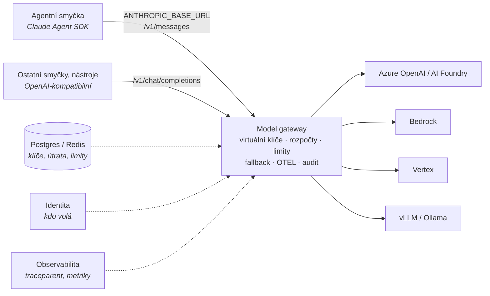

# Mapa model gateway a FinOps

Kontext: **jediný šev mezi agenty a poskytovateli modelů.** Agentní smyčka platformy je
Claude Agent SDK, trvalost Dapr Agents (viz [`../platforma/cilova-architektura.md`](../platforma/cilova-architektura.md)).
Gateway proto musí nést **Anthropic Messages API** bez ztráty (prompt caching, tool use, streaming),
a zároveň být místem, kde se vynucují rozpočty, limity a audit. Kritéria v [kriteria.md](kriteria.md).

## Co gateway v platformě dělá a nedělá

Dělá: jednotný endpoint, klíče, rozpočty, rate limity, fallback, metriky, logování na vyžádání.
Nedělá: orchestraci, paměť, MCP registry (pokud to umí, je to bonus, ne důvod volby – viz G6).

## Široké síto – kolo 1

Vyřazovací kritéria A1–A5 z [kriteria.md](kriteria.md). Ověřeno 2026-10-22 z `LICENSE`,
package registry a zdrojů dokumentace v GitHubu (renderované weby docs nebyly z prostředí
dostupné – čteny byly jejich zdrojové repozitáře, tedy stejný primární zdroj před renderem).

| Kandidát | Licence proxy | Enterprise hranice | Governance | Phone-home | Stav | Typ | Release | Výsledek |
|---|---|---|---|---|---|---|---|---|
| **[agentgateway](agentgateway.md)** | Apache-2.0 (LICENSE, `Cargo.toml`), bez `enterprise/` | V repu žádná; komerční nabídka Solo.io mimo repo (neověřeno) | **Linux Foundation** (`CHARTER.md`, TSC), ne CNCF; **ani CLA, ani DCO** | Žádné SDK v `Cargo.lock`; model catalog embedovaný, refresh z webu jen ručně z UI | Rozpočty Postgres/SQLite, **DDL v repu**; request log store s migracemi | Vlastní **Rust L7 proxy** + Go controller (Gateway API) | v1.6.0 (2026-10-02), v1.7.0-alpha.1 (2026-10-21), minor ~měsíčně | **postupuje** |
| **[Envoy AI Gateway → Agent Router](agent-router.md)** | Apache-2.0, bez `enterprise/` | Žádná v repu | **Agentic AI Foundation** (LF Projects), `Technical_Charter.pdf`; **DCO**; maintaineři Tetrate, Bloomberg, KServe | Nic nenalezeno | Jen rate-limit countery v Redisu; **žádný ledger útraty ani virtuální klíče** | **Envoy** (Envoy Gateway + Go extproc, CRD) | v1.2.0 (2026-10-07), cyklus 2–3 měsíce | **postupuje** – FinOps by se musel dostavět |
| **[LiteLLM](litellm.md)** | MIT **s carve-outem**: `enterprise/` pod BerriAI Enterprise license; PyPI `litellm` 1.106.2 MIT, **`litellm-enterprise` 0.1.78 `LicenseRef-Proprietary` je závislostí proxy** v `pyproject.toml` | SSO (zdarma do 5 uživatelů), JWT auth, audit log, RBAC, IP ACL, secret managery, **tag-based budgets**, model budgets per key, spend reports, 7 guardrail integrací, enforced params | Berri AI, žádná nadace, **CLA**; ~81 % commitů vendor + bot | Licenční klíč: offline RSA podpis, síť jen jako fallback; telemetrie off by default; **ceník modelů se stahuje z GitHub `main` při startu** (nutné `LITELLM_LOCAL_MODEL_COST_MAP=True`) | Postgres (Prisma schéma v repu, ~100 modelů), Redis | Python (FastAPI) + Rust fast-path | v1.106.2 (2026-10-21), téměř denně | **postupuje s výhradou** (A1: proprietární balíček v dependency tree; A3: ceník z GitHubu) |
| **[Bifrost](bifrost.md)** (Maxim AI) | Apache-2.0, bez `enterprise/`; **Enterprise = uzavřený binár z privátních registrů** (`featureflags.EnterpriseOnly`) | SSO/OIDC, **RBAC**, teams, access profiles, **audit log**, **guardrails** (12 integrací), alerting, secret management, log exports, **clustering/HA**, adaptive routing, circuit breaker; Enterprise nepodporuje SQLite | Maxim AI, žádná nadace; CLA/DCO nenalezeno; prakticky všechny commity Maxim | Žádné SDK; **ceník z `getbifrost.ai/datasheet`, bez něj „Bifrost cannot start“** – `file://` override zdokumentován v air-gapped guide | config SQLite/Postgres, logy SQLite/Postgres/ClickHouse; schéma v Go migratoru, ne DDL | Go app server | v2.3.2 (2026-10-20), patch každé 2–3 dny | **postupuje s výhradou** (HA, RBAC, audit a guardrails v uzavřeném bináru) |
| **Higress** (Alibaba) | Apache-2.0, bez `enterprise/`; komerční produkt Alibaba Cloud | Žádná v repu | **CNCF Sandbox**, Incubation nepodáno; CLA/DCO nenalezeno; ~36 % commitů Alibaba, top jednotlivec 35 % | Nic nalezeno v názvech souborů (hlubší grep neproveden) | K8s CRD (Istio); token limity a kvóty v **Redisu**; žádný ledger útraty | **Envoy + Istio**, Wasm pluginy | v2.2.5 (2026-10-04), ~6–8 týdnů | **rezerva** pro Envoy/Istio prostředí – FinOps tenký |
| **Kong AI Gateway (OSS)** | Apache-2.0 (`Kong/kong`) | **Od 3.10 neexistuje CE verze** – OSS linie končí 3.9.x (3.9.4 = CVE patch 2026-10-12); token budgety, semantic cache, MCP/A2A proxy a všechny guardrails „AI License Required“ | Kong Inc, žádná nadace | `anonymous_reports = on` default (vypnutelné) | Postgres nebo DB-less; cost management enterprise | NGINX/OpenResty | 3.9.4 (2026-10-12), 14 commitů za 3 měsíce | **vyřazen** – OSS linie zamrzlá, FinOps za licencí |
| **Portkey Gateway** | MIT na `main`; **větev `2.0.0` bez souboru LICENSE** (`package.json` říká MIT) | „org management, governance, security“ hosted/enterprise; seznam neověřen | Portkey Inc, bez CLA/DCO | neověřeno | OSS gateway stateless, **klíče a rozpočty v hostovaném control plane** | Node/Hono (i CF Worker) | v1.15.2 (2026-01-12); **0 commitů od 2026-07-22** | **vyřazen** – A4/A5, stagnace |
| **TensorZero** | Apache-2.0 | – | TensorZero Inc, CLA | Usage analytics default on (vypnutelné) | ClickHouse + Postgres | Rust | 2026.6.0 (2026-06-04) | **vyřazen – repozitář archivován 2026-06-12**, celá org read-only |
| **Helicone** (`ai-gateway`) | **`LICENSE` = GPL-3.0, README a `Cargo.toml` tvrdí Apache-2.0** – rozpor | Helm „contact enterprise@“ vs. veřejný chart Apache; hranice neověřena | Helicone Inc, bez CLA/DCO | `posthog-js` ve webu | Postgres + ClickHouse + MinIO | Rust router beta | v0.2.0-beta.30, **poslední commit 2025-11-20** | **vyřazen** – licenční rozpor + 11 měsíců bez commitu |
| **kgateway** | Apache-2.0, CNCF Sandbox, DCO | – | – | – | – | Envoy control plane | v2.4.7 (2026-10-16) | **mimo síto** – od v2.3.0 AI funkce přesunuty do agentgateway |

Soubory kandidátů v hranatých závorkách vzniknou v hloubkovém kole.

### Tři nové licenční vzorce z tohoto síta

Doplnit do [`../frameworks/licencni-vzorce.md`](../frameworks/licencni-vzorce.md) (návrh, čeká na schválení):

| Vzorec | Doložený případ | Jak poznat |
|---|---|---|
| **Proprietární balíček jako povinná závislost OSS proxy** | LiteLLM: `litellm-enterprise` (`LicenseRef-Proprietary`) v `pyproject.toml` proxy | Projít `requires_dist` / lock file proxy, ne jen `LICENSE` v rootu |
| **Rozpor LICENSE vs. metadata** | Helicone `ai-gateway`: `LICENSE` GPL-3.0, `Cargo.toml` a README Apache-2.0 | Porovnat soubor `LICENSE` s registry metadaty a README; při rozporu otázka na právníka |
| **OSS linie bez nových minorů při živém enterprise produktu** | Kong: CE končí 3.9, EE na 3.16 | Matice verzí v docs vendora, tagy v OSS repu vs. verze v docs |

## Co z toho plyne (předběžně, před kolem 2)

**Pozn. Adam:** dva kandidáti pod nadací s čistou licencí (agentgateway, Agent Router) mají
**nejtenčí FinOps** – Agent Router rozpočty neřeší vůbec, agentgateway má tabulku `budget_usage`.
Dva kandidáti s nejbohatším FinOps (LiteLLM, Bifrost) mají **placenou hranici přesně tam, kde
platforma potřebuje RBAC, audit a tagy útraty.** Rozhodnutí se tedy nedá udělat ze síta –
rozhodne G1 (věrnost Anthropic API) a kolik FinOps si platforma musí dostavět sama.

Dapr Agents mají LiteLLM jako přímou závislost (viz [`../frameworks/dapr-agents.md`](../frameworks/dapr-agents.md)) –
to ale je **SDK (MIT)**, ne proxy. Volba proxy tím není vynucená.

## Kolo 2 – protokolová věrnost a FinOps

*(doplní se z druhé rešerše)*

## Co ověřit dál

- [ ] **Harness G1:** `ANTHROPIC_BASE_URL` na každou z top gateway, jeden turn Claude Agent SDK s nástrojem
      a `cache_control`; porovnat `usage` s přímým voláním. Bez toho je „podporuje Anthropic“ jen marketing.
- [ ] LiteLLM: je blok s `litellm-enterprise` v `pyproject.toml` základní závislost, nebo extra `proxy`?
      Lze proxy nainstalovat a provozovat bez něj?
- [ ] agentgateway: obsah `crates/pool/LICENSE`; komerční nabídka Solo.io a její hranice vůči OSS; air-gapped návod.
- [ ] Bifrost: licenční mechanismus Enterprise bináru (kontrola klíče přes síť?); co přesně zůstává v OSS governance pluginu.
- [ ] Docker image labels (`org.opencontainers.image.licenses`) u všech postupujících.
- [ ] Higress a Agent Router: hlubší grep kódu na telemetrii; air-gapped provoz Wasm registry (Higress).
- [ ] Změřit režii gateway P50/P95 vs. přímé volání (harness, ne marketing).

## Changelog
- 2026-10-22: první verze; široké síto kolo 1, 10 kandidátů. Vyřazeni Kong (CE zamrzlé na 3.9), Portkey
  (stav v hostovaném control plane, stagnace), TensorZero (archivován 2026-06-12), Helicone (GPL/Apache rozpor,
  bez commitů), kgateway (mimo síto). Postupují agentgateway, Agent Router, s výhradou LiteLLM a Bifrost,
  Higress jako rezerva.
