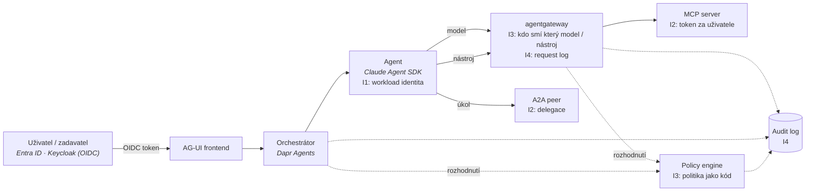

# Mapa identity, autorizace a governance

Kontext: **průřezová vrstva** – každá akce agenta v autonomní firmě má mít identitu (kdo),
mandát (za koho), oprávnění (co smí) a stopu (co udělal). Kritéria v [kriteria.md](kriteria.md).
Zvolené komponenty, do kterých se identita musí vejít: Claude Agent SDK, Dapr Agents,
agentgateway, hranice MCP / A2A / AG-UI (viz [`../platforma/cilova-architektura.md`](../platforma/cilova-architektura.md)).

## Čtyři otázky a kde se v platformě rozhodují

## Široké síto – kolo 1

*(doplní se z rešerše 2026-10-22)*

## Standardy a co z nich plyne

*(doplní se z rešerše 2026-10-22)*

## Regulace a governance

Detail v [regulace.md](regulace.md). Tři věci, které mění návrh (ověřeno 2026-10-22, text OJ nečten):

- **Příloha III odložena na 2.12.2027** (nařízení 2026/1744), ale **čl. 50 platí od 2.8.2026**: agent
  jednající s lidmi musí architektonicky oznámit „jsem AI, jednám za X“. To je první požadavek k implementaci.
- Platforma pro ADLC není vysoce riziková sama o sobě, ale **přidělování práce lidem** (příloha III/4) a
  **provoz systémů u CER entit** (III/2) use case zákazníka překlopí. Multiagentní systém se počítá jako
  **jeden systém** – nejde ho rozdělit na malé bezpečné agenty. → Klasifikační brána při onboardingu (T9).
- Audit trail má minimální schéma (T3), retenci ≥ 6 měsíců (čl. 19/26) a musí být **vlastností platformy**,
  ne dopisovaný agentem (T2). AISI: per-instance monitoring agentů nestačí – útok lze rozložit mezi agenty (T12).

## Co ověřit dál

- [ ] Síto kolo 1 – OSS kandidáti pro I1–I4 a N4.
- [ ] Stav MCP authorization, A2A auth, IETF drafty, Entra Agent ID.
- [x] ~~Aktuální harmonogram EU AI Act a technické požadavky na audit a lidský dohled~~ → [regulace.md](regulace.md), 2026-10-22; text OJ zbývá ověřit.

## Changelog
- 2026-10-22: regulace – harmonogram po Omnibusu, požadavky T1–T15 (regulace.md).
- 2026-10-22: první verze – kostra, diagram toku identity, otevřeno síto.
