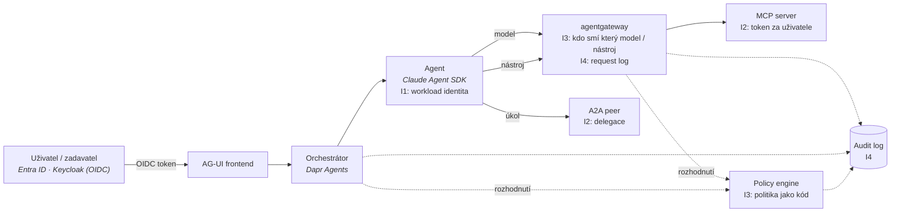

# Mapa identity, autorizace a governance

Kontext: **průřezová vrstva** – každá akce agenta v autonomní firmě má mít identitu (kdo),
mandát (za koho), oprávnění (co smí) a stopu (co udělal). Kritéria v [kriteria.md](kriteria.md).
Zvolené komponenty, do kterých se identita musí vejít: Claude Agent SDK, Dapr Agents,
agentgateway, hranice MCP / A2A / AG-UI (viz [`../platforma/cilova-architektura.md`](../platforma/cilova-architektura.md)).

## Čtyři otázky a kde se v platformě rozhodují

## Široké síto – kolo 1

Ověřeno 2026-10-22 z `LICENSE`, package registry a zdrojových repozitářů docs (weby a registry quay/ghcr
byly nedostupné; OCI labely ověřeny jen u OpenBao). Bus factor = podíl commitů za 3 měsíce podle domén.
Sloupec „Řeší“: I1 kdo je agent · I2 za koho jedná · I3 co smí · I4 audit · N4 tajemství.

| Kandidát | Řeší | Licence runtimu | Enterprise hranice | Governance | Phone-home | Stav | Release | Výsledek |
|---|---|---|---|---|---|---|---|---|
| **SPIRE** | I1 | Apache-2.0; Helm `helm-charts-hardened` Apache-2.0 | žádná | **CNCF graduated** 2022; DCO; 5 maintainerů, max. doména 26 % | ne | SQL datastore (SQLite/Postgres/MySQL), HA | v1.15.5 (2026-10-20) | **postupuje** |
| **Keycloak** | I1, I2, I4 (events) | Apache-2.0 | žádná v OSS (Red Hat build = support) | **CNCF incubating** 2023; DCO; 8/11 maintainerů IBM, redhat+ibm 52 % commitů | ne | Postgres/MySQL/MariaDB/MSSQL/Oracle, Liquibase (schéma není smluvní) | 26.8.1 (2026-10-13) | **postupuje** |
| **Zitadel** | I1, I2, I4 (event store) | **AGPL-3.0-only** (proto, docs, klienti Apache/MIT) | žádná funkční; Enterprise = support | bez nadace; **bez CLA, ale příspěvky povinně Apache-2.0** (vendor smí relicencovat) | `Telemetry.Enabled: false` | Postgres only, event-sourced | v4.20.0 (2026-10-22) | **s výhradou** – AGPL u dodávky zákazníkovi → právník |
| **Ory** Kratos / Hydra / Keto | I1 / I2 bez exchange / I3 | Apache-2.0 | **OEL**: ROPC, multi-tenancy v Kratosu, zero-downtime migrace, **včasné CVE opravy** | bez nadace; **CLA**; 100 % Ory, 2 tagy za 12 měsíců | **ano, opt-out** (Segment `sqa`) | SQL | v26.2.0 (2026-03-20) | Hydra **vyřazen** (bez RFC 8693 → neřeší I2); Keto s výhradou |
| **Dex** | I2 (federace, exchange bez actora) | Apache-2.0 | žádná | CNCF sandbox 2020; DCO; **2 maintaineři**, 1 autor 45 % | ne | etcd / CRD / SQL | v2.46.1 (2026-10-21) | s výhradou – federační shim, ne IdP |
| **OPA** | I3, I4 (decision log) | Apache-2.0 | Styra DAS / Enterprise OPA mimo repo; **bundle, decision log, testy v OSS** | **CNCF graduated** 2021; DCO; 7/10 maintainerů Apple (ex-Styra), 78 % commitů apple+gmail | **version check** na api.github.com při `opa run` (`--skip-version-check`) | bez DB, bundles | v1.21.3 (2026-10-19) | **postupuje** |
| **Cedar** | I3 | Apache-2.0; PyPI `cedarpy` bez licenčních metadat (3. strana) | Verified Permissions = AWS managed PDP (A4) | CNCF sandbox **2025-10-08**; ≈99 % Amazon; DCO text nenalezen | ne (knihovna) | žádný (embedded) | v4.14.0 (2026-10-16) | s výhradou – **knihovna bez PDP a decision logu** |
| **OpenFGA** | I3 | Apache-2.0; SDK se SPDX | Okta FGA managed; v OSS nic placeného; **audit/decision log v OSS nenalezen** | **CNCF incubating** 2025-10-28; **LF EasyCLA** (držitel nadace); 20/22 maintainerů Okta | ne | Postgres/MySQL/SQLite, migrace SQL v repu | v1.22.0 (2026-10-06) | **postupuje** |
| **SpiceDB** | I3 (+I4 placené) | Apache-2.0 | **Audit Logging, Rate Limiting, Security Embargo = jen Enterprise/Cloud** | bez nadace; **CLA** AuthZed; 80–90 % AuthZed | **ano, opt-out** – hodinově na `telemetry.authzed.com` | Postgres/CockroachDB/MySQL/Spanner | v1.57.0 (2026-10-20) | s výhradou |
| **Topaz** (Aserto) | I3, I4 (file decision log) | Apache-2.0 | control plane mimo repo | bez nadace; **1 autor 95 % commitů** | nenalezeno | BoltDB | v0.33.22 (2026-09-28) | s výhradou – bus factor 1 |
| **Casbin** | I3 | Apache-2.0; PyPI bez SPDX | žádná | **ASF Incubator** (2026); ICLA; 1 autor 73 % | ne | knihovna, adaptéry | v3.11.0 (2026-08-04) | s výhradou – knihovna |
| **OpenBao** | N4, I4 (audit devices) | **MPL-2.0** (LICENSE, OCI label, Helm, Go) | žádná – **namespaces v OSS** | **OpenSSF sandbox** (od 2025-06-05, ne LF Edge); DCO; SAP 22 %, control-plane.io 22 %, bez dominantního vendora | ne | Raft a další | v2.7.1 (2026-10-01) | **postupuje** |
| **HashiCorp Vault** | N4 | **BUSL-1.1** (Licensor IBM); `api/`, `sdk/` MPL-2.0 | replikace, HSM, namespaces, audit filtering, MFA, Sentinel, FIPS, LTS… | bez nadace; CLA; 98 % HashiCorp | Enterprise: license utilization reporting (air-gap = manuální) | Raft | v2.2.0 (2026-10-15) | **vyřazen A1** – text pro právníka níže |
| **External Secrets Operator** | N4 (distribuce) | Apache-2.0 | žádná | CNCF sandbox 2022; DCO; 5 maintainerů z 5 firem | ne | K8s CRD + Secrets | v2.13.0 (2026-10-16) | **postupuje** – ale agent tajemství **vidí**; injekce patří do gateway |
| **Infisical** | N4 (+I4 placené) | MIT mimo `ee/` (proprietární) | `onPremFeatures` bez klíče: `auditLogs:false, samlSSO:false, oidcSSO:false, rbac:false, scim:false, ldap:false, secretApproval:false, secretRotation:false, externalKms:false, hsm:false…` | bez nadace; bez CLA/DCO; 63 % gmail (afiliace neověřitelná) | **PostHog default on**; **licence validována online** (offline klíč existuje) | Postgres + Redis | v0.167.0 (2026-10-22) | **vyřazen** – SSO, RBAC i audit log za klíčem |

**Vault BUSL doslovně (LICENSE, 2026-10-22):** Additional Use Grant: „You may make production use of the Licensed
Work, provided Your use does not include offering the Licensed Work to third parties on a hosted or embedded basis
in order to compete with IBM Corp's paid version(s)… ‚competitive offering' is a Product that is offered to third
parties on a paid basis, **including through paid support arrangements**… ‚Embedded' means including the source
code or executable code from the Licensed Work in a competitive offering… Hosting or using the Licensed Work(s)
for internal purposes within an organization is not considered a competitive offering.“ Change Date: 4 roky od
publikace verze; Change License: MPL 2.0. **Otázka na právníka:** „dodáváme produkt zákazníkovi s podporou“ vs.
„paid support arrangements“. Do té doby OpenBao.

### Co ze síta plyne (Pozn. Adam – návrh, ne rozhodnutí)

| Otázka | Komponenta | Proč | Riziko |
|---|---|---|---|
| I1 workload identita | **SPIRE** vedle Dapr sentry | SVID per agent instance, JWT-SVID + OIDC discovery → jedna identita vůči Dapr, agentgateway, MCP serveru i Entra (FIC); CNCF graduated, bez vendora | Dapr sentry vydává jen X.509 per App ID – vztah sentry ↔ SPIRE zbývá ověřit |
| I2 uživatelé + delegace | **Keycloak** jako platformní AS, federovaný na Entra ID zákazníka | RFC 8693 V2 default on; `actor_token` delegace na main (release neověřen); CNCF incubating | Exchange umí **i upscoping**, dokud není zapnutý `downscope-assertion-grant-enforcer`; de facto IBM projekt. Zitadel má čistší RFC 8693 (downscope-only, RFC 8707), ale AGPL → alternativa po právním posudku |
| I3 + I4 | **OPA** jako PDP (sidecar u agentgateway přes `extAuthz`, Agent SDK `PreToolUse` hook), decision log → audit; **OpenFGA** až při reálné ReBAC potřebě | „agent X smí nástroj Y pro tenanta Z“ je ABAC nad JWT claims; decision log zadarmo; CNCF graduated | Maintaineři 7/10 Apple (směrové, ne licenční riziko); version check vypnout v air-gapu. SpiceDB silnější engine, ale telemetrie opt-out + placený audit log |
| N4 tajemství | **OpenBao** + ESO jen pro statická tajemství infrastruktury | MPL-2.0, namespaces v OSS, drop-in za Vault API, OpenSSF | Credential k MCP nástrojům **injektuje agentgateway**, ne env var přes ESO |

Čtyři komponenty, čtyři nadace (CNCF ×3, OpenSSF), žádný vendor s právem relicencovat.

## Standardy a co z nich plyne

Detail v [standardy.md](standardy.md). Jedna věta: **standardizovaný je jen hop uživatel → agent → MCP server**
(OAuth 2.1, RFC 9728, RFC 8707 – vše MUST). Delegace mezi agenty (A2A), token k downstream API a identita
k modelu jsou platformní konvence. Z toho plyne:

- Identita uživatele = OAuth token z IdP zákazníka (Entra / Keycloak); identita agenta = SPIFFE SVID
  (Dapr sentry intra, SPIRE JWT-SVID extra); **spojení obou se dělá token exchange v agentgateway**
  (`oauthTokenExchange` s `actorToken`, RFC 8693), ne v agentním kódu.
- Claude Agent SDK je jen lokální PEP (`PreToolUse` hook), nosičem identity není.
- Per-tool autorizaci umí agentgateway (`mcp.tool.name`, ne argumenty); per-argument až AuthZEN COAZ-MCP (Draft 1).
- Entra Agent ID je GA a funguje i pro workloady mimo Azure (sidecar nebo WIF přes SPIFFE) – jako **integrace**
  s IdP zákazníka, ne jádro platformy.

## Regulace a governance

Detail v [regulace.md](regulace.md). Tři věci, které mění návrh (ověřeno 2026-10-22, text OJ nečten):

- **Příloha III odložena na 2.12.2027** (nařízení 2026/1744), ale **čl. 50 platí od 2.8.2026**: agent
  jednající s lidmi musí architektonicky oznámit „jsem AI, jednám za X“. To je první požadavek k implementaci.
- Platforma pro ADLC není vysoce riziková sama o sobě, ale **přidělování práce lidem** (příloha III/4) a
  **provoz systémů u CER entit** (III/2) use case zákazníka překlopí. Multiagentní systém se počítá jako
  **jeden systém** – nejde ho rozdělit na malé bezpečné agenty. → Klasifikační brána při onboardingu (T9).
- Audit trail má minimální schéma (T3), retenci ≥ 6 měsíců (čl. 19/26) a musí být **vlastností platformy**,
  ne dopisovaný agentem (T2). AISI: per-instance monitoring agentů nestačí – útok lze rozložit mezi agenty (T12).

## Co ověřit dál

- [x] ~~Síto kolo 1 – OSS kandidáti pro I1–I4 a N4~~ – 2026-10-22, 15 kandidátů.
- [ ] **Kolo 2:** Keycloak – v kterém releasu je `actor_token` delegace; chování `downscope-assertion-grant-enforcer`; federace na Entra ID.
- [ ] Kolo 2: agentgateway `extAuthz` → OPA – latence sidecar vs. embedded; nebo jen CEL?
- [ ] Kolo 2: SPIRE vedle Dapr sentry – lze SPIRE jako upstream CA, nebo dvě identity?
- [ ] Právní posudek: Zitadel AGPL + inbound Apache; Vault BUSL „paid support arrangements“.
- [ ] OpenFGA: existuje decision/audit log v OSS? (nenalezen, docs neprohledány celé)
- [ ] OCI labely obrazů Keycloak (quay.io), SPIRE, Zitadel (ghcr) – registry byly nedostupné.
- [ ] Harness I2: user token → agentgateway `oauthTokenExchange` (Keycloak) → MCP server ověří `aud`; změřit, že `act` claim nese agenta a scope se jen zužuje.
- [x] ~~Stav MCP authorization, A2A auth, IETF drafty, Entra Agent ID~~ → [standardy.md](standardy.md), 2026-10-22.
- [x] ~~Aktuální harmonogram EU AI Act a technické požadavky na audit a lidský dohled~~ → [regulace.md](regulace.md), 2026-10-22; text OJ zbývá ověřit.

## Changelog
- 2026-10-22: síto kolo 1 – 15 kandidátů; Vault (BUSL), Infisical, Ory Hydra vyřazeni; návrh SPIRE + Keycloak + OPA + OpenBao.
- 2026-10-22: standardy – MCP auth, A2A, ID-JAG, Entra Agent ID, co řeší Dapr/agentgateway/Agent SDK (standardy.md).
- 2026-10-22: regulace – harmonogram po Omnibusu, požadavky T1–T15 (regulace.md).
- 2026-10-22: první verze – kostra, diagram toku identity, otevřeno síto.
