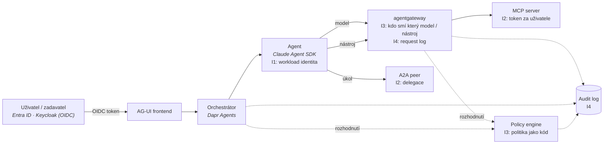

# Mapa identity, autorizace a governance

Kontext: **průřezová vrstva** – každá akce agenta v autonomní firmě má mít identitu (kdo),
mandát (za koho), oprávnění (co smí) a stopu (co udělal). Kritéria v [kriteria.md](kriteria.md).
Zvolené komponenty, do kterých se identita musí vejít: Claude Agent SDK, Dapr Agents,
agentgateway, hranice MCP / A2A / AG-UI (viz [`../platforma/cilova-architektura.md`](../platforma/cilova-architektura.md)).

## Čtyři otázky a kde se v platformě rozhodují

## Široké síto – kolo 1

*(doplní se z rešerše 2026-10-22)*

## Standardy a co z nich plyne

*(doplní se z rešerše 2026-10-22)*

## Regulace a governance

*(doplní se z rešerše 2026-10-22)*

## Co ověřit dál

- [ ] Síto kolo 1 – OSS kandidáti pro I1–I4 a N4.
- [ ] Stav MCP authorization, A2A auth, IETF drafty, Entra Agent ID.
- [ ] Aktuální harmonogram EU AI Act a technické požadavky na audit a lidský dohled.

## Changelog
- 2026-10-22: první verze – kostra, diagram toku identity, otevřeno síto.
