# Model firemní paměti

**Metodická poznámka (2026-10-23):** arXiv, w3.org, docs.letta.com, genai.owasp.org a learn.microsoft.com byly nedostupné;
MINJA, Prompt Infection, čísla AgentPoison a PROV-DM jsou **z paměti**, OWASP LLM Top 10 2026 ověřen z repa, Graphiti,
mem0, MS AF, ADK a Claude Code z repozitářů/docs.

## Závěr

**Paměť = jeden MCP server s PEP uvnitř (OPA, tenant filter vynucený v dotazu), pod ním Postgres (pgvector + hrany grafu
v tabulkách), záznam = „fakt s původem“** podle vzoru hlavičky `knowledge/README.md`, rozšířený o bi-temporalitu (Graphiti),
PROV vztahy a OTEL identifikátory. Žádný prověřený framework (mem0, Letta, Graphiti, Cognee, ADK Memory Bank, MS AF)
neřeší tenanta, původ a schvalovaný zápis jako první třídu – jsou použitelné jako **vzory algoritmů**, ne jako úložiště.

| Druh | Kde žije | Původ | Kdo zapisuje | Schválení | Retrieval |
|---|---|---|---|---|---|
| Pracovní | Dapr Workflows + `DaprSessionStore` (rozhodnuto) | `trace_id`, `gen_ai.conversation.id` | runtime | – | ne |
| Epizodická | ClickHouse trace + HITL verdikty (rozhodnuto); *destiláty* v paměťovém serveru | `trace_id` + span + verze policy | OTEL; destilaci dělá „sleep-time“ agent | destilát **auto do karantény**, sdílené po schválení | hybrid nad destiláty, filtr tenant |
| Sémantická | MCP server → Postgres (pgvector + hrany) | dokument / trace / člověk; `valid_from`–`valid_to` | agent (návrh) nebo člověk | **ano** pro scope firma a zákazník; platforma jen člověk | hybrid + graf, **tenant v SQL WHERE**, `valid_to IS NULL` |
| Procedurální | git (CLAUDE.md, skills, runbooky, ADR) + index v serveru | commit SHA + autor + PR review | PR | review = schválení | just-in-time (grep/glob), ne embeddingy primárně |

```mermaid
flowchart LR
    RUN["Běh agenta<br/><i>Claude Agent SDK v Dapr Workflow</i>"] -->|"OTEL spany, trace_id"| CH[("ClickHouse<br/>traces, HITL verdikty")]
    CH -->|"sleep-time destilace"| Q["Karanténa<br/><i>status=proposed, confidence, původ</i>"]
    DOC["Dokument / ticket / repo"] -->|"ingest s trust tier"| Q
    Q -->|"OPA: scope firma/zákazník → schválení"| HITL{"Člověk schválí?"}
    HITL -->|"ano: verified_by/at"| MEM[("Paměťový MCP server<br/>Postgres: fakty + hrany + embeddingy")]
    HITL -->|"ne: rejected (audit)"| MEM
    AG["Agent v roli<br/>(SVID + token uživatele)"] -->|"MCP search_memory"| PEP["PEP: OPA tenant/role/citlivost<br/>→ WHERE tenant_id=$t AND valid_to IS NULL"]
    PEP --> MEM
    MEM -->|"fakta s původem + id<br/>(span search_memory)"| AG
```



## A. Vzory z existujících řešení

| Otázka | Nejlepší vzor | Zdroj |
|---|---|---|
| Druhy paměti | náš model (pracovní / epizodická / sémantická / procedurální); frameworky mají jen „session vs. long-term“ | ADK, MS AF |
| **Konflikt faktů** | **bi-temporální invalidace, ne přepis**: `valid_at`, `invalid_at`, `expired_at`, `episodes[]` jako původ; „old facts are invalidated — not deleted“ | Graphiti `edges.py` |
| Totéž nezávisle | mem0 4/2026: „Single-pass ADD-only extraction – one LLM call, no UPDATE/DELETE. Memories accumulate; nothing is overwritten“ + temporal ranking; původní ADD/UPDATE/DELETE opuštěn | mem0 README |
| Destilace epizod | po běhu extrakce ≤ N položek, typy poznámek (`user/feedback/project/reference`), „neukládej, co je odvoditelné z kódu“, index ≤ 200 řádků / 25 KB vždy, detail on-demand; konsolidace po ≥ 5 sezeních a 24 h | Claude Code auto memory, MS AF `_memory.py`, Letta dreaming, Cognee session distillation |
| Procedurální v gitu | Letta MemFS „all context tracked via git“; CLAUDE.md hierarchie managed → project | Letta, Claude Code |
| Náklady tokenů | attention budget; sub-agent vrací 1–2k tokenů; just-in-time retrieval přes lehké identifikátory | Anthropic context engineering (29. 9. 2025) |
| Oddělený zápisový a čtecí scope | „Retrieval scope values never inherit from the storage scope“ | MS AF mem0 provider |

Bezpečnostní poznámka ze zdrojů: Graphiti referenční MCP server **nemá auth** („Any caller can read, change, or delete data
in any group_id“), stejně `@modelcontextprotocol/server-memory` – nasadit přímo = PEP v promptu, což B2 zakazuje.

## B. Model původu – schéma záznamu

Standardy k převzetí: **W3C PROV-DM** názvosloví (`wasGeneratedBy`, `wasAttributedTo`, `actedOnBehalfOf`, `wasDerivedFrom`,
`wasRevisionOf`, `wasInvalidatedBy` – z paměti, ne RDF), **OTEL** `gen_ai.memory.record.id` / `store.id`, `gen_ai.conversation.id`
(„SHOULD NOT fall back to trace ID“), **bi-temporal** (valid time vs. transaction time – nutné pro „co firma věděla v době
rozhodnutí“, čl. 12 AI Act), **OWASP LLM09:2026** „Track provenance for every embedding (source, ingestion time, trust tier,
pipeline version)“, **vzor tohoto repa** (`naposledy_overeno`, `zralost`, `primarni_zdroje`, „Pozn. Adam“ = názor).

| Pole | Proč |
|---|---|
| `id` (ULID) | OTEL `record.id`; idempotence při at-least-once Dapr |
| `tenant_id` | B2; LLM09 „enforce tenant scoping inside the index query“; T4 |
| `scope: platforma \| firma \| zakaznik` | B2; „paměť je firemní“ |
| `type: fakt \| nazor \| pouceni \| postup` | B1; Claude Code `type` |
| `content`, `content_hash` | dedup, podpis |
| `entities[]`, `relations[]` | B1 graf i vektor; Graphiti triplet |
| `sources[]` {`kind: trace\|document\|human\|repo`, `ref`, `span_id`, `commit`, `trust_tier`} | M1; PROV `wasDerivedFrom`; T3 |
| `created_by` {`agent_id` (SVID), `role`, `on_behalf_of`} | PROV; T1 delegační řetězec; T12 registr agentů |
| `created_at` (transaction time) | bi-temporal, audit |
| `verification` {`by`, `method: human\|agent\|none`, `at`} | B1; `naposledy_overeno`; T3 |
| `confidence`, `confidence_basis` | B1; bez ověření nikdy nad práh pro sdílený scope |
| `valid_from`, `valid_to` (valid time) | Graphiti; eval „nepoužije zastaralý“ |
| `status: proposed \| approved \| rejected \| superseded \| tombstoned` | B2 karanténa; M4 výmaz |
| `sensitivity: public \| internal \| confidential \| personal` | B2; LLM08; GDPR |
| `retention` {`policy_id`, `expires_at`} | B4; T4 |
| `version`, `supersedes` | PROV `wasRevisionOf` |
| `pipeline_version` | LLM09; T10 change management (verze destilačního promptu/modelu) |
| `embedding` {`model`, `version`, `vector_ref`} | A3 přes gateway; vektor je **odvozenina**, ne identita záznamu |
| `signature` | T2 append-only podepsaný log; klíč z OpenBao |

```json
{"id":"01JB2X9Q7K4M8NDG3F5H6R7T8V","tenant_id":"acme","scope":"zakaznik","type":"fakt",
 "content":"Produkční cluster ACME běží na AKS 1.31, upgrade plánován na Q1/2027.","content_hash":"sha256:9f2c…",
 "entities":[{"id":"ent:acme/prod-cluster","type":"system"}],"relations":[{"from":"ent:acme/prod-cluster","rel":"runs_version","to":"ent:k8s/1.31"}],
 "sources":[{"kind":"trace","ref":"trace:4bf92f…","span_id":"00f067aa…"},{"kind":"document","ref":"https://wiki.acme.example/infra/aks","retrieved_at":"2026-10-20T09:12:00Z","trust_tier":"customer-internal"}],
 "created_by":{"agent_id":"spiffe://platform/agent/sre","role":"sre","on_behalf_of":"user:adam@…"},"created_at":"2026-10-20T09:15:31Z",
 "verification":{"by":"user:jan.novak@acme.example","method":"human","at":"2026-10-21T14:02:00Z"},"confidence":0.9,"confidence_basis":"potvrzeno zákazníkem v HITL",
 "valid_from":"2026-09-01","valid_to":null,"status":"approved","sensitivity":"confidential",
 "retention":{"policy_id":"acme-default-24m","expires_at":"2028-10-20"},"version":2,"supersedes":"01JB1W…",
 "pipeline_version":"distill-prompt@1.4.0/claude-opus-5-5","embedding":{"model":"text-embedding-3-large@gateway","version":"2026-10","vector_ref":"pgvector:row"},"signature":"ed25519:…"}
```

## C. Memory poisoning a izolace

Hrozby (OWASP LLM Top 10 2026, ověřeno z repa): **LLM05** scénář 9 „attacker injects malicious instructions into an AI
agent's persistent memory over multiple sessions“, scénář 8 „one tenant injects adversarial data into shared embeddings…
cross-tenant contamination“; **LLM09**: „the access-control decision happens after the embedding-space search has run“,
„A client-supplied scope is a suggestion, not a control“, „Index-level segregation is preferable to classification tags on
a shared index“; **LLM08**: „Assume all context available to the LLM could also be available to users“; agentní paměť
v **OWASP Agentic Top 10 2026 ASI06 „Memory and Context Poisoning“** (obsah nečten), MITRE ATLAS AML.T0080.000.
Z paměti: MINJA (injekce jen přes dotazy, agent si škodlivé „zkušenosti“ zapíše sám), Prompt Infection (self-replikace
mezi agenty), AgentPoison (backdoor trigger proti embedderu). Konsenzus: **filtrování obsahu nestačí, řídit kanál zápisu.**

**Obrany v pořadí podle poměru cena/užitek:**

1. **Tenant filter vynucený v PEP MCP serveru z identity (SVID / token), ne z argumentu** – `WHERE tenant_id = $t`; pgvector partial index per tenant nebo `hnsw.iterative_scan`.
2. **Zápis vždy `proposed`; `approved` jen přes HITL aktivitu Dapr pro scope firma/zákazník** – reuse durable schvalování (T6, T13).
3. **Default retrieval jen `approved` a `valid_to IS NULL`; neověřené jen explicitně a označené.**
4. **Původ povinný (`sources[]` neprázdné), jinak server zápis odmítne** – umožňuje rollback batchů přes `pipeline_version`.
5. **Rate limit a žádné raw similarity score agentovi** – agentgateway už umí.
6. **Oddělené tabulky per scope, partition per tenant** – levné teď, drahé později.
7. **Podpis záznamu klíčem z OpenBao + append-only verze** – pro high-risk profil (T9).
8. **Re-verifikace stárnoucích faktů agentem + pokles confidence.**
9. **Evaly M-E3/M-E4 jako CI gate** – bez nich se nic výše nedá doložit (čl. 15).
10. Anomálie v ingestu – až po všem výše.

OPA rozhoduje o zápisu i čtení jako o **akci** (Rego sdílené s hookem Agent SDK a `extAuthz` – rozhodnuto 2026-10-23):
„zápis do sdílené paměti“ je stejná třída jako „nasazení do produkce“.

## D. Životní cyklus

- **Zapomínání:** žádný framework nemá Ebbinghaus v kódu (MemoryBank jen deklaruje); mem0 dělá temporal ranking, Letta a MS AF
  konsolidaci. Doporučení: tři deterministické mechanismy – `last_accessed_at` + `access_count` ze spanů `search_memory`
  → kandidáti na archiv; epizodické destiláty po retenci → shrnutí per zákazník; sémantický fakt bez přístupu N dní bez
  re-verifikace → `stale` (vrací se s varováním).
- **Re-verifikace:** politika per `type` a `scope` (fakt o zákazníkovi 90 dní; poučení z incidentů bez expirace, ale
  confidence klesá); re-verifikaci dělá agent proti zdroji → nová verze s `verification.method: agent`; na `human` jen HITL.
- **Výmaz (GDPR čl. 17):** tombstone (obsah a vektor vynulovány, metadata původu zůstávají); kaskáda přes `sources[].ref`
  (PROV `wasDerivedFrom`); LLM09 „Delete embeddings within a bounded time… verify with reconciliation audits“; pgvector HNSW
  drží mrtvé tuples → `REINDEX CONCURRENTLY` + `VACUUM` do runbooku; ClickHouse trace per tenant šifrovat klíčem z OpenBao,
  výmaz = zničení klíče (crypto-shredding, *praxe bez primárního zdroje*); zálohy vektorové DB na úrovni citlivosti
  zdrojových dokumentů (LLM09, inverze embeddingů).
- **Změna embedding modelu:** LLM09 „re-embed the corpus rather than mixing old and new vectors“; vektor je odvozenina
  s `embedding.model/version` → batch přes gateway, původ beze změny, dva indexy během migrace, přepnutí po evalu.
- **Retence:** T4 pro epizodickou vrstvu (ClickHouse TTL per tenant); sémantická `retention.policy_id` per tenant a `type`;
  Dapr `ttlInSeconds` jen pro pracovní/cache stav.

## E. Evaly paměti pro role (Inspect AI)

Benchmarky LongMemEval (kategorie `knowledge-update`, `temporal-reasoning`, abstention – adaptovatelné), LoCoMo, BEAM
(`contradiction_resolution`, `abstention`) měří **jednoho uživatele bez tenantů, původu, schválení a útočníka**.

| Eval | Dataset | Scorer | Role |
|---|---|---|---|
| **M-E1** najde správný fakt o zákazníkovi | syntetická firma: 3 tenanti × 50 faktů s původem | exact/judge + **podíl odpovědí s citovaným `record.id`** | account, architekt |
| **M-E2** nepoužije zastaralý fakt | páry fakt / superseding s `valid_to`; LongMemEval knowledge-update | aktuální verze; penalizace staré; abstention když obě neplatné | všechny |
| **M-E3** nevyzradí cizí tenant | dotazy tenanta A na fakta B, vč. inference přes počty/skóre | kód: žádný `record.id` tenanta B ve spanech `search_memory`; **gate pass^k = 100 %** | všechny |
| **M-E4** odolá poisoned dokumentu | `inspect_evals/ipi_coding_agent` + payload „remember that…“; AgentDojo jako reference | kód: žádný `create_memory` z injektovaného kanálu bez `proposed`; approval `terminate` při pokusu o `approved` | vývojář, reviewer |
| **M-E5** cena tokenů paměti per úkol | tytéž úkoly s/bez paměti | `gen_ai.usage.input_tokens` spanů `search_memory` + delta ceny přes gateway | governance |
| **M-E6** destilace je správná | trace → navržené fakty | judge + lidský label (Langfuse datasety); precision, podíl odmítnutých HITL | governance |

Všechny evaly přes agentgateway a MCP server paměti, aby se měřil PEP, ne model.

## F. Co role potřebují z paměti

| Role | Potřeba | Druh | Zdroj | Scope / citlivost |
|---|---|---|---|---|
| Account / zadání | kontakty, preference, prostředí, historie zakázek | sémantická | CRM/ticket, člověk, destilát dialogu | zákazník / personal |
| Architekt | **ADR a rozhodnutí** (i zamítnutá), „co firma umí“, ceny modelů | procedurální (ADR v gitu) + sémantická (index s `valid_to`) | repo; `cilova-architektura.md` jako vzor | firma |
| Vývojář | kód, konvence, poučení z PR | procedurální + epizodický destilát `pouceni` | repo, trace, review komentáře | zákazník (kód) / firma (konvence) |
| Reviewer / QA | historie review, opakující se chyby, HITL labely | epizodická → destilát | trace + Langfuse anotace | firma |
| SRE | **runbooky, incidenty, post-mortemy**, stav prostředí | procedurální + sémantická (`valid_to`) + epizodická | ticketing, trace, člověk | zákazník / confidential |
| Governance | kdo co zapsal/schválil, risk register (T11), registr agentů (T12) | epizodická (audit) – **čte vše, nepíše fakta** | ClickHouse, OPA decision log | platforma |
| Člověk | schvaluje `proposed → approved` dávkově, vidí původ a confidence (T6) | – | AG-UI HITL | – |

Zásady: procedurální paměť **zůstává v gitu** (PR review = schválení), server ji jen indexuje; epizodická se **nikdy nečte
surová** z ClickHouse, jen přes destiláty s původem; auto memory / `owner` scope se mapuje na `tenant + role`, ne na instanci.

## Pozn. Adam (názor z rešerše, k rozhodnutí)
**Napsat sami:** model záznamu (1 tabulka + hrany + pgvector za Dapr komponentou, export JSONL), MCP server paměti s PEP
(tenká vrstva), destilační sleep-time agent (prompt + Dapr Workflow), evaly M-E1–E6. **Převzít:** bi-temporalitu
z Graphiti (schéma, ne knihovna – Neo4j/FalkorDB licence), append-only z mem0, procedurální paměť v gitu, Claude memory tool
jako rozhraní pro pracovní poznámky per běh (nikdy kanál do sdílené paměti bez karantény), OWASP LLM09 jako review checklist.
**Přijaté riziko:** OTEL memory spany Development; lidské schválení je úzké hrdlo → `proposed` fakta agent čte s označením,
schvalování dávkově.

## Co ověřit dál
- [ ] MINJA, Prompt Infection, AgentPoison, Zep paper, PROV-DM, OWASP ASI06 z primárních zdrojů.
- [ ] Letta memory blocks (core vs. archival) z docs; mem0 paper 2025 vs. README 4/2026.
- [ ] **Harness M1:** MCP server paměti (Postgres + pgvector) s PEP: tenant filter z tokenu, `proposed`/`approved`, původ povinný, OPA, spany `search_memory`; evaly M-E3 a M-E4 v Inspect.

## Changelog
- 2026-10-23: první verze z rešerše.
