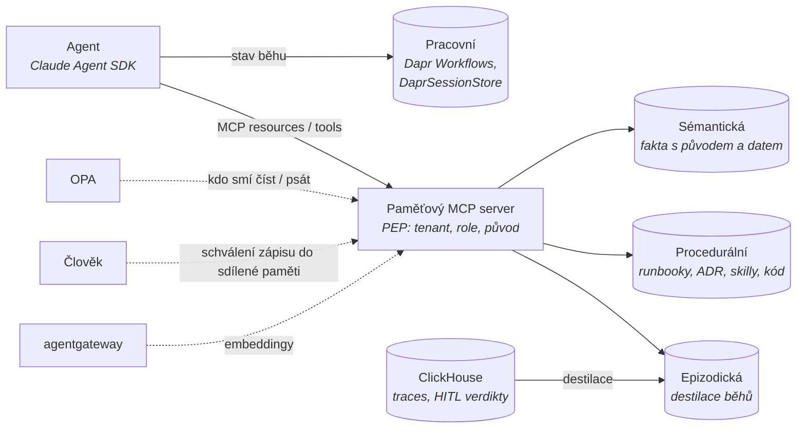

# Mapa paměti a znalostí

Kontext: **paměť je firemní, ne agentní.** Vrstva navazuje na rozhodnuté komponenty: stav běhu drží Dapr,
epizodická data vznikají v ClickHouse, oprávnění řeší OPA, identita Keycloak/SPIRE, nástroje jdou přes MCP
a agentgateway. Kritéria v [kriteria.md](kriteria.md).

## Čtyři druhy paměti v platformě

## Široké síto – kolo 1

Ověřeno 2026-10-23 ze souborů `LICENSE` v repozitářích a registry metadat (PyPI/npm); weby docs byly nedostupné, čteny
zdrojové repozitáře dokumentace (commit hashe nedostupné přes GitHub API – doověřit). Sloupec „Řeší“: druhy paměti a M1–M4.

**Závěr síta:** jako **jádro firemní paměti neprošel žádný memory framework** – mem0, Cognee a Graphiti mají totéž DNA
(Apache SDK, PostHog default on, OpenAI jako povinná závislost, tenant jako konvence, enterprise hranice tam, kde začíná
provoz). Projdou **úložiště**: PostgreSQL + pgvector (+ Apache AGE), Qdrant, Weaviate s výhradami, Milvus (těžký).
Grafové DB s vlastní licencí (Neo4j EE, Memgraph BSL, FalkorDB SSPL) jsou pro produkt dodávaný zákazníkovi mimo hru.

### Memory frameworky

| Kandidát | Řeší | Licence | Enterprise hranice | Governance / telemetrie | Multi-tenancy | Původ a temporalita | Rozhraní | Výsledek |
|---|---|---|---|---|---|---|---|---|
| **mem0** 2.2.1 | sémantická osobní (user/agent/run); M4 částečně (`expiration_date`, historie) | Apache-2.0 (SDK i server) | benchmarky „reflect Mem0's managed platform… proprietary optimizations not available in the open-source SDK“; **graph memory v OSS kódu nenalezena**; MCP jen hostovaný (`mcp.mem0.ai`), OSS MCP archivován | **CLA**; PostHog **default on**; `posthog` a `openai` povinné deps | `user_id/agent_id/run_id` filtry, ne tenant RBAC | `hash`, `created_at`, `expiration_date`; **bez zdroje, trace_id, confidence** | REST, SDK; Dapr ne | **ne jako jádro** – referenční API |
| **Letta** (ex-MemGPT) | pracovní + sémantická paměť agenta (memory bloky) | Apache-2.0 | Python server V1 **archivován** (0.16.8, 2026-05); nový kód `letta-code` TS s **Letta Cloud jako defaultem** | PostHog, opt-out nenalezen; commity převážně boti | neověřeno | neověřeno | REST App Server; Dapr ne | **vyřazen** – osobní harness s Cloudem |
| **Zep / Graphiti** 0.31.2 | Graphiti: sémantická + epizodická (temporální graf); **M1 ✅** (`episodes[]`, `valid_at/invalid_at/expired_at`), M2 ❌ („you build… tenancy, access control“), M4 ✅ invalidace | Graphiti Apache-2.0; **Zep CE „no longer supported“** (`legacy/`), Zep Cloud na vlastní DB „Konig“ | BYO Neo4j/FalkorDB/Neptune (Kuzu deprecated) → **licenční past v backendu** | **CLA**; PostHog default on; `neo4j`, `openai`, `posthog` povinné | `group_id` na každém uzlu – **konvence, ne vynucení** | nejlepší model v poli (bi-temporální hrana s původem) | MCP i REST „no authentication, no authorization… Do not use as a production deployment“ | **jako vzor schématu / knihovna**, ne služba; Zep server vyřazen |
| **Cognee** 1.6.5 | sémantická (dokumenty → graf + vektor); M2 ⚠️ per-dataset permissions | Apache-2.0, **DCO** | Postgres jako graph store „demo feature. The production-ready version is available as a licensed product“ | telemetrie default on → `test.prometh.ai` vč. **pseudonymního hashe LLM API klíče** | `ENABLE_BACKEND_ACCESS_CONTROL` default; vynucení neověřeno | neověřeno (DataPoint) | `cognee-mcp`, REST; **default graf Kuzu (archivovaný)** | s výhradami, ne jako jádro |
| **LangMem** 0.0.30 | sémantická nástroje pro LangGraph | MIT (PyPI bez SPDX) | persistence = `langgraph.store`; LangGraph Platform (`langgraph-api` ELv2) | bez release **12 měsíců** | namespace tuple – konvence | ne | žádný server ani MCP | **vyřazen** (A5) |
| **MCP `server-memory`** 2.0.0 | entity–relace–observations | MIT → Apache-2.0 (přechod) | – | LF Projects | ne (jeden JSONL) | ne | MCP 9 tools | **vyřazen jako úložiště**; **vzor tool API** |

### Vektorové DB

| Kandidát | Licence | Enterprise hranice | Governance / telemetrie | Multi-tenancy, RBAC | Rozhraní | Výsledek |
|---|---|---|---|---|---|---|
| **pgvector** 0.8.7 (+ pgvectorscale 0.9.1) | PostgreSQL License | žádná; pgvectorscale CLA Timescale, README odkazuje na nový alfa `pg_vectorsearch` | `ankane` 20/20 commitů (bus factor 1, malá extension); **bez telemetrie** | **Postgres RLS, role, schémata – vynucení v DB**; **Dapr PostgreSQL v2 state store Stable** | žádný oficiální MCP | **postupuje** |
| **Qdrant** 1.20.0 | Apache-2.0 | Helm README: zero-downtime upgrade, backup/DR jen Cloud / Private Cloud Enterprise Operator; `security.md`: self-hosted „not secure by default… not production-ready“ | žádná nadace; **telemetrie default on** (`telemetry_disabled: false`) | tenant v payloadu jedné kolekce, **filtr dává klient**; JWT RBAC v OSS per kolekce | oficiální `mcp-server-qdrant` („example“) | **postupuje** (záloha) |
| **Weaviate** 1.40.2 | **BSD-3 mimo `wl/`** („all rights reserved… enabled via license key“: `backupdedupe`, `dbusers`, `namespaces`, `selfrecovery`) | jeden image CE+EE | **CLA**; telemetrie **default on každých 24 h vč. AWS Account ID / GCP Project ID / Azure Subscription ID** („may use this data to identify potential customers… share it with third parties“), `DISABLE_TELEMETRY=true` | **nativní tenanti** (tenant = shard), RBAC v CE | **MCP vestavěný od 1.37.1** (`/v1/mcp`, respektuje RBAC) | postupuje s výhradou |
| **Milvus** 3.0.3 | Apache-2.0 | Zilliz Cloud; bez `ee/` | **LF AI & Data graduated**, DCO; phone-home nenalezen | DB/collection/partition, RBAC v OSS (default off) | `mcp-server-milvus` | postupuje, **předimenzováno** (etcd, Pulsar/Kafka, S3) |
| LanceDB 0.40 | Apache-2.0 | server = Cloud/Enterprise produkt | bez nadace | žádná nativní (embedded) | neověřen | jen knihovna (lokální index v sandboxu) |
| Chroma 1.5.9 | Apache-2.0 | Chroma Cloud; Rust server ≥ 1.0 **bez auth** (Helm: `chromadb.auth.*` „legacy and ignored“) | PostHog default on; poslední release 2026-05 | tenant koncept bez vynucení | `chroma-mcp` | **vyřazen** (B2) |

### Grafové DB

| Kandidát | Licence | Co chybí v OSS | Výsledek |
|---|---|---|---|
| **Apache AGE** 1.8.0 | Apache-2.0, **ASF** | nic – openCypher v Postgresu, tenanti/RBAC/zálohy = Postgres; releasy jen `-rc0` tagy per PG větev (⚠️ hygiena) | **postupuje** |
| Neo4j 2026.10 | **GPLv3** CE; EE closed-source mimo repo | EE only: **RBAC, property/sub-graph access control, LDAP, online backup, multiple databases, clustering**; CE jedna DB bez RBAC; usage data default on | **vyřazen** (B2 celé v EE) |
| Memgraph 3.14 | **BSL 1.1 + MEL**; Additional Use Grant doslovně: „internal business purposes, provided… you do not a) embed or otherwise distribute the Licensed Work to third parties… b) host… ‚database-as-a-service‘… c) …competes“; Change Date „2030-21-10“ (sic), Change License Apache-2.0 | HA, multi-tenancy, ACL, SSO, backup = MEL | **vyřazen** (A1; a) míří na dodávku produktu) |
| FalkorDB 6.0.3 | **SSPL v1** | graf = Redis klíč; 16/20 commitů jeden člověk | **vyřazen** (A1) |
| Kuzu 0.11.3 | MIT | **„We are archiving the KuzuDB project“** (2025-10) | **vyřazen** (EOL); default v Cognee |
| JanusGraph 1.1.0 | Apache-2.0, LF AI incubating, CLA | poslední release 2024-11; 20/20 commitů jeden autor; Cassandra + ES, Gremlin | **vyřazen** (stagnace) |

**Azure za Dapr ševem:** Cosmos DB state store Stable (bez `workflow`), PostgreSQL v2 Stable (s `workflow`), SQL Server
Stable; **žádná Dapr komponenta pro Azure AI Search ani vektorové DB**; Conversation API má Azure OpenAI přes `openai`
komponentu (`apiType: azure`). PyPI hygiena (vzorec 2): `pymilvus`, `lancedb`, `chromadb` bez `license_expression`,
`zep-cloud` bez licence, `@modelcontextprotocol/server-memory` „SEE LICENSE IN LICENSE“ → pro SBOM gate „unknown“.

### Co ze síta plyne (Pozn. Adam – návrh k rozhodnutí)

| Otázka | Komponenta | Proč | Riziko / co zbývá |
|---|---|---|---|
| Úložiště sémantické paměti a destilátů | **PostgreSQL + pgvector** přes Dapr PostgreSQL v2 state store; tenant přes **RLS** (`SET app.tenant_id` ze session) | PostgreSQL License bez enterprise hranice, bez telemetrie, vynucení tenanta **v DB**; stejná DB jako stav platformy; zálohy/HA/Helm = Postgres operátory | pgvector bus factor 1 (malá extension); výkon nad desítky milionů vektorů per tenant neměřen → Qdrant jako záloha (telemetrie off, JWT RBAC, backup/DR jen Cloud) |
| Graf | **hrany v Postgresu** s `valid_from/to`; **Apache AGE** až při traverzech hlubších než 2–3 skoky | žádná samostatná graf DB nemá OSI licenci s RBAC a multi-DB | AGE hygiena releasů; výkon traverzů neměřen |
| Epizodická paměť | ClickHouse (rozhodnuto) → destilace poučení s `trace_id` do Postgresu | – | destilační agent se píše |
| Framework | **ne – vlastní tenký MCP server** s PEP (tenant a role z tokenu, OPA, embeddingy přes agentgateway); tool API tvarem z `server-memory` + povinný původ | hodnota frameworků (LLM extrakce, dedup) je pár set řádků nad Agent SDK; CLA a PostHog netřeba podstupovat | Graphiti jen jako vzor schématu (bi-temporální hrana, `episodes[]`), případně extrakční knihovna s vlastním driverem |
| Rozhraní pro Claude | memory tool jako pracovní poznámky per běh (handler mapuje `/memories` na tenant/run); CLAUDE.md pro procedurální | nativní, bez frameworku | nikdy kanál do sdílené paměti bez karantény |

Detail modelu záznamu, obran a evalů v [model-pameti.md](model-pameti.md); nativní schopnosti v [nativni-schopnosti.md](nativni-schopnosti.md).

## Nativní schopnosti a standardy

Detail v [nativni-schopnosti.md](nativni-schopnosti.md). **Model si nepamatuje nic.** Anthropic dává memory tool
(client-side soubory bez modelu dat), compaction a context editing (beta, optimalizace jednoho běhu), CLAUDE.md
(procedurální, git) a Managed Agents memory stores s dreams (verzování, redakce, destilace – ale jen Anthropic cloud /
AWS / GCP, **ne Azure**, ne ZDR → pro nás jen vzor). Dapr Agents v platformě auto memory i CLAUDE.md **vypínají**.
Dapr dává state (tx, ETag, TTL, AES-GCM) a od 1.19 Vector API (alpha, jen Meilisearch), dapr-agents na 1.19 ještě
nejsou. MCP dává `lastModified` a `ttlMs`, per-resource autorizace je jen SHOULD. Benchmarky MemLeak a PiSAs ukazují, že
**izolace tenantů v promptu nefunguje** – filtr musí být vynucený v DB nebo PEP.

## Model původu a životní cyklus

Detail v [model-pameti.md](model-pameti.md). Záznam = **fakt s původem**: tenant, scope, typ, `sources[]` povinné,
`created_by` (SVID + za koho), `verification` (člověk / agent), confidence, **bi-temporalita** (`valid_from/to`,
transaction time), `status` (`proposed → approved`), citlivost, retence, verze, `pipeline_version`, embedding jako
odvozenina, podpis. Konflikt faktů = invalidace, ne přepis (Graphiti; mem0 4/2026 přešlo na ADD-only). Obrany proti
poisoningu v pořadí cena/užitek: tenant filter z identity v PEP, zápis vždy `proposed` se schválením přes Dapr HITL,
default jen `approved`, původ povinný, rate limit, oddělené tabulky, podpis, re-verifikace, evaly M-E3/M-E4 jako gate.
Procedurální paměť zůstává v gitu, epizodická se čte jen přes destiláty.

## Co ověřit dál

- [x] ~~Síto kolo 1~~ – 2026-10-23, 19 kandidátů; commit hashe docs repozitářů doověřit.
- [ ] Kolo 2: pgvector + AGE – výkon traverzů, RLS + Dapr state store v jedné DB, re-embedding migrace; Qdrant JWT payload enforcement; Graphiti extrakce bez Neo4j.
- [ ] mem0 graph memory v OSS (tag 2.2.1 vs. main); Cognee DataPoint schéma; Weaviate RBAC per tenant.
- [ ] **Harness M1:** MCP server paměti nad Postgres + pgvector s RLS, PEP (tenant z tokenu, OPA), `proposed/approved`, původ povinný, spany `search_memory`; evaly M-E3 (cizí tenant) a M-E4 (poisoned dokument) v Inspect AI.
- [x] ~~Co dává Claude, Dapr, MCP a OTEL~~ → [nativni-schopnosti.md](nativni-schopnosti.md), 2026-10-23.
- [x] ~~Model původu, izolace tenantů, memory poisoning, výmaz~~ → [model-pameti.md](model-pameti.md), 2026-10-23.

## Changelog
- 2026-10-23: síto kolo 1 – 19 kandidátů; žádný framework jako jádro; návrh Postgres + pgvector (+ AGE), vlastní MCP server s PEP.
- 2026-10-23: model paměti – schéma záznamu s původem, obrany proti poisoningu, životní cyklus, evaly M-E1–E6.
- 2026-10-23: nativní schopnosti – model si nepamatuje nic; Managed Agents memory jen vzor; Dapr Vector API 1.19 alpha.
- 2026-10-23: první verze – kostra, čtyři druhy paměti, otevřeno síto.
