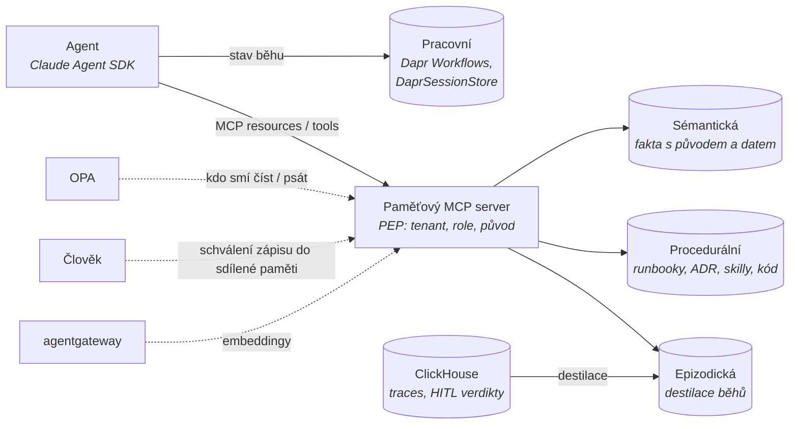

# Mapa paměti a znalostí

Kontext: **paměť je firemní, ne agentní.** Vrstva navazuje na rozhodnuté komponenty: stav běhu drží Dapr,
epizodická data vznikají v ClickHouse, oprávnění řeší OPA, identita Keycloak/SPIRE, nástroje jdou přes MCP
a agentgateway. Kritéria v [kriteria.md](kriteria.md).

## Čtyři druhy paměti v platformě

## Široké síto – kolo 1

*(doplní se z rešerše 2026-10-23)*

## Nativní schopnosti a standardy

*(doplní se z rešerše 2026-10-23)*

## Model původu a životní cyklus

*(doplní se z rešerše 2026-10-23)*

## Co ověřit dál

- [ ] Síto kolo 1 – memory frameworky, vektorové a grafové DB, licence.
- [ ] Co dává Claude (memory tool, CLAUDE.md, kompakce), Dapr (state, Conversation API), MCP (resources) a OTEL (memory spany).
- [ ] Model původu, izolace tenantů, memory poisoning, výmaz (GDPR čl. 17) – metodika.

## Changelog
- 2026-10-23: první verze – kostra, čtyři druhy paměti, otevřeno síto.
