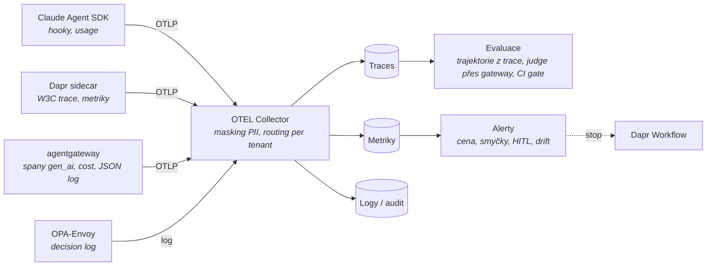

# Mapa observability a evaluace

Kontext: **průřezová vrstva** – odpovídá na „co se stalo“ (O1), „dělá to práci dobře“ (O2) a „kdy zasáhnout“ (O3).
Kritéria v [kriteria.md](kriteria.md). Navazuje na to, co už emitují zvolené komponenty: agentgateway (JSON log
s `jwt.sub` a `extauthz.*`, propagace `traceparent` jako child span – harness G1), OPA decision log (harness I2),
Dapr tracing, Claude Agent SDK hooky. Audit podle čl. 12 AI Act je **nosič** této vrstvy
([`../identity/regulace.md`](../identity/regulace.md), T2–T4).

## Tok dat

## Široké síto – kolo 1

Ověřeno 2026-10-23 z blob-less klonů (commit v souborech), PyPI/npm JSON API, Docker Hub OCI labelů; weby docs,
cncf.io, artifacthub a GHCR labely nedostupné (nadační stupně neověřeny). Sloupec „Řeší“: O1 tracing · O2 evaluace · O3 metriky/alerty.

**Dva průřezové nálezy:** OTEL GenAI semconv se přestěhovaly do `semantic-conventions-genai` (vše Development, bez tagu);
**Collector contrib má `genainormalizerprocessor`** (alpha) – přepisuje OpenInference/OpenLLMetry atributy na GenAI semconv.
Tím padá argument „vendor backend je nutný kvůli konvenci“: převod patří do Collectoru.

| Kandidát | Řeší | Licence backendu | Enterprise hranice | Governance / telemetrie nástroje | OTLP / semconv | Úložiště | Release | Výsledek |
|---|---|---|---|---|---|---|---|---|
| **OTEL Collector + contrib** | O1 transport, O3 (spanmetrics) | Apache-2.0 (OCI label Apache-2.0) | žádná | CNCF, EasyCLA; široká základna; bez phone-home | OTLP; `genainormalizer`, `redaction` (traces beta), `transform`, `routingconnector` per tenant, `clickhouseexporter`, `azuremonitorexporter` | bezstavový | 0.163.2 (2026-10-21) | **postupuje – povinná vrstva** |
| Jaeger v2 | O1 | Apache-2.0 | žádná | CNCF, DCO; **137/300 commitů jeden maintainer (AI bot)**; ClickHouse storage **experimental** (feature gate) | OTLP (je Collector distribuce); bez GenAI UI | Cassandra/ES/Badger/ClickHouse exp.; multi-tenancy `x-tenant` | 2.22.0 (2026-10-06) | s výhradou |
| Grafana Tempo + Loki + Mimir (+ Grafana) | O1 + O3 + logy | **AGPL-3.0** všechny čtyři | Grafana Enterprise: RBAC, SAML, reporting, caching, usage insights | Tempo DCO, **Grafana CLA** (precedens relicence 2021); Loki/Mimir CLA neověřeno; **4× telemetrie default on** | Tempo OTLP; Loki/Mimir neověřeno | objektové úložiště; **multi-tenancy a retence per tenant nativně** | Tempo 3.1.1, Loki 3.7.9, Mimir 3.2.3, Grafana 13.2.4 (10/2026) | s výhradou – AGPL → právník |
| **Prometheus** | O3 | Apache-2.0 (OCI label) | žádná | CNCF, DCO; široká základna | OTLP ingest neověřen | TSDB single-tenant | 3.15.1 (2026-10-21) | **postupuje** (jen metriky) |
| SigNoz | O1 + O3 | MIT + **`ee/`, `cmd/enterprise/`** (SigNoz Enterprise license) | v `ee/`: SAML/OIDC SSO, **authz OpenFGA, auditor, anomaly, licensing, metering**; IAM role za licencí | SigNoz Inc.; bez CLA/DCO; **statsreporter default on, sbírá i e-maily**; licence online | OTLP; AI dashboard čte GenAI vč. cache tokenů | ClickHouse; multi-tenancy OSS neověřena | v0.147.0 (2026-10-22) | s výhradou |
| **ClickHouse** | úložiště | Apache-2.0 | žádná v OSS | ClickHouse Inc., **CLA**; **`send_crash_reports.enabled=true` v dodávaném configu** | n/a (`clickhouseexporter`) | sloupcové, RBAC, kvóty | 26.9; LTS 26.3/26.8 | **postupuje** (crash reports vypnout) |
| **Langfuse** | O1 + O2 + O3 | MIT + `ee/` (copyright **ClickHouse, Inc.** – akvizice 2026-01-16) | za klíčem doslovně: „Project-level RBAC Roles, Protected Prompt Labels, **Data Retention Policies, Audit Logs, Server-Side Data Masking**, UI Customization, Organization Creators, Org Management API and SCIM, Instance Management API“ | CLA; PostHog default on, OSS vypne `TELEMETRY_ENABLED=false`, **EE nelze vypnout**; update check nekonfigurovatelný; air-gap doložen | OTLP **jen HTTP** (`/api/public/otel`); mapuje `gen_ai.*`, OpenInference, MLflow | Postgres + ClickHouse + Redis + S3; org/projekty v OSS; retence bez EE neomezená | v4.68.0 (2026-10-22); Helm zaostává (4.63) | **postupuje s výhradou** |
| Arize Phoenix | O1 + O2 | **Elastic-2.0** + `IP_NOTICE` (patenty) | žádné gates; SAML, multi-tenancy jen Arize AX | CLA; 1 autor 136/305; telemetrie default on (`PHOENIX_TELEMETRY_ENABLED`), air-gap dokumentován | OTLP gRPC+HTTP; OpenInference nativně, gen_ai → OI auto; **cache tokeny Anthropic nemapuje** | SQLite/Postgres; single-tenant per instance | 20.25.0 (2026-10-23) | **vyřazen A1** |
| OpenLLMetry / Traceloop | O1 (SDK) | SDK Apache-2.0; **backend není OSS** (privátní image) | celý backend | 2 maintaineři; SDK default endpoint api.traceloop.com, `telemetry_enabled=True` | emituje `gen_ai.*` + `llm.*`/`traceloop.*` | n/a | SDK 0.62.4 | **vyřazen A2 jako backend**; instrumentace přes Collector |
| Opik | O1 + O2 + O3 | Apache-2.0 celá platforma | **žádná autentizace v OSS** („Authentication features are available on Enterprise plans“) | Comet, CLA; usage report default on | OTLP HTTP; semconv neověřeno | ClickHouse (Altinity operator) + MySQL + Redis + MinIO | 2.2.117 (2026-10-22) | s výhradou – auth jen přes proxy |
| MLflow | O1 + O2 | Apache-2.0 | žádná | LF (stupeň neověřen), DCO; **Copilot 96/300 commitů**; telemetrie default on (`MLFLOW_DISABLE_TELEMETRY`), auto off v CI | OTLP ingest `/v1/traces`; export GenAI semconv vč. cache tokenů | **SQL store pro spany** (Postgres); workspaces | 3.17.2 (2026-10-21) | s výhradou (telemetrie, SQL pro spany) |
| Pydantic Logfire | – | SDK MIT; **backend enterprise, smlouva** | celý backend | – | SDK OTLP kamkoliv | n/a | SDK 5.2.0 | **vyřazen A2** |
| LangSmith | – | SDK MIT; **self-hosted = Enterprise add-on**, licenční klíč | celý backend | `beacon.langchain.com` usage | OTLP | ClickHouse + Postgres | 0.17.52 | **vyřazen A1/A2** |
| Laminar | O1 + O2 + O3 | Apache-2.0 | za klíčem: Signals, alerty e-mail/Slack | CLA; 2 zakladatelé ≈ 900/2086; PostHog default off | OTLP gRPC+HTTP; konvence OpenLLMetry | Postgres + ClickHouse + Quickwit (+RabbitMQ, Valkey); Helm `appVersion: latest` | 0.8.0 (2026-10-16) | s výhradou (tým, chart) |
| OpenInference | vrstva O1 | Apache-2.0 | žádná | Arize, CLA; stejný autor jako Phoenix | vlastní konvence; `annotations` ↔ `gen_ai.evaluation.result` | n/a | 0.1.41 (2026-10-01) | jen jako vstup do `genainormalizer` |

### Rozhodnutí (Adam, 2026-10-23) – co ze síta a harnessů plyne

| Otázka | Komponenta | Proč | Riziko / co zbývá |
|---|---|---|---|
| O1 + O3 transport | **OTEL Collector contrib** s `genainormalizer` (jedna konvence na drátě), `redaction` před exportem, `routingconnector` per tenant, `spanmetrics` | Apache-2.0, CNCF, bez phone-home; jediný bod, kde se dá maskovat a normalizovat | `genainormalizer` alpha |
| O1 úložiště traces + logů | **ClickHouse** přes `clickhouseexporter`; retence = ClickHouse TTL per tenant | Apache-2.0, LTS; stejné úložiště, jaké používá každá LLM platforma v sítu | CLA; crash reports vypnout; **ClickHouse Inc. vlastní i Langfuse** (jeden vendor + CLA = vzorec vysokého rizika) |
| O3 metriky | **Prometheus** (Mimir jen po právním posudku AGPL) | Apache-2.0, CNCF | single-tenant; agentgateway a Dapr už exportují |
| UI | Grafana jen jako **vyměnitelné UI** nad ClickHouse/Prometheus (AGPL – data nikdy v jejím formátu) | – | AGPL + Grafana CLA → právník |
| O2 + agentní pohled | **Langfuse jako druhý konzument téhož OTLP streamu** z Collectoru (ne primární backend) | MIT jádro, OTLP, ClickHouse, air-gap doložen; datasety z trace, anotace, judge přes `base_url`, agent graphs | retence, audit log, masking a project RBAC za EE klíčem → řešit v Collectoru, ClickHouse TTL, gateway/OPA; EE telemetrie nelze vypnout; OTLP jen HTTP; judge nevidí trajektorii ([evaluace.md](evaluace.md)) |
| O2 evaluace rolí | **Inspect AI** + **promptfoo** (CI gate), **MLflow** pro L4/L5 | viz [evaluace.md](evaluace.md) | – |

Cena odchodu: data jsou OTLP v ClickHouse a JSONL datasety; Langfuse i Grafana jsou vyměnitelné UI.

## Standard na drátě a co emitují komponenty

Detail v [standardy.md](standardy.md). Pět věcí, které mění návrh (2026-10-23):

- **OTEL GenAI semconv je celé `Development`**, přesunuté do vlastního repa bez release; MCP semconv existuje, A2A ne.
  Stavět na něm lze, ale s vrstvou normalizace v Collectoru (`gen_ai.system` → `provider.name`, cache tokeny).
- **Trace se ve výchozím stavu přeruší mezi Claude Code a naší gateway**: CLI posílá `traceparent` jen na
  api.anthropic.com; nutné `CLAUDE_CODE_PROPAGATE_TRACEPARENT=1`. Traces CLI jsou beta za dalšími třemi env.
- **Dapr Workflow aktivity nemají trace kontext**; Dapr Agents to obchází serializací do vstupu workflow; Dapr
  `samplingRate` default 0.0001.
- **agentgateway je nejbohatší zdroj**: `gen_ai.*` spany, cache tokeny, cost USD metrika, `jwt.sub` a `extauthz.*`
  jako CEL pole, propagace k modelu i MCP (i do `_meta`).
  **Ověřeno na AKS 2026-10-27 (P3-6 E4)**: `config.tracing` + `fields.add` z `apiKey.<metadata>` a `llm.cost.total`, `randomSampling: "true"`
  → span každého LLM requestu v ClickHouse `otel.otel_traces` s tenantem, zakázkou a rolí; součet ceny per zakázka == `budget_usage` → per-request
  ledger pro FinOps a audit (Governance MCP nástroj `ledger`, GUI FinOps). Tracing se načítá jen při startu gateway.
- **Model na Azure Foundry žádné spany neposílá**; Claude Platform má beta serverové spany do telemetry destination.
  MCP Python SDK v2 má OTEL default on, TypeScript SDK nic, A2A SDK nepropaguje.

## Evaluace

Detail v [evaluace.md](evaluace.md). Do kola 2 postupují **Inspect AI** (MIT, UK AISI, bez telemetrie, trajektorie
a approval policy), **promptfoo** (OTLP receiver + trajektorové asserce, CI gate; red-team pluginy pro agenty jen cloud),
**MLflow 3** (OTLP ingest, trace scorery, judge alignment, DCO), **Opik** a **DeepEval**. Vyřazen Phoenix (Elastic-2.0
i evals balíček), Braintrust a LangSmith (hostované), OpenAI Evals, Ragas. Metodika: šest vrstev L0–L5 (unit nástrojů,
trajektorie, výsledek úkolu s pass^k, bezpečnost, provozní drift, kalibrace judge) a šest metrik k evidenci pro čl. 15.
Nikdo nedodává konvertor trace → eval případ ani role-specifické gradery – to je naše práce.

## Harnessy O1 a O2 (změřeno 2026-10-23)

| Harness | Výsledek | Co prokázal |
|---|---|---|
| **O1** `tools/harness_observability_o1/` – orchestrátor (OTEL SDK) → Claude Agent SDK → CLI → agentgateway → mock model; Collector (`gen_ai_normalizer`, `redaction`) → ClickHouse 26.8 LTS | **9/9 PASS**, 1 SKIP (Dapr) | Jeden `trace_id` pro 5 spanů orchestrátoru, **10 spanů Claude Code** (`interaction` → `llm_request`, `tool` → `execution`) a 6 spanů agentgateway (rodič = `claude_code.llm_request`); gateway span nese `gen_ai.usage.cache_creation/cache_read.input_tokens`, `session.id`; redaction zamaskovala `sk-…` na `****`; normalizer přepsal `llm.token_count.*` na `gen_ai.usage.*`; CLI metriky `cost.usage`, `token.usage` a eventy `api_request`, `tool_decision` s `enduser.id` |
| **O2** `tools/harness_eval_o2/` – Inspect AI 0.3.283 přes agentgateway, 2 vzorky × 3 epochy | **6/6 PASS**, 1 INFO | Scorer nad trajektorií (`state.messages`): správný nástroj, argument, ≤ 2 kroky; **approval policy zamítla `delete_ticket`** (nástroj se neprovedl, `ToolCallError(type='approval')` v trajektorii); pass^3 = 1.0; CI gate exit code; export trajektorií do JSONL; negativní kontrola bez policy: delete se provedl a scorer dal INCORRECT |

Tím je navržený stack O1 (Collector + ClickHouse) a jádro O2 (Inspect AI) **změřené**, ne jen přečtené. Neměřeno:
Dapr Workflow v řetězu, LLM-as-judge a kalibrace (L2/L5), Langfuse jako druhý konzument, Prometheus metriky z gateway.

## Co ověřit dál

- [x] ~~Síto kolo 1 – backendy a LLM observability platformy~~ – 2026-10-23, 15 kandidátů.
- [ ] **Kolo 2:** Collector + ClickHouse – schéma `clickhouseexporter`, TTL per tenant, `genainormalizer` nad spany z agentgateway a Claude Code; Langfuse – co z O3 (alerty) je v OSS, OTLP HTTP z Collectoru.
- [ ] Nadační stupně (OTEL, Jaeger, Prometheus CNCF; MLflow LF AI) – weby nedostupné.
- [ ] Právní posudek AGPL (Tempo/Loki/Mimir/Grafana) a Grafana CLA.
- [x] ~~Harness O1 end-to-end~~ – **změřeno 2026-10-23, 9/9** (bez Dapr Agents executoru – zbývá).
- [x] ~~Harness O2 Inspect AI~~ – **změřeno 2026-10-23, 6/6**; promptfoo `trajectory:*` nad spany z Collectoru zbývá.
- [ ] Harness O1 s Dapr Agents `ClaudeAgentExecutor` (serializace traceparent přes workflow) – vyžaduje Dapr lokálně.
- [ ] Harness O2 rozšířit: LLM-as-judge přes gateway s rubrikou (L2), kalibrace proti HITL labelům (L5), sandbox s Claude Code bridge.
- [ ] Langfuse jako druhý konzument OTLP z Collectoru (HTTP) – co zobrazí z `claude_code.*` spanů.
- [x] ~~Stav OTEL GenAI semconv, co emitují komponenty, kde se trace přeruší~~ → [standardy.md](standardy.md), 2026-10-23.
- [x] ~~Evaluační frameworky pro trajektorie agentů, metodika~~ → [evaluace.md](evaluace.md), 2026-10-23.

## Changelog
- 2026-10-27: P3-6 E4 – per-request ledger ze spanů agentgateway v ClickHouse (tenant/zakázka/role/cena) změřen na AKS; FinOps pohled v Governance MCP a GUI.
- 2026-10-23: rozhodnuto (Adam): Collector + ClickHouse + Prometheus, Langfuse druhý konzument, Inspect AI + promptfoo + MLflow.
- 2026-10-23: harnessy O1 (9/9) a O2 (6/6) změřeny.
- 2026-10-23: síto kolo 1 – 15 backendů; návrh Collector + ClickHouse + Prometheus, Langfuse jako druhý konzument, Grafana jen UI.
- 2026-10-23: evaluace – síto 15 kandidátů, vrstvy L0–L5, metriky čl. 15 (evaluace.md).
- 2026-10-23: standardy – semconv Development, přerušení trace CLI → gateway, Dapr aktivity, Foundry bez spanů.
- 2026-10-23: první verze – kostra, tok dat, otevřeno síto.
