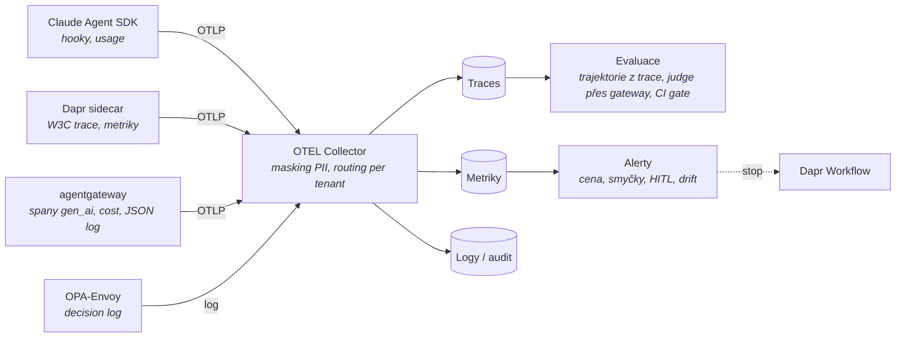

# Mapa observability a evaluace

Kontext: **průřezová vrstva** – odpovídá na „co se stalo“ (O1), „dělá to práci dobře“ (O2) a „kdy zasáhnout“ (O3).
Kritéria v [kriteria.md](kriteria.md). Navazuje na to, co už emitují zvolené komponenty: agentgateway (JSON log
s `jwt.sub` a `extauthz.*`, propagace `traceparent` jako child span – harness G1), OPA decision log (harness I2),
Dapr tracing, Claude Agent SDK hooky. Audit podle čl. 12 AI Act je **nosič** této vrstvy
([`../identity/regulace.md`](../identity/regulace.md), T2–T4).

## Tok dat

## Široké síto – kolo 1

*(doplní se z rešerše 2026-10-23)*

## Standard na drátě a co emitují komponenty

Detail v [standardy.md](standardy.md). Pět věcí, které mění návrh (2026-10-23):

- **OTEL GenAI semconv je celé `Development`**, přesunuté do vlastního repa bez release; MCP semconv existuje, A2A ne.
  Stavět na něm lze, ale s vrstvou normalizace v Collectoru (`gen_ai.system` → `provider.name`, cache tokeny).
- **Trace se ve výchozím stavu přeruší mezi Claude Code a naší gateway**: CLI posílá `traceparent` jen na
  api.anthropic.com; nutné `CLAUDE_CODE_PROPAGATE_TRACEPARENT=1`. Traces CLI jsou beta za dalšími třemi env.
- **Dapr Workflow aktivity nemají trace kontext**; Dapr Agents to obchází serializací do vstupu workflow; Dapr
  `samplingRate` default 0.0001.
- **agentgateway je nejbohatší zdroj**: `gen_ai.*` spany, cache tokeny, cost USD metrika, `jwt.sub` a `extauthz.*`
  jako CEL pole, propagace k modelu i MCP (i do `_meta`).
- **Model na Azure Foundry žádné spany neposílá**; Claude Platform má beta serverové spany do telemetry destination.
  MCP Python SDK v2 má OTEL default on, TypeScript SDK nic, A2A SDK nepropaguje.

## Evaluace

Detail v [evaluace.md](evaluace.md). Do kola 2 postupují **Inspect AI** (MIT, UK AISI, bez telemetrie, trajektorie
a approval policy), **promptfoo** (OTLP receiver + trajektorové asserce, CI gate; red-team pluginy pro agenty jen cloud),
**MLflow 3** (OTLP ingest, trace scorery, judge alignment, DCO), **Opik** a **DeepEval**. Vyřazen Phoenix (Elastic-2.0
i evals balíček), Braintrust a LangSmith (hostované), OpenAI Evals, Ragas. Metodika: šest vrstev L0–L5 (unit nástrojů,
trajektorie, výsledek úkolu s pass^k, bezpečnost, provozní drift, kalibrace judge) a šest metrik k evidenci pro čl. 15.
Nikdo nedodává konvertor trace → eval případ ani role-specifické gradery – to je naše práce.

## Co ověřit dál

- [ ] Síto kolo 1 – backendy a LLM observability platformy.
- [x] ~~Stav OTEL GenAI semconv, co emitují komponenty, kde se trace přeruší~~ → [standardy.md](standardy.md), 2026-10-23.
- [x] ~~Evaluační frameworky pro trajektorie agentů, metodika~~ → [evaluace.md](evaluace.md), 2026-10-23.

## Changelog
- 2026-10-23: evaluace – síto 15 kandidátů, vrstvy L0–L5, metriky čl. 15 (evaluace.md).
- 2026-10-23: standardy – semconv Development, přerušení trace CLI → gateway, Dapr aktivity, Foundry bez spanů.
- 2026-10-23: první verze – kostra, tok dat, otevřeno síto.
