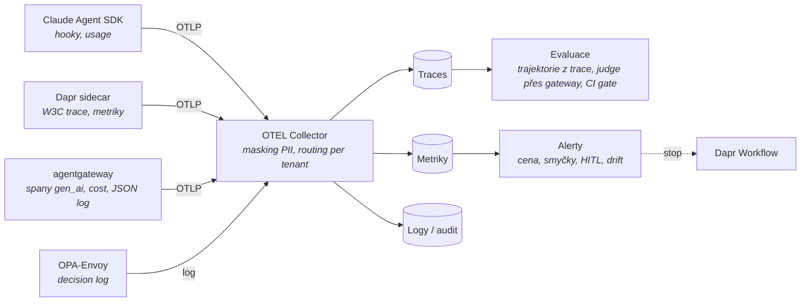

# Mapa observability a evaluace

Kontext: **průřezová vrstva** – odpovídá na „co se stalo“ (O1), „dělá to práci dobře“ (O2) a „kdy zasáhnout“ (O3).
Kritéria v [kriteria.md](kriteria.md). Navazuje na to, co už emitují zvolené komponenty: agentgateway (JSON log
s `jwt.sub` a `extauthz.*`, propagace `traceparent` jako child span – harness G1), OPA decision log (harness I2),
Dapr tracing, Claude Agent SDK hooky. Audit podle čl. 12 AI Act je **nosič** této vrstvy
([`../identity/regulace.md`](../identity/regulace.md), T2–T4).

## Tok dat

## Široké síto – kolo 1

*(doplní se z rešerše 2026-10-23)*

## Standard na drátě a co emitují komponenty

*(doplní se z rešerše 2026-10-23)*

## Evaluace

*(doplní se z rešerše 2026-10-23)*

## Co ověřit dál

- [ ] Síto kolo 1 – backendy a LLM observability platformy.
- [ ] Stav OTEL GenAI semconv, co emitují Claude Agent SDK / Dapr / agentgateway / MCP SDK, kde se trace přeruší.
- [ ] Evaluační frameworky pro trajektorie agentů, metodika pro role virtuální firmy.

## Changelog
- 2026-10-23: první verze – kostra, tok dat, otevřeno síto.
