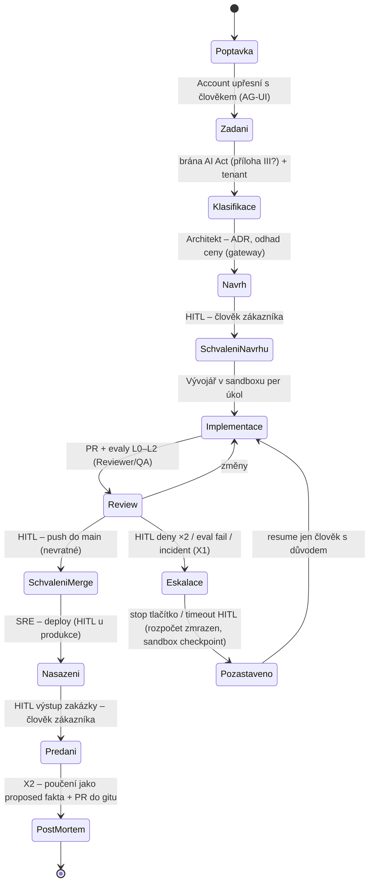

# Organizační vrstva: virtuální IT firma

Návrhová vrstva nad sedmi rozhodnutými. Zásada z [kriteria.md](kriteria.md): **firma je sada procesů, role jsou
odvozené.** Tento soubor nahrazuje pracovní hypotézu v
[`../platforma/cilova-architektura.md`](../platforma/cilova-architektura.md) a bude se přepisovat po každém kole návrhu.

## Co firma dodává (v0 – rozhodnuto Adamem 2026-10-23: výchozí volby)

| Otázka | Rozhodnutí v0 | Důsledek pro návrh |
|---|---|---|
| Služby v první verzi | **jen vývoj a dodání na zakázku**; provoz a podpora až po harnessu O-1, konzultace bez kódu později | katalog procesů v0 končí předáním a nasazením do prostředí zákazníka; role SRE je v procesu Nasazení, ne v trvalém provozu |
| Kde je člověk povinně | **nevratné kroky + vstup a výstup zakázky** (přijetí zadání, předání výsledku); hranice se posouvá podle pass^k rolí | každá zakázka má ≥ 2 HITL body navíc k nevratným krokům; autonomie uvnitř (návrh → implementace → review) |
| První zákazník | **dogfooding** – platforma staví sama sebe (jeden tenant, bez přílohy III AI Act) | tenant model jednoduchý, klasifikační brána zatím jen jako proces bez reálného use casu; harness O-1 bez cizích dat |

## Tok zakázky (v0)

Detail: [procesy.md](procesy.md) (P1–P5, X1–X2, P1a), [autonomie.md](autonomie.md) (N1–N10, stop, brána, pass^k),
[role.md](role.md) + [`roles/`](roles/) (YAML), [metriky.md](metriky.md) (zdroje dat, registr agentů T12, risk register T11).

Každý přechod = Dapr Workflow aktivita; každý **HITL** = durable approval (dny) přes AG-UI; každé předání mezi
rolemi = A2A úkol s artefaktem (zadání, ADR, PR, runbook). Nevratné kroky: push do main, deploy, komunikace
ven (čl. 50 disclosure), platba, smazání dat – všechny kryté approval policy (hook Agent SDK + OPA) **a** gateway
(403 na `git-receive-pack` mimo schválený kanál – změřeno S1).

## Role (v0 – odvozené z toku; oprávnění, rozpočty a YAML v [role.md](role.md))

| Role | Proces | Smí (nástroje) | Nesmí bez člověka | Scope paměti | Sandbox profil | Evaly |
|---|---|---|---|---|---|---|
| Account | Poptávka → Zadání | AG-UI dialog, CRM/ticket MCP, čtení paměti zákazníka | slíbit cenu/termín, poslat nabídku | zákazník | žádný (bez kódu) | L3 kvalita zadání |
| Architekt | Návrh | čtení repa, paměť firmy (ADR), cena modelů z gateway, sandbox pro prototyp | schválit návrh | firma + zákazník | lehký (interpreter) | L3 ADR, odhad vs. skutečnost |
| Vývojář | Implementace | sandbox per úkol (Kata + srt), git přes gateway (jen HTTPS, bez push do main), testy, MCP repo/issue | push do main, deploy, egress mimo allow-list | zákazník (kód) + firma (konvence) | plný vývojový | L1–L2 pass^k, cena per úkol |
| Reviewer / QA | Review | čtení PR, spouštění evalů (`inspect_k8s_sandbox`), komentáře | merge, schválení faktů do paměti jen jako `reviewer` role | firma | eval sandbox | L2 shoda s člověkem |
| SRE | Nasazení → Provoz | cloud API přes MCP s krátkodobým tokenem, runbooky, ClickHouse | produkční deploy, smazání, změna oprávnění | zákazník (confidential) | provozní (CLI) | L2 incident uzavřen, MTTR |
| Governance | průřezově | čtení auditu (ClickHouse, OPA decision log), rozpočty, registr agentů, risk register | nic nepíše do faktů ani kódu | platforma | žádný | T11–T15 evidence |
| Člověk (vlastník procesu) | všude | schvaluje HITL, eskalace, stop tlačítko (T6) | – | – | – | – |

## Kolo 1 návrhu (2026-10-23) – co vzniklo

| Soubor | Obsah | Klíčový návrh (Pozn. Adam) |
|---|---|---|
| [procesy.md](procesy.md) | P1 Přijetí (+ P1a brána), P2 Návrh, P3 Implementace, P4 Review, P5 Předání a nasazení; X1 Eskalace, X2 Post-mortem; stavové diagramy, artefakty, A2A kontrakt předání, mapování stavů na vrstvy | každý stav = Dapr aktivita, HITL = `when_any(wait_for_external_event, create_timer)`; timeout **nikdy** neschvaluje |
| [autonomie.md](autonomie.md) | katalog nevratných akcí N1–N10, dvojí vynucení (gateway/OPA/PEP + hook), timeouty 1/2/5 dnů, stop tlačítko per zakázka a tenant, klasifikační brána, pravidlo rozšiřování autonomie | v0 žádná nevratná akce „jen agent“; posun na reviewer-agent až po ≥ 30 rozhodnutích, ≤ 5 % odmítnutí, pass^3 ≥ 0,90; nikdy pro vstup/výstup zakázky, N4–N6, N9 |
| [role.md](role.md), [`roles/*.yaml`](roles/) | šablona role se sedmi bloky (identity, authz, budget, memory, sandbox, evals, escalation/disclosure), profily sandboxu, jedna Rego s daty per roli; plné YAML Vývojář a Reviewer | **nevratné kroky vykonává deterministická Dapr aktivita s podepsaným approval tokenem** – žádná role agenta nemá scope merge/deploy |
| [metriky.md](metriky.md) | zdroje dat (ClickHouse, gateway log, OPA log, ledger paměti, Inspect), metriky per proces a role, schéma `org.*` (registr agentů T12, risk register T11, approvals, eval gates), odpovědnost, úrovně autonomie A0–A3 | registr a risk register = tabulky v platformním Postgresu s RLS, ne dokument |

### Otázky z kola 1 – výchozí odpovědi (použity v návrhu, Adam může změnit)

| # | Otázka | Výchozí odpověď |
|---|---|---|
| Q1 | Co je v dogfoodingu „deploy“ (N2)? | merge do `main` tohoto repa; apply do dev clusteru jako samostatná N2 až od harnessu O-1 |
| Q2 | Timeouty HITL 1/2/5 prac. dnů, platnost schválení 24 h? | ano pro v0, přehodnotit po 3 zakázkách |
| Q3 | Rozpočty v0 | per role × 24 h Audit/Block: Account 5/10, Architekt 15/30, Vývojář 25/50, Reviewer 10/20, SRE 10/20, Governance 20/40 USD; zakázka 400 USD/30 d Block; překročení úkolu = X1, navýšení = N6 |
| Q4 | Prahy pass^k a body, které se nikdy neposouvají | ano; první kandidát na posun H4 merge u profilu `standard` |
| Q5 | Komunikace ven v dogfoodingu | jen issue/PR komentáře v tomto repu s disclosure řádkem vkládaným adaptérem; e-mail MCP až s externím zákazníkem |
| Q6 | Čí token je subject při vícedenním běhu | service account `svc-{tenant}-{proces}` s `on_behalf_of` = schvalovatel vstupu, obnovovaný při každém HITL; offline token člověka jen pro Account |
| Q7 | Nevratné kroky vykonává Dapr aktivita, ne agent | ano – agent navrhuje, workflow provádí; změří O-1 |
| Q8 | Reviewer schvaluje paměť i ve scope zákazník? | firma + zákazník vlastního tenanta, jen `fakt`/`pouceni`, sensitivity ≤ confidential |
| Q9 | Registr agentů a risk register ve stejném Postgresu jako paměť? | ano, schéma `org`, role `org_writer` jen pro Dapr aktivity a eval-gate job |

## Co ověřit dál

- [x] ~~Adamovy odpovědi na tři otázky~~ – 2026-10-23 výchozí volby (jen vývoj, člověk na nevratných krocích + vstup/výstup, dogfooding).
- [x] ~~Kolo 1 návrhu~~ – 2026-10-23: `procesy.md`, `autonomie.md`, `role.md` + `roles/`, `metriky.md`.
- [ ] **Harness O-1**: jedna zakázka end-to-end s mock rolemi přes Dapr Workflow (HITL `when_any`, timeout → Pozastaveno), merge-executor s approval tokenem, gateway rozpočet per zakázka, paměť `proposed`, sandbox S1; tvrzení: nevratný krok bez schválení neprojde (ani přes injection), timeout neschvaluje, stop zmrazí rozpočet, předání nesou artefakty, cena per zakázka v logu. Lokálně vyžaduje `daprd` + placement + scheduler bez Dockeru (harness_dapr_claude běžel s Redisem v Dockeru).
- [ ] Role Account, Architekt, SRE, Governance jako plné YAML (zatím zkrácené v `role.md`); Dapr Workflow pause/resume jako T5 mechanismus ověřit v docs 1.18.
- [ ] Mapování na AI Act T1–T15 per proces (klasifikační brána, čl. 14, čl. 50).

## Changelog
- 2026-10-23: kolo 1 návrhu – procesy, autonomie, role, metriky; diagram doplněn o Eskalaci, Předání, Post-mortem a Pozastaveno; otázky Q1–Q9 s výchozími odpověďmi.
- 2026-10-23: rozhodnuty výchozí volby (služby, člověk, první zákazník); kolo 1 návrhu spuštěno.
- 2026-10-23: první verze – kostra: tok zakázky v0, role v0, plán kola 1, tři otázky pro Adama.
