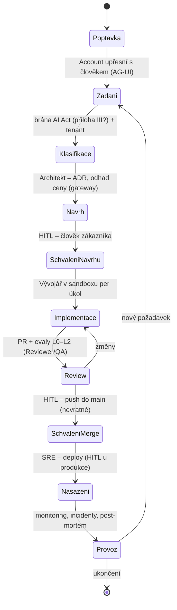

# Organizační vrstva: virtuální IT firma

Návrhová vrstva nad sedmi rozhodnutými. Zásada z [kriteria.md](kriteria.md): **firma je sada procesů, role jsou
odvozené.** Tento soubor nahrazuje pracovní hypotézu v
[`../platforma/cilova-architektura.md`](../platforma/cilova-architektura.md) a bude se přepisovat po každém kole návrhu.

## Co firma dodává (v0 – rozhodnuto Adamem 2026-10-23: výchozí volby)

| Otázka | Rozhodnutí v0 | Důsledek pro návrh |
|---|---|---|
| Služby v první verzi | **jen vývoj a dodání na zakázku**; provoz a podpora až po harnessu O-1, konzultace bez kódu později | katalog procesů v0 končí předáním a nasazením do prostředí zákazníka; role SRE je v procesu Nasazení, ne v trvalém provozu |
| Kde je člověk povinně | **nevratné kroky + vstup a výstup zakázky** (přijetí zadání, předání výsledku); hranice se posouvá podle pass^k rolí | každá zakázka má ≥ 2 HITL body navíc k nevratným krokům; autonomie uvnitř (návrh → implementace → review) |
| První zákazník | **dogfooding** – platforma staví sama sebe (jeden tenant, bez přílohy III AI Act) | tenant model jednoduchý, klasifikační brána zatím jen jako proces bez reálného use casu; harness O-1 bez cizích dat |

## Tok zakázky (v0)

Každý přechod = Dapr Workflow aktivita; každý **HITL** = durable approval (dny) přes AG-UI; každé předání mezi
rolemi = A2A úkol s artefaktem (zadání, ADR, PR, runbook). Nevratné kroky: push do main, deploy, komunikace
ven (čl. 50 disclosure), platba, smazání dat – všechny kryté approval policy (hook Agent SDK + OPA) **a** gateway
(403 na `git-receive-pack` mimo schválený kanál – změřeno S1).

## Role (v0 – odvozené z toku; konkrétní oprávnění a rozpočty až v kole 1)

| Role | Proces | Smí (nástroje) | Nesmí bez člověka | Scope paměti | Sandbox profil | Evaly |
|---|---|---|---|---|---|---|
| Account | Poptávka → Zadání | AG-UI dialog, CRM/ticket MCP, čtení paměti zákazníka | slíbit cenu/termín, poslat nabídku | zákazník | žádný (bez kódu) | L3 kvalita zadání |
| Architekt | Návrh | čtení repa, paměť firmy (ADR), cena modelů z gateway, sandbox pro prototyp | schválit návrh | firma + zákazník | lehký (interpreter) | L3 ADR, odhad vs. skutečnost |
| Vývojář | Implementace | sandbox per úkol (Kata + srt), git přes gateway (jen HTTPS, bez push do main), testy, MCP repo/issue | push do main, deploy, egress mimo allow-list | zákazník (kód) + firma (konvence) | plný vývojový | L1–L2 pass^k, cena per úkol |
| Reviewer / QA | Review | čtení PR, spouštění evalů (`inspect_k8s_sandbox`), komentáře | merge, schválení faktů do paměti jen jako `reviewer` role | firma | eval sandbox | L2 shoda s člověkem |
| SRE | Nasazení → Provoz | cloud API přes MCP s krátkodobým tokenem, runbooky, ClickHouse | produkční deploy, smazání, změna oprávnění | zákazník (confidential) | provozní (CLI) | L2 incident uzavřen, MTTR |
| Governance | průřezově | čtení auditu (ClickHouse, OPA decision log), rozpočty, registr agentů, risk register | nic nepíše do faktů ani kódu | platforma | žádný | T11–T15 evidence |
| Člověk (vlastník procesu) | všude | schvaluje HITL, eskalace, stop tlačítko (T6) | – | – | – | – |

## Co vznikne v kole 1 návrhu

1. **Katalog procesů** – tabulka: proces, vstup, výstup, stavy, nevratné kroky, vlastník, SLA (`procesy.md`).
2. **Matice rolí** – YAML definice role (identita/SVID, OPA pravidla, rozpočet, scope paměti, sandbox profil,
   evaly) + šablona (`role.md`, `roles/*.yaml`).
3. **Katalog nevratných akcí a schvalovacích bodů** – kdo schvaluje co, timeouty, eskalace (`autonomie.md`).
4. **Metriky a odpovědnost** – per proces a role; registr agentů a risk register jako data (`metriky.md`).
5. **Harness O-1** – jedna zakázka end-to-end s mock rolemi přes Dapr Workflow, HITL body, gateway, paměť a
   sandbox: změří, že nevratný krok bez schválení neprojde a že předání nesou artefakty.

## Co ověřit dál

- [x] ~~Adamovy odpovědi na tři otázky~~ – 2026-10-23 výchozí volby (jen vývoj, člověk na nevratných krocích + vstup/výstup, dogfooding).
- [ ] Kolo 1 návrhu: `procesy.md`, `role.md` + `roles/*.yaml`, `autonomie.md`, `metriky.md`.
- [ ] Harness O-1 (Dapr Workflow s HITL, mock role; vyžaduje Dapr lokálně – smoke test v `tools/` existuje).
- [ ] Mapování na AI Act T1–T15 per proces (klasifikační brána, čl. 14, čl. 50).

## Changelog
- 2026-10-23: rozhodnuty výchozí volby (služby, člověk, první zákazník); kolo 1 návrhu spuštěno.
- 2026-10-23: první verze – kostra: tok zakázky v0, role v0, plán kola 1, tři otázky pro Adama.
