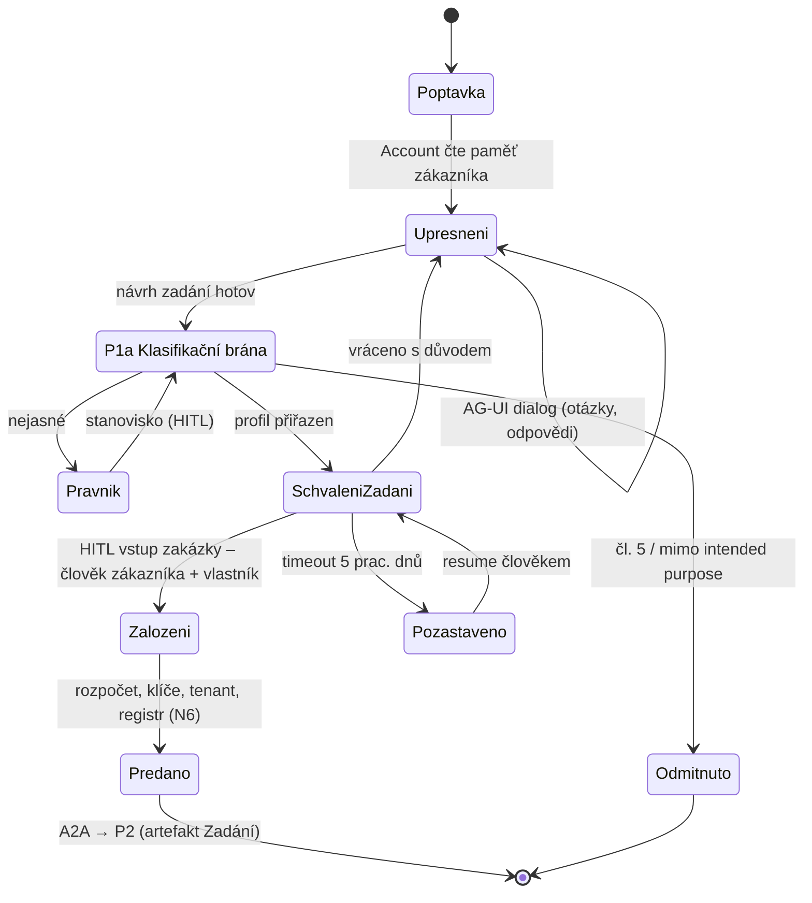
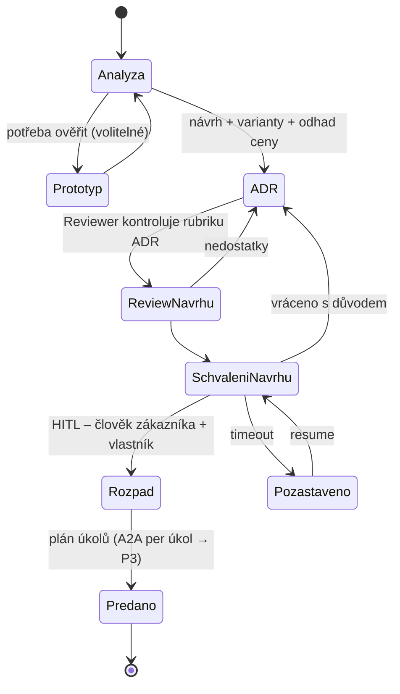
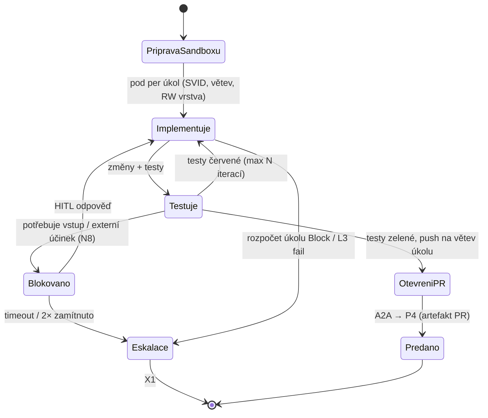
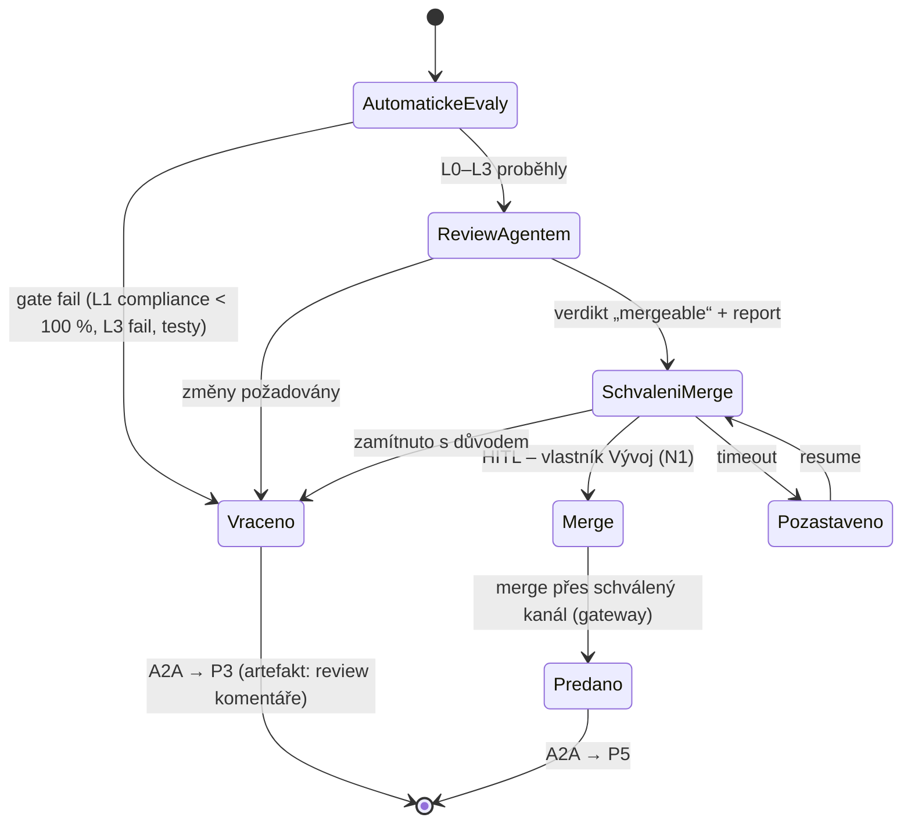
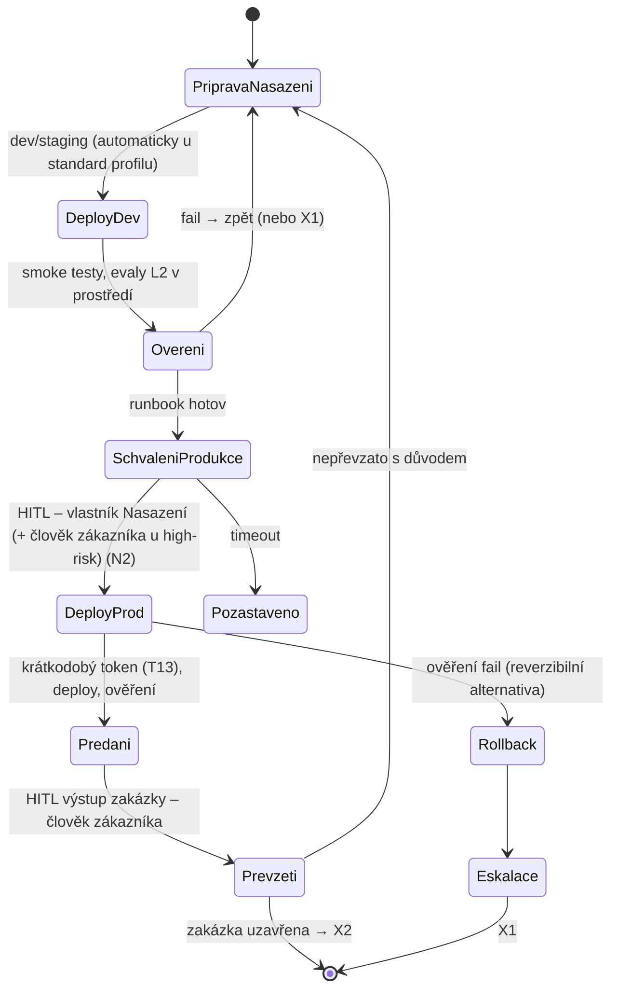
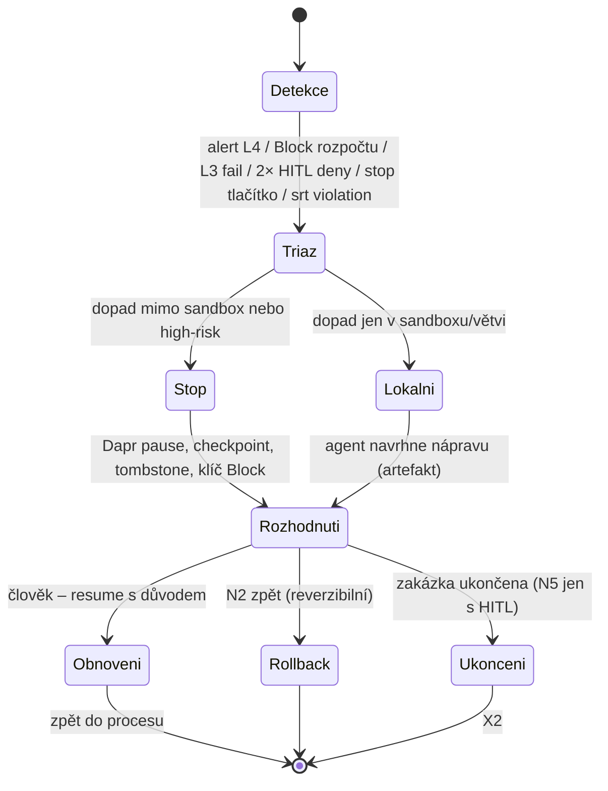
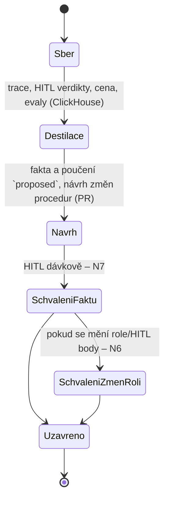

# Katalog procesů v0

**Pozn. Adam:** celý soubor je návrh. Rozhodnuté vstupy: jen vývoj a dodání na zakázku; člověk povinně na
nevratných krocích a na vstupu/výstupu zakázky; první zákazník = dogfooding (viz [overview.md](overview.md)).
Nevratné akce N1–N10 a schvalovatelé jsou v [autonomie.md](autonomie.md).

## Závěr

Zakázka = rodičovské Dapr Workflow `org.zakazka` s pěti podřízenými workflow (P1–P5) a dvěma průřezovými
(X1, X2). Každý stav je aktivita, každý HITL bod je `wait_for_external_event` + timer, každé předání mezi rolemi je
A2A úkol s artefaktem, kód se dotýká jen sandboxu. Dogfooding: zadání = issue, ADR = soubor v `knowledge/`, PR = tento
repozitář, runbook = `tools/<harness>/README.md`.

## Společné konvence (mapování na vrstvy)

| Prvek procesu | Vrstva | Konkrétně |
|---|---|---|
| Zakázka | Dapr Workflow | `org.zakazka` (instance id = `zakazka_id`, ULID); procesy P1–P5 jako child workflow `org.p1` … `org.p5`; X1 jako samostatné workflow spouštěné eventem; stav zakázky v Dapr state storu (Postgres v2) |
| Stav procesu | Dapr Workflow aktivita | `run_executor` (ClaudeAgentExecutor + DaprSessionStore) nebo deterministická aktivita (založení sandboxu, zápis artefaktu) |
| HITL bod | Dapr Workflow | `when_any(wait_for_external_event("hitl:<bod>:<zakazka_id>"), create_timer(T))`; timeouty a eskalace viz [autonomie.md](autonomie.md#timeouty-a-eskalace); approval event nese approver token (Dapr Agents 1.0.6) → T3 identita schvalovatele |
| Dialog s člověkem | AG-UI | vlastní frontend; každá zpráva agenta nese hlavičku „jsem AI agent v roli X, jednám za firmu Y“ (T7); approval UI ukazuje limity a vyžaduje důvod (T6) |
| Předání mezi rolemi | A2A | A2A Task přes vlastní adaptér (Dapr Agents A2A nepodporuje); `artifacts[]` povinné, `metadata` = `{zakazka_id, process, from_role, to_role, trace_id, artifact_hash}`; kontrakt níže |
| Práce s kódem | Sandbox | pod per úkol: Kata (`kata-vm-isolation`) + srt + egress jen přes agentgateway (SNI allow-list, git terminovaný, token vkládá gateway); SVID per pod; `git-receive-pack` na `main` → 403 (změřeno S1) |
| Paměť | MCP server paměti | čtení přes PEP (tenant a role z tokenu; default jen `approved`, `valid_to IS NULL`); zápis **vždy** `status=proposed` se `sources[]`; `approved` jen přes HITL (N7) |
| Rozpočet | agentgateway | API klíč per **role × zakázka** (`apiKey.keys[].budgets[]` USD, rolling 30d): `Audit` na 80 %, `Block` na 100 %; klíč per úkol pro vývojáře; překročení → X1 |
| Observabilita | OTEL → ClickHouse, Inspect, promptfoo | spany `org.process.
`, `org.state.<s>`, `org.handoff` (A2A task id), `org.hitl` (approver, reason, decision); atributy `org.zakazka_id`, `org.tenant_id`, `org.role`, `org.policy_version`; T3 pole (model+verze, nástroj+parametry, náklad); eval gate per stav níže |
| Identita | Keycloak + SPIRE + OPA | každý request: principal (člověk, který zakázku zadal / schválil) + SVID role + delegační řetězec (T1); OPA Rego sdílená hookem a `extAuthz` |

### Dogfooding – artefakty

| Artefakt | Kde v tomto repu | Kdo ho vlastní |
|---|---|---|
| Zadání | GitHub issue s šablonou `zakazka` (sekce: cíl, akceptační kritéria, profil rizika, rozpočet USD, vlastník) | Adam |
| ADR | `knowledge/<vrstva>/<tema>.md` + řádek v `knowledge/platforma/cilova-architektura.md` | Architekt (návrh), Adam (schválení) |
| Plán úkolů | checklist v issue, každý úkol = větev `zakazka/<id>/<n>-<slug>` | Architekt |
| PR | PR do `main` s odkazem na issue; CI = promptfoo gate + Inspect L0–L3 | Vývojář |
| Review report | komentář PR z role Reviewer (s disclosure T7) + JSONL výsledků evalů | Reviewer |
| Runbook / předání | `tools/<harness>/README.md` nebo `knowledge/<vrstva>/runbook-*.md`; předávací komentář v issue | SRE |
| Post-mortem | záznam v `Changelog` dotčeného souboru + fakt `pouceni` v paměti (`proposed`) | Governance |

## Přehled

| ID | Proces | Vstup | Výstup / artefakt | Vlastník (člověk) | SLA (návrh) |
|---|---|---|---|---|---|
| P1 | Přijetí zadání (+ P1a Klasifikační brána) | poptávka | Zadání (`zakazka_id`, profil rizika, rozpočet) | vlastník Account | 2 prac. dny |
| P2 | Návrh | Zadání | ADR + plán úkolů + odhad ceny | vlastník Architektura | 3 prac. dny |
| P3 | Implementace | ADR + úkol | PR + zelené testy | vlastník Vývoj | ≤ 8 h agentního času / úkol |
| P4 | Review | PR | Review report → merge | vlastník Vývoj | 1 prac. den |
| P5 | Předání a nasazení | mergnutý PR | Runbook + předávací protokol + deploy | vlastník Nasazení | 2 prac. dny |
| X1 | Eskalace / incident | událost | Incident záznam + rozhodnutí | vlastník dotčeného procesu → governance | reakce 4 h |
| X2 | Post-mortem / poučení | uzavřená zakázka / incident | Post-mortem + `pouceni` + PR do procedurální paměti | governance | 5 prac. dnů |

Dogfooding: všechny vlastníky zastává Adam; role vlastníků zůstávají oddělené v OPA (různé `approver_role`), aby
log T3 ukazoval, *v jaké roli* schválil.

## P1 Přijetí zadání

| | |
|---|---|
| Vstup | poptávka (AG-UI zpráva, e-mail přes MCP, issue) + identita zadavatele (OAuth z IdP zákazníka přes Keycloak) |
| Výstup / artefakt | **Zadání**: `zakazka_id`, cíl, akceptační kritéria, omezení, **profil rizika** (P1a), rozpočet USD, vlastník, tenant, `sources[]` dialogu |
| Předání (A2A) | Account → Architekt: task `p1.zadani` s artefaktem Zadání (hash) |
| Nevratné kroky | N3 komunikace ven (odpověď zadavateli – jen s disclosure T7; v0 schvaluje vlastník); N6 založení rozpočtu a klíčů; N9 přiřazení profilu rizika |
| HITL body | **H1 Schválení zadání** (vstup zakázky, rozhodnuto: vždy člověk): člověk zákazníka + vlastník Account; timeouty 1/2/5 prac. dnů (viz autonomie.md); **H1a stanovisko právníka** jen při `nejasné` |
| Vlastník | člověk – vlastník Account (dogfooding: Adam) |
| SLA | 2 prac. dny od poptávky k H1; dialog ≤ 3 kola otázek (pak eskalace vlastníkovi) |
| Metriky | doba cyklu; podíl zadání vrácených z P2 jako nejasná (L3 kvalita zadání); podíl H1 odmítnutí; cena P1 (USD) |

**P1a Klasifikační brána (T9)** – rozhodovací tabulka je v [autonomie.md](autonomie.md#klasifikační-brána-příloha-iii);
výsledek `profil_rizika ∈ {standard, high-risk-III/4, high-risk-III/2, odmitnout, nejasne}` se zapíše do Zadání
a do OPA data (`tenants[tenant].profile`) – profil mění schvalovatele N2 a povinnost T2–T6 (regulace.md T9).
Dogfooding = `standard` (overview.md: bez přílohy III).

| Stav | Dapr | Protokol | Sandbox | Paměť čte / zapisuje | Gateway | Observabilita |
|---|---|---|---|---|---|---|
| Poptavka | start `org.zakazka` + child `org.p1` | AG-UI (vstup) | – | – / – | – | `org.process.p1` root span, `org.tenant_id` |
| Upresneni | `run_executor` Account | AG-UI dialog s T7 | žádný | scope zákazník (`approved`) / destilát dialogu `proposed` | klíč `account@zakazka`, limit 2 USD | spany `gen_ai.*`; eval L3 kvalita zadání (rubrika) |
| Klasifikace | deterministická aktivita + `run_executor` Governance (dotazník) | AG-UI (otázky brány) | – | scope platforma (intended purpose) / – | – | `org.state.klasifikace` s výsledkem; gate: výsledek ≠ `nejasne` pokračuje |
| Pravnik | HITL `hitl:pravnik` | AG-UI | – | – / stanovisko `proposed` (scope firma) | – | `org.hitl` |
| SchvaleniZadani | HITL `hitl:h1` + timery | AG-UI approval (důvod povinný, T6) | – | – / – | – | `org.hitl` (approver, reason) |
| Zalozeni | deterministické aktivity: gateway klíče per role × zakázka, OPA data (tenant, profil, rozpočet), SPIRE entry sandbox labelu, registr agentů | – | – | – / záznam zakázky scope firma `proposed` | založení klíčů = N6 (schváleno v H1) | `org.state.zalozeni`; decision log OPA |
| Predano | A2A task → `org.p2` | A2A | – | – | – | `org.handoff` |

## P2 Návrh

| | |
|---|---|
| Vstup | Zadání (artefakt z P1) |
| Výstup / artefakt | **ADR** (kontext, varianty, rozhodnutí, rizika, zdroje) + **plán úkolů** (každý úkol: cíl, akceptační test, rozpočet USD, větev) + odhad ceny (z cen gateway) |
| Předání (A2A) | Architekt → Reviewer: `p2.adr-review`; Architekt → Vývojář: `p2.ukol[n]` (jeden task per úkol, artefakt = úkol + odkaz na ADR) |
| Nevratné kroky | žádný; prototyp jen v sandboxu bez egress mimo allow-list; cena odhadu = N4 jen pokud > rozpočet zakázky (vrací se do H1) |
| HITL body | **H2 Schválení návrhu** – člověk zákazníka + vlastník Architektura (v0 člověk; kandidát na posun na reviewer-agent u `standard` profilu – viz autonomie.md); timeouty 1/2/5 |
| Vlastník | člověk – vlastník Architektura |
| SLA | 3 prac. dny do H2; ≤ 2 kola ReviewNavrhu |
| Metriky | doba cyklu; odhad vs. skutečná cena zakázky (Δ %); H2 odmítnutí; podíl úkolů vrácených z P3 jako neproveditelné; L2 ADR rubrika |

| Stav | Dapr | Protokol | Sandbox | Paměť čte / zapisuje | Gateway | Observabilita |
|---|---|---|---|---|---|---|
| Analyza | `run_executor` Architekt | – | žádný (čtení repa přes MCP read-only) | scope firma (ADR, konvence) + zákazník / – | klíč `architekt@zakazka`, limit 5 USD | `gen_ai.*`; `search_memory` spany (M-E1) |
| Prototyp | aktivita „spusť sandbox“ → Pod (Kata) | – | lehký profil: interpreter, egress jen modely + package registry | – / – | egress přes gateway | spany srt/gateway verdikty |
| ADR | `run_executor` | – | – | – / ADR jako PR do `knowledge/` (procedurální) + index `proposed` | – | eval **L2 ADR rubrika** (gate ≥ prahu, jinak zpět) |
| ReviewNavrhu | A2A → Reviewer `run_executor` | A2A | eval sandbox | scope firma / komentář (procedurální, PR review) | klíč `reviewer@zakazka` | `org.handoff`; L2 shoda reviewer vs. H2 (L5 label) |
| SchvaleniNavrhu | HITL `hitl:h2` | AG-UI approval (ukáže varianty, cenu, rizika – T6) | – | – | – | `org.hitl` |
| Rozpad | deterministická aktivita: založí větve, klíče per úkol, A2A tasky | A2A | – | – | klíče `vyvojar@zakazka/ukol-n` | `org.handoff` ×n |

## P3 Implementace (per úkol, paralelně)

| | |
|---|---|
| Vstup | úkol (A2A z P2) + ADR + přístup k repu přes gateway (jen HTTPS, token vkládá gateway) |
| Výstup / artefakt | **PR** na větvi `zakazka/<id>/<n>-<slug>`: popis se vazbou na úkol, zelené testy, trajektorie (ATIF/JSONL) jako příloha pro review |
| Předání (A2A) | Vývojář → Reviewer: `p3.pr` (artefakt = PR URL + head SHA + trajektorie) |
| Nevratné kroky | uvnitř sandboxu žádný (sandbox je zahoditelný, výsledek = commit na větvi úkolu, která se maže jen přes N5); **push do `main` nemožný** (gateway 403, S1); N8 nástroj s externím účinkem (založení issue, komentář v cizím repu) jen přes approval |
| HITL body | **H3 Blokováno** – dotaz na vlastníka Vývoj (AG-UI), timeout 1 prac. den → eskalace architektovi (agent) → vlastník; **H3b approval N8** |
| Vlastník | člověk – vlastník Vývoj |
| SLA | ≤ 8 h agentního času na úkol; rozpočet úkolu (návrh 10 USD, `Audit` 80 %, `Block` 100 %); ≤ 5 iterací Testuje→Implementuje |
| Metriky | cena per úkol; kroky a tokeny per úkol (L1); podíl úkolů eskalovaných; L1 policy-compliance = 100 % (žádný nesankcionovaný nástroj); L3 injekce z repa/issue (ipi_coding_agent) |

| Stav | Dapr | Protokol | Sandbox | Paměť čte / zapisuje | Gateway | Observabilita |
|---|---|---|---|---|---|---|
| PripravaSandboxu | aktivita → Pod/Job s RuntimeClass `kata-vm-isolation`, `automountServiceAccountToken: false`, non-root; SPIRE SVID z `pod-label=zakazka/ukol` | – | obraz role `vyvojar` (devcontainer build v CI) | – | egress CNP → jen gateway | `org.state.sandbox` (pod uid, image digest = T10) |
| Implementuje | `run_executor` v podu (`srt claude`), DaprSessionStore (obnova session po restartu; nástroje at-least-once → idempotence přes argumenty) | MCP (repo, testy, Playwright) | plný vývojový profil; `.git/hooks` deny | scope zákazník (kód) + firma (konvence, `pouceni`) / pracovní poznámky (memory tool) **ne** do sdílené paměti | klíč `vyvojar@zakazka/ukol-n` | `gen_ai.*`, `claude_code.*` spany; srt violations → ClickHouse |
| Testuje | tatáž aktivita | – | – | – / – | – | L0 unit (pytest) jako výstup aktivity |
| Blokovano | HITL `hitl:h3` | AG-UI (otázka s kontextem) | pod pozastaven? **ne** – pod běží dál max 2 h, pak checkpoint (push větve) a tombstone; po odpovědi nový pod | – | – | `org.hitl` |
| OtevreniPR | aktivita přes MCP repo (push větve úkolu = povolená route; PR create = N8 schválený hromadně v H2 pro větve zakázky) | – | – | – / destilát běhu (sleep-time) `proposed` | – | `org.handoff`; **gate L1 policy-compliance 100 %** (jinak X1) |

## P4 Review

| | |
|---|---|
| Vstup | PR (head SHA) + trajektorie + ADR |
| Výstup / artefakt | **Review report**: výsledky L0–L3 (JSONL + `gen_ai.evaluation.result`), komentáře v PR (s T7), verdikt; po H4 mergnutý `main` |
| Předání (A2A) | Reviewer → Vývojář `p4.vraceno` (artefakt komentáře) nebo Reviewer → SRE `p4.merged` (artefakt merge SHA) |
| Nevratné kroky | **N1 merge / push do main** – schvaluje vlastník Vývoj; schválení vázané na head SHA (změna SHA = nové schválení) |
| HITL body | **H4 Schválení merge** (v0 člověk; první kandidát na posun na reviewer-agent po splnění pravidla pass^k pro `standard` profil – viz autonomie.md); timeouty 1/2/5 |
| Vlastník | člověk – vlastník Vývoj |
| SLA | 1 prac. den; ≤ 3 kola Vraceno (pak X1) |
| Metriky | počet kol; H4 odmítnutí; **L2 shoda reviewer-agenta s H4 verdiktem** (L5 label); doba od PR k merge; cena review |

| Stav | Dapr | Protokol | Sandbox | Paměť čte / zapisuje | Gateway | Observabilita |
|---|---|---|---|---|---|---|
| AutomatickeEvaly | aktivita: CI (promptfoo gate exit 100; Inspect `inspect_k8s_sandbox` L0–L3) | – | eval sandbox = týž pod profil (Kata, CNP → gateway) | – | klíč `reviewer@zakazka` (judge přes gateway) | `gen_ai.evaluation.result` do trace PR |
| ReviewAgentem | `run_executor` Reviewer (čtení PR, komentáře) | MCP repo (read + comment) | eval sandbox | scope firma (historie review, `pouceni`) / komentáře (procedurální) + destilát `proposed` | tamtéž | spany; L2 rubrika |
| SchvaleniMerge | HITL `hitl:h4` | AG-UI approval: ukáže report, diff, cenu, limity (T6) | – | – | – | `org.hitl` (approver = vlastník Vývoj, reason, head SHA) |
| Merge | aktivita přes gateway terminovanou routu `git-receive-pack` na `main` s `approval_id` v CEL/OPA kontextu; bez approval 403 | – | – | – / – | route 403 default | decision log OPA + gateway log |

## P5 Předání a nasazení

| | |
|---|---|
| Vstup | merge SHA + ADR + akceptační kritéria ze Zadání |
| Výstup / artefakt | **Runbook** (jak nasadit, ověřit, vrátit zpět; kontakty; limity systému = podklad pro čl. 13 instrukce) + **předávací protokol** (akceptační kritéria ✓/✗, cena zakázky, verze modelu/promptu/policy = T10) + nasazená verze |
| Předání (A2A) | SRE → Account `p5.predani` (artefakt protokol); Account → člověk zákazníka (AG-UI, N3 s T7) |
| Nevratné kroky | **N2 deploy do prostředí zákazníka** (produkce vždy člověk; dev/staging u `standard` automaticky s rollbackem); **N3 komunikace ven**; N10 práce s tajemstvími (jen přes OpenBao, krátkodobý token přes token exchange v gateway, T13) |
| HITL body | **H5 Schválení produkčního deploye** – vlastník Nasazení; u profilu high-risk + člověk zákazníka (T13); **H6 Převzetí** (výstup zakázky, rozhodnuto: vždy člověk zákazníka); timeouty 1/2/5 |
| Vlastník | člověk – vlastník Nasazení |
| SLA | 2 prac. dny od merge k H5; rollback ≤ 30 min (runbook) |
| Metriky | doba merge→produkce; podíl rollbacků; H5/H6 odmítnutí; MTTR při rollbacku; cena P5 |

**Dogfooding:** „deploy“ = merge do `main` tohoto repa (stav DeployDev a DeployProd splývají; viz otázka Q1);
nasazení do dev clusteru (kind/AKS) jako N2 až od harnessu O-1.

| Stav | Dapr | Protokol | Sandbox | Paměť čte / zapisuje | Gateway | Observabilita |
|---|---|---|---|---|---|---|
| PripravaNasazeni | `run_executor` SRE | – | provozní profil (CLI, cloud MCP read-only) | scope zákazník confidential (prostředí, runbooky) / runbook (procedurální PR) | klíč `sre@zakazka` | spany |
| DeployDev | aktivita → MCP cloud (write) s krátkodobým tokenem; rollback automatický | – | provozní profil | – | egress na cloud API jen terminovaná route s `backendAuth` | `org.state.deploy` + verze (T10) |
| SchvaleniProdukce | HITL `hitl:h5` | AG-UI approval (diff prostředí, runbook, rollback plán) | – | – | – | `org.hitl` |
| DeployProd | aktivita: token exchange (RFC 8693) v gateway → krátkodobý credential (≤ 1 h), OPA povolí `deploy` jen s `approval_id` | – | provozní profil | – / stav prostředí `proposed` | route `deploy` default 403 | decision log; `org.state.deploy_prod` |
| Predani / Prevzeti | A2A → Account; HITL `hitl:h6` | AG-UI (N3, T7) | – | – / fakta o zákazníkovi `proposed` | – | `org.hitl`; uzavření root spanu zakázky s celkovou cenou |

## X1 Eskalace a incident v průběhu zakázky

| | |
|---|---|
| Vstup | událost: MLflow/Prometheus alert (L4 drift: cena, kroky, HITL deny), gateway `Block`, Inspect/promptfoo gate fail, srt/gateway verdikt deny opakovaně, OPA deny na nevratnou akci (pokus), stop tlačítko (T5) |
| Výstup / artefakt | **Incident záznam** (scope firma, `type: pouceni`, `proposed`): co, kdy, trace_id, rozhodnutí, kdo (T3) |
| Předání (A2A) | dotčená role → SRE `x1.incident` (artefakt = incident + trace odkazy); SRE → governance při high-risk |
| Nevratné kroky | rollback (N2 – reverzibilní alternativa deploye), ukončení zakázky s výmazem (N5), změna oprávnění role (N6 – např. stažení role z procesu) |
| HITL body | **H7 Rozhodnutí o incidentu** – vlastník dotčeného procesu; eskalace na governance po 4 h; u dopadu na zákazníka informovat člověka zákazníka (N3) |
| Vlastník | vlastník dotčeného procesu; governance jako eskalační stupeň |
| SLA | reakce 4 h (prac. doba); stop okamžitě (automaticky) |
| Metriky | počet incidentů per zakázka a per role; MTTR; podíl incidentů spuštěných OPA deny (pokusy o nesankcionovanou akci = L1 compliance) |

Mapování: Detekce = Dapr event (`raise_event` z Collectoru/alertmanageru přes malý adaptér) nebo HITL stop z AG-UI;
Stop = postup v [autonomie.md](autonomie.md#stop-tlačítko-t5-t6); Rozhodnuti = HITL `hitl:h7`; obnovení = Dapr resume.

## X2 Post-mortem a poučení

| | |
|---|---|
| Vstup | uzavřená zakázka (H6) nebo uzavřený incident (X1) |
| Výstup / artefakt | **Post-mortem** (Changelog + záznam scope firma), fakta `pouceni` schválená (N7), PR do procedurální paměti (CLAUDE.md, skills, runbooky), metriky zakázky do evidence čl. 15 (pass^k, compliance, cena) |
| Předání (A2A) | governance → vlastníci procesů `x2.postmortem` (artefakt) |
| Nevratné kroky | N7 `proposed → approved` (člověk); N6 změna role/HITL bodu (pravidlo pass^k) |
| HITL body | **H8 Schválení faktů** (dávkově, vlastník governance); **H9 Změna role** (vlastník procesu + governance) |
| Vlastník | governance |
| SLA | 5 prac. dnů po uzavření |
| Metriky | podíl `proposed` schválených (M-E6 precision); počet poučení použitých v dalších zakázkách (`access_count`); Δ metrik rolí mezi zakázkami (L4) |

Mapování: Sber/Destilace = sleep-time destilační agent (Dapr Workflow, scope firma, `pipeline_version`); SchvaleniFaktu =
HITL `hitl:h8` nad PEP paměti (jen tato aktivita smí volat `approve_memory`); SchvaleniZmenRoli = `hitl:h9` + PR na
`roles/*.yaml` (procedurální paměť; merge = N1 pro repo platformy).

## Kontrakt předání (A2A)

| Pole | Povinné | Obsah |
|---|---|---|
| `task.id` | ano | ULID; idempotence (at-least-once Dapr) |
| `metadata.zakazka_id`, `tenant_id`, `process`, `from_role`, `to_role` | ano | vazba na workflow a OPA input |
| `metadata.trace_id` | ano | propagace W3C traceparent (T1) |
| `metadata.principal`, `delegation[]` | ano | člověk, za kterého se jedná + řetězec rolí (T1) |
| `artifacts[]` | **ano, ≥ 1** | typ (`zadani`, `adr`, `ukol`, `pr`, `review-report`, `runbook`, `protokol`, `incident`, `postmortem`), URI, `sha256`, verze |
| `metadata.budget_remaining_usd` | ano | z gateway, aby příjemce věděl limit |
| `metadata.profile` | ano | profil rizika tenanta |
| `status` | ano | A2A stavy; `canceled` při stop |

Bez `artifacts[]` adaptér task odmítne (kriteria.md B1, anti-kritérium „debaty bez artefaktu“).

## Metriky per proces (souhrn)

| Metrika | Zdroj | P1 | P2 | P3 | P4 | P5 | X1 | X2 |
|---|---|---|---|---|---|---|---|---|
| doba cyklu | Dapr workflow start/end (span) | ✓ | ✓ | ✓ | ✓ | ✓ | MTTR | ✓ |
| podíl HITL odmítnutí | `org.hitl.decision` | H1 | H2 | H3 | H4 | H5, H6 | H7 | H8, H9 |
| cena USD | gateway per klíč zakázka/role/úkol | ✓ | ✓ (+ odhad vs. skutečnost) | per úkol | ✓ | ✓ | – | – |
| eval gate | Inspect/promptfoo | L3 zadání | L2 ADR | L0, L1 compliance 100 %, L3 | L2 shoda s H4 | L2 prostředí | – | M-E6 |
| incidenty | X1 záznamy | ✓ | ✓ | ✓ | ✓ | ✓ | ✓ | – |
| SLA plnění | timery vs. SLA | ✓ | ✓ | ✓ | ✓ | ✓ | ✓ | ✓ |

## Co ověřit dál

- [ ] Harness O-1: zakázka P1→P5 s mock rolemi; tvrzení: H1–H6 přežijí restart (viz dapr-agents harness T2), timeout nevede ke schválení, A2A task bez artefaktu odmítnut, cena zakázky v logu per klíč, merge bez `approval_id` = 403.
- [ ] Dapr Workflow pause/resume API jako mechanismus stop (T5) – ověřit v docs Dapr 1.18 a změřit (SIGKILL během pause).
- [ ] A2A adaptér: mapování Dapr child workflow ↔ A2A Task (`canceled` při stop); A2A v1.1 stav.
- [ ] Hromadné schválení N8 pro „PR create na větvi zakázky“ v H2 – je to v souladu s A1 (hranice v procesu)?
- [ ] Šablona issue `zakazka` a šablona ADR pro dogfooding.
- [ ] SLA čísla a rozpočty (otázky Q2, Q3) po prvních 3 zakázkách přehodnotit.

## Changelog
- 2026-10-23: první verze – P1–P5, X1–X2, P1a, mapování stavů na vrstvy, kontrakt A2A, metriky (kolo 1, část A).
