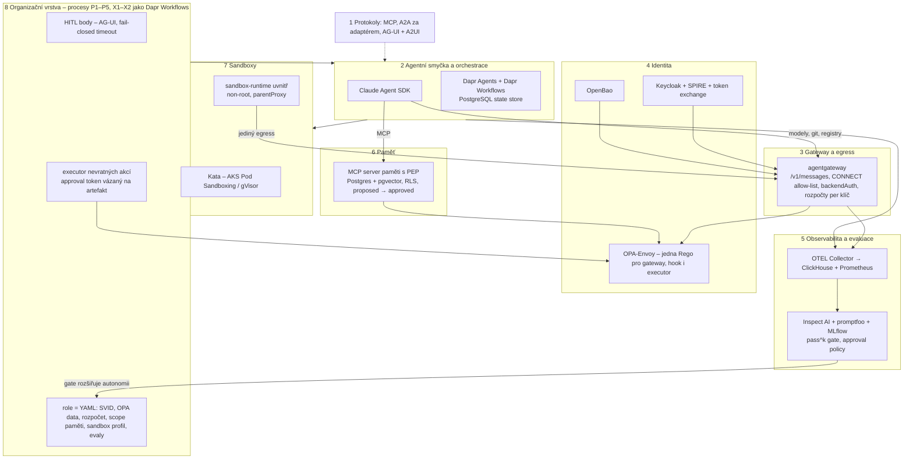

# Cílová architektura

Živý soubor. Každá prověřená vrstva sem vloží **jedno rozhodnutí** se zdůvodněním a riziky,
která Adam vědomě přijímá. Prázdné řádky jsou záměrně prázdné – označují, co ještě není rozhodnuto.
Detail a zdroje jsou vždy ve složce dané vrstvy, tady je jen výsledek.

## Rozhodnutí po vrstvách

| Vrstva | Rozhodnutí | Datum | Přijatá rizika | Detail |
|---|---|---|---|---|
| Agent ↔ nástroje | **MCP** jako jediná hranice k nástrojům a datům | 2026-09-23 | – | [`../protocols/mcp.md`](../protocols/mcp.md) |
| Agent ↔ agent | **A2A**, ale za vlastním adaptérem (vyměnitelné) | 2026-09-23 | A2A v1.1 ve vývoji, SDK verze se liší per framework | [`../protocols/a2a.md`](../protocols/a2a.md) |
| Agent ↔ uživatel | **AG-UI** (vlastní frontend) + **A2UI** jako payload; MCP Apps jen uvnitř cizího hostitele | 2026-09-23 | AG-UI 1.0 čerstvé, ekosystém v migraci; A2UI bez v1.0 rendererů | [`../protocols/overview.md`](../protocols/overview.md) |
| Agentní smyčka | **Claude Agent SDK** | 2026-10-21 | `claude-agent-sdk` pinnutý na 0.2.x v Dapr Agents | [`../frameworks/overview.md`](../frameworks/overview.md) |
| Orchestrace a durable execution | **Dapr Agents** (`ClaudeAgentExecutor` + `DaprSessionStore`) nad Dapr Workflows | 2026-10-21 | Bus factor 1, žádná support policy, A2A/AG-UI nepodporuje – nutný vlastní A2A server; obnovení během nástroje at-least-once → idempotency key | [`../frameworks/dapr-agents.md`](../frameworks/dapr-agents.md) |
| Model gateway a FinOps | **agentgateway** (LF, Apache-2.0, nativní `/v1/messages`, USD rozpočty v OSS); LiteLLM záloha | **2026-10-22 (rozhodnuto, Adam)** – po harnessu G1: mock 21/21, live 2/2 | bus factor 1 (51 % commitů), bez CLA/DCO, rozpočty jen per API klíč (klíč per agent/tým jako pracovní model), persistence rozpočtů mezi replikami neověřena | [`../gateway/overview.md`](../gateway/overview.md) |
| Identita, autorizace, governance | Identita uživatele = OAuth z IdP zákazníka přes **Keycloak**; identita agenta = **SPIRE** SVID jako druhý credential (ne `act` v tokenu); **token exchange v agentgateway** (RFC 8693, scope hlídá config gateway, enforcer ne); PDP = **OPA-Envoy** za `extAuthz` + stejná Rego z hooku Agent SDK, decision log; tajemství **OpenBao** | **2026-10-23 (rozhodnuto, Adam)** – po sítu, kole 2 a harnessu I2 | Keycloak upscope je default (gateway = plně důvěryhodný PEP); `act` delegace v Keycloaku preview → agent v tokenu uživatele není; SPIRE neměřen; A2A delegace není standard → vlastní extension | [`../identity/overview.md`](../identity/overview.md) |
| Observabilita a evaluace | **OTEL Collector** (`gen_ai_normalizer`, `redaction`, routing per tenant) → **ClickHouse** (traces, logy, TTL per tenant) + **Prometheus** (metriky); Grafana jen vyměnitelné UI; **Langfuse** jako druhý konzument OTLP pro datasety a anotace; evaluace **Inspect AI** (role, sandbox, approval policy) + **promptfoo** (CI gate, trajektorie nad spany) + **MLflow** (L4/L5 drift, kalibrace judge); vrstvy L0–L5, metriky pro čl. 15 | **2026-10-23 (rozhodnuto, Adam)** – po sítu a harnessech O1 9/9, O2 6/6 | GenAI semconv vše Development; trace CLI → gateway jen s `CLAUDE_CODE_PROPAGATE_TRACEPARENT=1`; Dapr aktivity bez kontextu (Dapr Agents obchází, neměřeno); Foundry bez serverových spanů; Langfuse retence/audit/masking za EE klíčem, EE telemetrie nevypnutelná, ClickHouse Inc. vlastní Langfuse; AGPL u Grafana stacku → právník; L2/L5 judge neměřen | [`../observability/overview.md`](../observability/overview.md) |
| Paměť a znalosti | **Vlastní tenký MCP server paměti s PEP** (tenant a role z tokenu, OPA, embeddingy přes agentgateway) nad **PostgreSQL + pgvector** (RLS per tenant, Dapr PostgreSQL v2 state store), graf jako hrany v Postgresu (**Apache AGE** až při hlubších traverzech); záznam = **fakt s původem** (bi-temporalita, `sources[]` povinné, `verification`, `status proposed → approved` přes Dapr HITL); epizodická = destiláty z ClickHouse; procedurální v gitu; **žádný memory framework** (mem0, Letta, Zep, Cognee, LangMem); Claude memory tool jen pro pracovní poznámky per běh | **2026-10-23 (rozhodnuto, Adam)** – po sítu, modelu paměti a harnessu M1 (11/11: RLS + OPA + karanténa vynutí model mimo prompt, M-E3/M-E4 gate 100 %) | pgvector bus factor 1; výkon nad velkými objemy neměřen (Qdrant záloha); destilační agent a schvalovací tok se píší; OTEL memory spany Development; lidské schválení faktů je úzké hrdlo (dávkově); MemLeak: izolace jen v DB/PEP, ne v promptu | [`../memory/overview.md`](../memory/overview.md) |
| Sandboxy a pracovní prostředí | S1 = **Kata Containers** (AKS Pod Sandboxing `kata-vm-isolation`, jinde `kata-deploy`) s **gVisor `systrap`** jako přenositelnou zálohou; uvnitř podu **Anthropic `sandbox-runtime`** (bwrap + seccomp, síť jen přes proxy, decider → OPA); egress jen přes **agentgateway jako CONNECT forward proxy** (SNI allow-list, terminace TLS pro modely a git s `backendAuth`) za Cilium/NetworkPolicy default-deny; SVID per pod, žádný credential v podu; prostředí = **devcontainer.json + `devcontainer build` v CI**, prohlížeč **Playwright + Playwright MCP**, krátké výpočty **wasmtime/Pyodide**; orchestrace Dapr aktivita → Pod/Job s RuntimeClass (agent-sandbox CRD sledovat); evaly **`inspect_k8s_sandbox`** s vlastním chartem | **2026-10-23 (rozhodnuto, Adam)** – po sítu (31 kandidátů), kole 2 a harnessu S1 (11/11 lokálně; microVM část se měří na AKS skriptem `tools/harness_sandbox_s1/aks/`) | nested virt = gen2 SKU, bez GPU; Kata na AKS = MS fork 4.1.0, guest bez Landlock, seccomp profil podu se neaplikuje, `hostUsers` ne; srt beta (breaking změny každé 2–3 týdny), sdílený kernel, non-root + vlastní seccomp profil nutné, nekryje MCP/hooky; **vestavěné nástroje Claude Code běží mimo `sandboxed_bash` (O-2 live) → role jen s MCP nástroji (`tools=[]`, `strict_mcp_config`) a celý proces v podu + `srt claude`**; agentgateway 1.6.0 bez loopback ochrany dynamic backendu → CNP na gateway; git token žije v gateway podu; start Kata VM a hustota neměřeny | [`../sandbox/overview.md`](../sandbox/overview.md) |
| Organizační vrstva | Firma = **procesy P1–P5 + X1–X2** jako Dapr Workflows, HITL = `when_any(wait_for_external_event, create_timer)` s fail-closed timeoutem; **role = YAML svazek** (SVID + Keycloak role, OPA data, gateway klíč per role × zakázka, scope paměti, sandbox profil, evaly s gate, eskalace, disclosure); **nevratné akce N1–N10 vykonává deterministická Dapr aktivita (executor) s approval tokenem** vázaným na hash artefaktu, akci, zakázku a člověka – žádná agentní role nemá scope merge/deploy; stop = pause + zmrazený rozpočet, resume jen člověk s důvodem; autonomie se rozšiřuje měřením (pass^3, HITL odmítnutí), nikdy pro vstup/výstup zakázky, platbu, výmaz, oprávnění; registr agentů (T12) a risk register (T11) = tabulky `org.*` v platformním Postgresu | **2026-10-23 (rozhodnuto, Adam)** – po kole 1 návrhu a harnessu O-1 (9/9: injekce nevede k merge, timeout neschvaluje, restart přežije) | role zatím mock (Agent SDK v sandboxu neměřeno end-to-end); AG-UI a OpenBao transit nahrazeny HTTP a HMAC; schválení během stopu se uplatní po resume (vlastnost Dapr pause); SLA a rozpočty v0 odhad, přehodnotit po 3 zakázkách; AI Act fakta z `regulace.md` (preview) | [`../organization/overview.md`](../organization/overview.md) |

## Celek po rozhodnutí všech vrstev (2026-10-23)

Všech osm vrstev je rozhodnuto. Pracovní hypotéza organizační vrstvy je nahrazena návrhem v1 v
[`../organization/overview.md`](../organization/overview.md); pět požadavků, které se opakovaly napříč vrstvami,
zůstává platných jako zásady A1–A6 v [`../organization/kriteria.md`](../organization/kriteria.md).

### Co následuje – produkt (návrh fází, Pozn. Adam; stav v [produkt.md](produkt.md))

| Fáze | Cíl | Co se skládá z rozhodnutých vrstev | Harness, který to změří |
|---|---|---|---|
| **P0 Dogfooding zakázka** (uzavřeno 2026-10-24, výhrada: ostrý zápis GitHub) | první reálná zakázka v tomto repu: mock role z O-1 nahradí **Claude Agent SDK v sandboxu S1 za agentgateway**, paměť M1, identita I2 | Dapr Workflow z O-1 + Agent SDK + srt/gateway z S1 + MCP paměti z M1 + OPA + Keycloak JWKS + OpenBao transit + budgets gateway | **O-2 mock 6/6 (2026-10-23)**, live 5/0/3, scénáře sre/github/github-hitl/identity/budget vše PASS (2026-10-24); shrnutí v [produkt.md](produkt.md) |
| **P1 Platforma na AKS** (plán: [p1-aks.md](p1-aks.md)) | jeden cluster: agentgateway, Keycloak, SPIRE, OPA, OpenBao, Collector, ClickHouse, Postgres (state + paměť + `org.*`), Kata node pool | Helm/manifesty z harnessů (`aks/`, configs); kroky P1-2…P1-5 nejdřív na `kind` | tytéž harnessy proti clusteru (S1 aks/, M1, O1, I2, G1, O-1, O-2 všechny scénáře) + P1-G persistence rozpočtů mezi replikami |
| **P2 Role naostro** | YAML rolí → OPA bundle, gateway klíče, obrazy rolí (devcontainer build), evaly rolí s gate | `roles/*.yaml` → generátor konfigurací | evaly L0–L3 per role, registr agentů plněný z workflow |
| **P3 První externí zákazník** | tenant model, klasifikační brána naostro, čl. 50 disclosure v reálných kanálech, SLA | vše výše + AG-UI frontend | O-3 multi-tenant: M-E3 přes dva tenanty, stop per tenant |

## Changelog
- 2026-10-24: P0 uzavřeno (výhrada: ostrý zápis GitHub); identita (Keycloak JWKS, OpenBao transit) a FinOps (budgets gateway) změřeny v O-2; plán P1 v p1-aks.md.
- 2026-10-24: P0 – O-2 live na Macu: model injekci odmítl sám; riziko sandboxů doplněno o vestavěné nástroje CLI.
- 2026-10-23: P0 – harness O-2 (mock) 6/6: všechny vrstvy v jednom běhu; sledovací soubor produkt.md.
- 2026-10-23: organization – **rozhodnuto (Adam)**; všech osm vrstev rozhodnuto; doplněn celkový diagram a fáze produktu P0–P3.
- 2026-10-23: organization – návrh v1 po kole 1 a harnessu O-1 (9/9); čeká na rozhodnutí.
- 2026-10-23: sandbox – **rozhodnuto (Adam)** podle návrhu; otevřena organizační vrstva.
- 2026-10-23: sandbox – kolo 2 + harness S1 (11/11) potvrdily návrh; čeká na rozhodnutí.
- 2026-10-23: sandbox – návrh po sítu: Kata/gVisor + srt + agentgateway egress + devcontainer + Playwright MCP + wasmtime.
- 2026-10-23: memory – **rozhodnuto (Adam)** podle návrhu; otevřena vrstva sandboxy.
- 2026-10-23: memory – harness M1 (11/11) potvrdil návrh: jedna tabulka + RLS + OPA, žádný framework.
- 2026-10-23: memory – návrh: vlastní MCP server nad Postgres + pgvector, fakt s původem, žádný framework.
- 2026-10-23: observability – **rozhodnuto (Adam)** podle návrhu; otevřena vrstva paměť.
- 2026-10-23: observability – harnessy O1 (9/9) a O2 (6/6) potvrdily Collector + ClickHouse a Inspect AI.
- 2026-10-23: observability – návrh Collector + ClickHouse + Prometheus, Langfuse druhý konzument, Inspect AI + promptfoo + MLflow.
- 2026-10-23: identity – **rozhodnuto (Adam)** podle návrhu z kola 2 a harnessu I2.
- 2026-10-22: identity – po harnessu I2 upřesněno: exchange v gateway změřen, `act` nevzniká → SVID jako druhý credential, OPA-Envoy fail-closed.
- 2026-10-22: identity – návrh SPIRE + Keycloak + OPA + OpenBao, exchange v gateway; do hypotézy přidány požadavky čl. 50 a klasifikační brána.
- 2026-10-22: gateway – **rozhodnuto (Adam): agentgateway**, LiteLLM záloha; po harnessu G1 mock 21/21 a live 2/2.
- 2026-10-22: první verze – přeneseno pět rozhodnutí z `protocols/` a `frameworks/`, prázdné řádky
  pro zbylé vrstvy, pracovní hypotéza organizační vrstvy.
