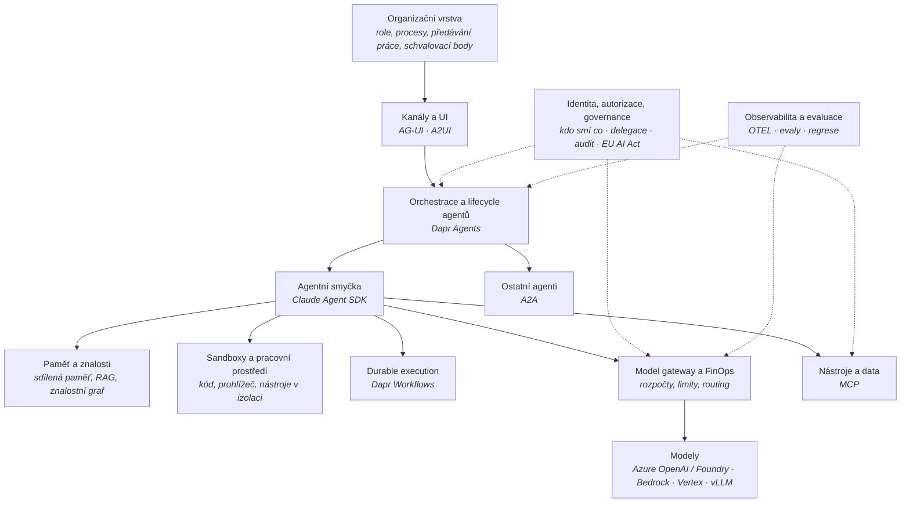

# Mapa vrstev platformy

Cíl: **multiagentní platforma, která funguje autonomně jako celá IT firma** – od zadání přes
návrh, implementaci, provoz až po governance, s člověkem jen u schvalovacích bodů.
Dodávaná jako produkt do prostředí zákazníka (Azure výchozí, ale i AWS, GCP, on-premises),
výhradně z přenositelných open-source komponent.

Tenhle soubor je **rozcestník**: říká, které vrstvy platforma má, v jakém stavu je znalost
o každé z nich a v jakém pořadí se otevírají. Rozhodnutí, která z prověrek plynou, se sbírají
v [cilova-architektura.md](cilova-architektura.md).

## Vrstvy

Průřezové vrstvy (identita, observabilita) jsou čárkovaně – nemají jedno místo, protínají všechny ostatní.

## Stav znalosti po vrstvách

| # | Vrstva | Složka | Skill / agent | Stav (2026-10-22) |
|---|---|---|---|---|
| 1 | Protokoly (MCP, A2A, AG-UI, A2UI) | `protocols/` | `protocol-research` / `protocol-scout` | ✅ hotovo, ověřeno 2026-10-20 |
| 2 | Frameworky, orchestrace, durable execution | `frameworks/` | `framework-research` / `framework-scout` | ✅ rozhodnuto 2026-10-21 (Claude Agent SDK + Dapr Agents), otevřené položky v `frameworks/overview.md` |
| 3 | **Model gateway a FinOps** | `gateway/` | `gateway-research` / `gateway-scout` | ✅ rozhodnuto 2026-10-22 (agentgateway) po sítu, kole 2 a harnessu G1 mock + live |
| 4 | Identita, autorizace, governance | `identity/` | `identity-research` / `identity-scout` | 🟡 otevřeno 2026-10-22, síto kolo 1 běží |
| 5 | Observabilita a evaluace | `observability/` | – | ⬜ čeká |
| 6 | Paměť a znalosti | `memory/` | – | ⬜ čeká |
| 7 | Sandboxy a pracovní prostředí | `sandbox/` | – | ⬜ čeká |
| 8 | Organizační vrstva | `organization/` | – | ⬜ čeká – **návrhová**, ne rešeršní (viz níže) |

## Pořadí a proč

Pořadí není abecední. Řídí se tím, co blokuje co, a co je nejdražší předělat později.

| Pořadí | Vrstva | Důvod |
|---|---|---|
| 3 | Gateway a FinOps | Nejmenší vrstva, Dapr Agents už na LiteLLM závisí – rozhodnutí je zčásti vynucené a potřebuje ověřit. Bez ní nelze měřit cenu ničeho dalšího. |
| 4 | Identita a governance | Nejdražší na dodatečné vložení. Určuje, jak agenti dostávají oprávnění, jak se deleguje a co se audituje – ostatní vrstvy to musí respektovat, ne obráceně. |
| 5 | Observabilita a evaluace | Bez evalů nelze říct, jestli autonomní firma dělá práci dobře. Musí být dřív než paměť, protože paměť se bez evalů nedá ladit. |
| 6 | Paměť a znalosti | Největší neznámá. Závisí na identitě (kdo smí číst co) a na state storech, které Dapr podporuje. |
| 7 | Sandboxy | Závisí na identitě (co smí sandbox) a observabilitě (co se z něj loguje). |
| 8 | Organizace | Skládá všechny předchozí. Hypotéza rolí se ale píše **hned** do `cilova-architektura.md`, aby technické vrstvy měly konkrétní požadavky. |

## Společný postup pro každou vrstvu

Stejný princip jako u protokolů a frameworků, v tomhle pořadí:

1. **Kritéria** – `knowledge/<vrstva>/kriteria.md`. Vyřazovací A1–A5 jsou společná
   (zdroj: [`../frameworks/kriteria.md`](../frameworks/kriteria.md)), bodovaná jsou per vrstva.
2. **Skill** – `.claude/skills/<vrstva>-research/SKILL.md`: jak zkoumat, čemu nevěřit, kde jsou pasti.
   Licenční postup se nekopíruje, odkazuje se na `framework-research` sekci 2 a `licencni-vzorce.md`.
3. **Agent** – `.claude/agents/<vrstva>-scout.md`: role, pravidla, formát výstupu.
4. **Síto kolo 1** – široký seznam kandidátů, vyřazovací kritéria, tabulka v `overview.md`.
5. **Hloubkové kolo** – top 2–3 kandidáti, vlastní soubor pro každého.
6. **Rozhodnutí** – řádek v [cilova-architektura.md](cilova-architektura.md) se zdůvodněním a přijatými riziky.
7. **Harness** – kde jde rozhodnutí změřit, změří se (`tools/`), ne věří.

Skill se píše **před** rešerší, ale po první rešerši se **přepíše** o to, co se ukázalo jako past.
Skilly pro protokoly a frameworky tak vznikly taky.

**Výjimka – organizační vrstva.** Není co prověřovat na licenci. Je to návrh: role, procesy,
odpovědnosti, předávání práce a schvalovací body virtuální firmy. Skill pro ni bude návrhová
metoda (jak role odvodit z procesů, jak nastavit hranice autonomie), ne licenční prověrka.

## Co se nemá dělat

- **Nečekat s produktem na poslední vrstvu.** Kostra platformy v `cilova-architektura.md` existuje
  od začátku a každá vrstva do ní vloží jedno rozhodnutí. Jinak vznikne hromada znalostí bez
  rozhodovacího rámce a vrstvy, které na sobě závisí, se budou prověřovat bez požadavků.
- **Nekopírovat metodiku do každého skillu.** Společné části se odkazují. Šest kopií se rozejde.
- **Neotevírat víc než jednu až dvě vrstvy najednou.** Rešerše stárne; co se otevře a nedotáhne,
  bude za dva měsíce k přeověření.

## Changelog
- 2026-10-22: otevřena vrstva identity (kritéria, skill, agent, kostra přehledu).
- 2026-10-22: první verze – osm vrstev, pořadí, společný postup, otevřena vrstva gateway.
