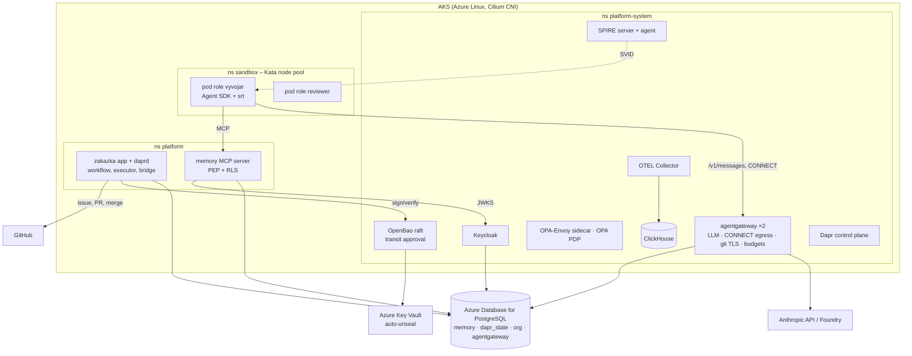

# P1 – platforma na AKS

**Závěr (návrh):** P1 = stejná skladba, kterou P0 změřilo lokálně v jednom procesu per komponenta, přenesená do jednoho
AKS clusteru beze změny chování. Měřítkem úspěchu je **tentýž harness O-2 (všechny scénáře) spuštěný proti clusteru**, ne
nová funkce. Pořadí: nejdřív hranice (Kata, síť, identita), pak datové komponenty, pak workflow a role. Šest kroků,
každý s vlastním měřením; odhad náročnosti 3–4 týdny práce při jednom člověku s agentní podporou (*spekulace*).

## Co P0 předává do P1

| Z P0 (lokálně, bez Dockeru) | V P1 (cluster) | Co se mění |
|---|---|---|
| agentgateway 1.6.0 jeden proces: LLM listener, CONNECT egress, TLS terminace git, apiKey budgets (sqlite) | Deployment `agentgateway` (2 repliky), Service, `config.database` = Postgres | persistence rozpočtů mezi replikami (neověřeno – harness P1-G) |
| Keycloak 26.8.1 `start-dev --import-realm` (H2) | Keycloak operator / Helm, Postgres, realm `p0` z `configs/realm-p0.json` jako import | produkční režim, TLS, hostname |
| OpenBao 2.7.1 `-dev` (in-memory) + transit + audit file | OpenBao Helm (raft), auto-unseal Azure Key Vault, transit `approval`, audit do stdout → Collector | unseal, auth metoda Kubernetes místo tokenu v env |
| OPA REST (`org.rego`, `memory.rego`, `authz` z rolegen) | OPA-Envoy sidecar u gateway + OPA Deployment pro PDP app; bundle z rolegen přes OCI | bundle server místo adresáře na disku |
| Postgres přes `pgserver` (paměť M1, RLS) + Dapr `state.sqlite` | Azure Database for PostgreSQL Flexible Server (nebo CloudNativePG v clusteru): schémata `memory`, `dapr_state`, `org`, `agentgateway` | jedna instance, čtyři schémata; RLS a role `memory_app` beze změny |
| Dapr placement + scheduler + daprd lokálně | Dapr Helm 1.18 (control plane), sidecar injection, `state.postgresql` actorStateStore | durabilita stavu workflow |
| OTEL Collector contrib + ClickHouse lokálně (O1) | Collector jako DaemonSet/Deployment, ClickHouse operator (Altinity) nebo single StatefulSet | retence, disk |
| sandbox-runtime v kontejneru harnessu (bubblewrap) | pod s `runtimeClassName: kata-vm-isolation`, srt uvnitř non-root, CNP default-deny → jen gateway | S1 aks/ (změřit), hustota a start |
| SPIRE jen jako řetězec `spiffe://platform/role/<role>` | SPIRE server + agent (Helm), `k8s` workload attestor, SVID per pod role | agent jako druhý credential (I2) |
| GitHub bridge poll + webhook proti mock GitHubu | bridge Deployment, webhook přes Ingress s HMAC, GitHub App místo PAT | ostrý zápis – vyžaduje souhlas |
| rolegen ručně → soubory na disku | CI job (GitHub Actions) → OPA bundle (OCI), gateway klíče jako CRD/ConfigMap, srt settings v obrazech rolí | zavedení klíče per zakázka při jejím založení |

## Cílový tvar clusteru



## Kroky a měření

| # | Krok | Co vzniká | Harness, který to změří | Hotovo, když |
|---|---|---|---|---|
| P1-1 | Cluster + Kata node pool + Cilium CNP default-deny | Terraform `infra/terraform` (AKS Azure Linux + Cilium, node pool `kata` `workload_runtime = "KataVmIsolation"` `Standard_D2ads_v7`), GitHub Actions OIDC, Flux | **S1 aks/** (`run-s1-aks.sh`): S1h-1…6 | Kata pod běží s vlastním kernelem, srt uvnitř bez `enableWeakerNestedSandbox`, egress jen přes gateway |
| P1-2 | Datová vrstva: Postgres (4 schémata), ClickHouse, Collector | Helm values + migrace schémat z M1 (`SCHEMA`), O1 (`otelcol.yaml`) | **M1** proti clusterovému Postgresu (`MEMORY_DB_URI`), **O1** end-to-end (Agent SDK → Collector → ClickHouse) | M1 11/11, O1 9/9 na clusterových službách |
| P1-3 | Identita: Keycloak (realm `p0`), SPIRE, OpenBao (raft + KV auto-unseal) | Helm values, realm import, transit klíč, policy `approval-signer`, auth `kubernetes` | **I2** proti clusteru; **O-2 identity** s `KC_HOME`/`BAO` nahrazenými URL | 5/5 identity, SVID per pod role vidět v tokenu (I2e varianta) |
| P1-4 | agentgateway ×2 s Postgres `config.database`, apiKey budgets, egress CONNECT, git TLS | config z `tools/harness_p0_o2/configs/agentgateway.yaml` → ConfigMap, certy z cert-manager | **G1** proti clusteru; **O-2 budget**; nový check **P1-G**: tentýž klíč přes dvě repliky → jeden `budget_usage` | G1 21/21, budget 5/5, P1-G PASS |
| P1-5 | Dapr + aplikace zakázky + paměťový server + bridge | Helm chart `platform` (app, memory, bridge), Dapr `state.postgresql`, workflow `zakazka` | **O-1**, **O-2 p0/sre/github-hitl** proti clusteru | O-2 všechny scénáře PASS v clusteru |
| P1-6 | Role jako Kata pody z rolegen (`k8s/<role>.yaml`), CI job rolegen → bundle/klíče | GitHub Actions: `roles/*.yaml` → OPA bundle OCI, ConfigMap klíčů, obrazy rolí | **R1** v CI; **O-2 live** s rolí jako podem místo `agent_run` ve stejném procesu | zakázka P0-1 (injekce) projde clusterem se stejným výsledkem jako lokálně |

Poznámky k pořadí: P1-1 je jediný krok, který nejde udělat bez Azure (nested virt); vše ostatní lze předem připravit v
`kind`/`k3d` bez Katy (runc) a na AKS jen přepnout RuntimeClass. Proto návrh: **P1-2 až P1-5 nejdřív na kind lokálně**
(harnessy už umí běžet proti URL), P1-1 a P1-6 na AKS.

## Co z P0 zůstává zjednodušené i v P1 (vědomě)

| Zjednodušení | Proč zůstává | Kdy se řeší |
|---|---|---|
| Role běží jako `agent_run` v procesu aplikace (Agent SDK v Dapr aktivitě) | až P1-6 je pod per role; do té doby stejný kód | P1-6 |
| Klíče gateway per zakázka předgenerované, hodnoty vydává harness | OpenBao vydá klíč a rolegen ho zapíše do ConfigMap/CRD při založení zakázky – vyžaduje P1-3 + P1-4 | P1-6 / P2 |
| 30d strop zakázky per klíč, ne součet klíčů zakázky | agentgateway budgets jsou per klíč; součet = sdílený klíč zakázky pro 30d okno (role × zakázka klíče pro 24h) nebo ledger nad logem | P2 (FinOps ledger v ClickHouse) |
| `on_behalf_of` v tokenu role chybí (client_credentials) | delegace = token exchange v gateway (I2) až s AG-UI a lidským tokenem | P3 |
| GitHub zápis suchý běh | čeká na souhlas a PAT/GitHub App | kdykoli po souhlasu |
| Evaly L3 s adversarial mock agentem (živý model injekci odmítá) | mock agent v O-2 to pokrývá; v clusteru totéž | P2 |

## Cena provozu P1 (*spekulace*, West Europe PAYG, 2026-10-24; ceny ze `sandbox/azure-kata-gvisor.md`, Retail Prices API nedostupné)

| Položka | SKU | ≈ USD / měsíc (730 h) |
|---|---|---|
| System node pool | 2× D2s_v5 (0,115 $/h) | 168 |
| Kata node pool (role) | 1× D4ads_v7 (0,276 $/h), scale-to-zero mimo pracovní dobu neuvažováno | 201 |
| PostgreSQL Flexible Server | B2ms / D2ds_v4 burstable–general | 60–150 |
| Disky (ClickHouse, OpenBao raft) | 2× P10 | 40 |
| Key Vault, LB, egress | – | 20–40 |
| **Celkem infrastruktura** | | **≈ 490–600** |
| Modely | Haiku 4.5 přes gateway: P0 zakázka 0,045–0,058 $ → 100 zakázek/měsíc | < 10; Sonnet ~5× |

Úspora: dev cluster vypínat (`az aks stop`) → ~60 % méně; Kata pool škálovat na 0 mimo běh zakázek.

## Rizika P1

| Riziko | Dopad | Mitigace |
|---|---|---|
| Persistence rozpočtů agentgateway mezi replikami (čítače v paměti + flush 5 s) | překročení limitu o součet replik × 5 s útraty | **P1-G změřeno 2026-10-24:** persistence aditivní a správná; přestřel u 2 replik 3,7 requestu (0,011 USD) vs. 0,7 u jedné → přijato jako měkký strop + audit; tvrdý strop = jedna replika listeneru s budgets (PDB) nebo `localRateLimit` per klíč |
| Kata na AKS: `emptyDir` přes virtio-fs na hostu, `hostUsers: false` nepodporováno | pracovní data agenta na hostu; srt spoléhá na user namespaces v guestu | S1h-3 měří bwrap v guestu; cleanup emptyDir jako součást tombstone sandboxu |
| Keycloak/OpenBao provozní režim (TLS, unseal, zálohy) | výpadek identity zastaví všechny zakázky (fail-closed = správně, ale drahé) | Key Vault auto-unseal, Postgres HA pro Keycloak, runbook v `knowledge/organization/procesy.md` X2 |
| agentgateway 1.7 mění chybová těla (PR #2162) | kontrakt Claude Code | zůstat na 1.6.0, přeměřit G1 na 1.7 před upgrade |
| Nested virt SKU dostupnost v regionu/subscription | P1-1 neproveditelný | ověřit `az vm list-skus` před vytvořením; záloha gVisor `systrap` DaemonSet |

## Rozhodnutí k AKS (2026-10-24, Adam)

| Otázka | Rozhodnutí | Důsledek |
|---|---|---|
| Subscription, region, kdo platí | Adamova subscription (soukromá karta, přihlášen na svém Macu); region vybrat v EU podle ceny a dostupnosti nested-virt SKU + Pod Sandboxing | **Poland Central** (od 2026-10-25, záloha Italy North). Měřeno 2026-10-24/25 (`az vm list-skus`, `apply`): Sweden Central – kapacita (PG B1ms `RegionalAllocationFailed`, AKS D4as_v5 `Creating` 90 min); West Europe – `locationineligible` (region nepřijímá nové subscription); Germany West Central, France Central – `NotAvailableForSubscription`; North Europe – SKU nevypsány; Italy North a Poland Central – bez restrikcí. Region řídí repo variable `AZURE_LOCATION` (`TF_VAR_location`), PG může mít vlastní `pg_location` |
| Jak se Azure ovládá | **DevOps (Adam 2026-10-24):** IaC v Terraformu, GitHub Actions, GitHub ↔ Azure přes OIDC, dál nahoru operátory (GitOps) – ne imperativní skripty z Macu | `infra/terraform` + `.github/workflows` + Flux (AKS GitOps extension); Mac jen 1× `infra/bootstrap/azure-oidc.sh` (RG, tfstate, identita s federací na `repo:akczcz/adam`, Contributor + UAA jen na RG). Claude workflow spouští a čte přes GitHub API, cloudové prostředí Azure nepotřebuje. Tajemství: žádný client secret; heslo PG v tf state a Flux substitute (dev), P2 External Secrets |
| Postgres | **Azure Database for PostgreSQL Flexible Server** | schéma M1, RLS a role `memory_app` beze změny; nejmenší SKU `Standard_B1ms` (~15 USD/měs., *sek.*), heslo z OpenBao |
| GitHub ostrý zápis | PAT vydá Adam | fine-grained PAT jen na `akczcz/adam`; běh na Macu s tokenem v env jednoho příkazu (viz níže), ne v chatu ani v cloudovém prostředí. **Provedeno 2026-10-24: issue #3, PR #4, merge `2c47bfe`.** |
| Pořadí | kind nejdřív (P1-4, P1-5 v cloudovém kontejneru); Mac k dispozici | AKS až P1-1 a P1-6 |
| Kata SKU | co nejmenší | Kata pool `Standard_D2ads_v7` autoscale 0–1 (nested virt, 8 GiB), system pool 1× `Standard_D4as_v5` (platformní komponenty ~6 GiB RAM); cluster vypínat (`az aks stop`) mimo práci |
| PR do `main` | podle mého uvážení | PR po P1-3 (15 commitů), další práce v nové větvi |

Cena P1 po rozhodnutí (*spekulace*, PAYG): system D4as_v5 ≈ 0,19 USD/h + Kata D2ads_v7 ≈ 0,14 USD/h (jen při běhu zakázek) + Flexible Server B1ms ≈ 15 USD/měs.
+ disky/LB/KV ≈ 30 USD/měs. → **≈ 250 USD/měs. nepřetržitě, ≈ 100 USD/měs. při 8 h denně ve všední dny**. Dřívější odhad 490–600 USD platil pro 2× D2s_v5 + D4ads_v7 + větší Postgres.

### PAT pro `--scenario github --publish-github` (instrukce)

1. GitHub → Settings → Developer settings → Personal access tokens → **Fine-grained tokens** → Generate new token.
2. Resource owner `akczcz`, Repository access **Only select repositories → `akczcz/adam`**, expirace **7 dní**.
3. Repository permissions: **Contents: Read and write**, **Issues: Read and write**, **Pull requests: Read and write** (Metadata: Read se přidá samo). Nic dalšího.
4. Spustit na Macu (Remote Control session nebo terminál), token jen v prostředí jednoho příkazu, nikdy do chatu ani do souboru:
   ```bash
   cd tools/harness_p0_o2 && GITHUB_TOKEN=github_pat_… P0_GITHUB_REPO=akczcz/adam .venv/bin/python harness.py --scenario github --publish-github
   ```
   Výsledek: issue `[P0-4] …`, větev `zakazka/P0-4/ukol-1`, PR a merge PR přes executor po H4 (schválení dělá harness). Po běhu token revokovat.

## Postup

| Krok | Stav |
|---|---|
| P1-2 | ✅ kind 2026-10-24 – `tools/harness_p1_k8s` 6/6: M1 11/11 a O1 9/9 proti clusterovým službám beze změny checků; manifesty `infra/k8s/base/{postgres,clickhouse,otel-collector}` + overlay `kind` |
| P1-3 | ✅ kind 2026-10-24 – `tools/harness_p1_k8s` P1-3 5/5: Keycloak (realm p0, DB keycloak), OpenBao raft (init/unseal operátorem, audit stdout), SPIRE 1.14.2 (k8s_psat, SVID z pod-labelu); O-2 `identity` 5/5 proti clusteru. Obrazy pro kind z GitHub release artefaktů (`infra/images`), na AKS oficiální |
| P1-4 | ✅ kind 2026-10-24 – `tools/harness_p1_k8s` P1-4 6/6: agentgateway ×2, Postgres `budget_usage`, G1 21/21 proti clusteru; P1-G: aditivní persistence OK, vynucení mezi replikami eventually consistent (flush 5 s) → pro ostrý strop jedna replika listeneru s budgets nebo `localRateLimit` jako tvrdá brzda |
| P1-5 | ✅ kind 2026-10-24 – `tools/harness_p1_k8s` P1-5 6/6: OPA, Dapr (placement, scheduler, daprd sidecar, Postgres state), aplikace zakázky, paměť, mock GitHub, bridge; zakázka end-to-end v clusteru, durabilita (smazaný pod → workflow obnoveno), FinOps z Postgresu. Obraz `platform/zakazka-app` (Python + Node + CLI) |
| P1-1 | 🟡 **infrastruktura stojí (2026-10-25, Poland Central)**: 7. `apply` z GitHub Actions přes OIDC – ACR `acrplatformdevakcz`, AKS `aks-platform-dev` (Azure Linux, Cilium overlay, workload identity, system 1× D4as_v5), node pool `kata` (D2ads_v7 `KataVmIsolation`, autoscale 0–1, 0 uzlů), Flexible Server `pg-platform-dev-akcz-polandcentral` (B1ms PG16, 5 DB, VECTOR), Flux extension + konfigurace `platform` na `main:infra/k8s/overlays/aks`. Zbývá: merge PR #5 (Flux čeká na overlay v `main`), workflow `images` (ACR), `measure` (S1 na Katě – kapacita Dadsv7 v regionu nejistá, 2026-10-25 `AllocationFailed`) |
| P1-6 | ⬜ AKS (po P1-1): role jako Kata pody z rolegen, srt uvnitř, egress CONNECT gateway, SPIRE entries z rolegen |

## Changelog
- 2026-10-25: Kata pool přepnut z D2ads_v7 (Poland Central jen zóna 1, AllocationFailed/provisioning-state-failed) na Standard_D4s_v5 (DSv5 kvóta 8 vCPU). Platforma z Fluxu běží; overlay `aks` upraven pro oficiální obrazy (dapr cesty, Keycloak KC_DB, SPIRE uid 1000).
- 2026-10-25: P1-1 infrastruktura vytvořena v Poland Central po 7 bězích `apply` (kapacita Sweden Central, locationineligible West Europe, kvóty vCPU 0 → navýšeny, jedna operace na AKS cluster naráz, rezervované jméno PG, `zone` drift, orphan node pool → import). Všechny pasti zapsány v `infra/bootstrap/README.md`.
- 2026-10-25: druhý `apply` (West Europe) → `RequestDisallowedByAzure: region not accepting new customers`; SKU průzkum 5 regionů → Poland Central.
- 2026-10-25: první `apply` ve Sweden Central selhal na kapacitě (PG B1ms RegionalAllocationFailed, AKS Creating > 90 min); přesun do West Europe, PG bez pinované zóny, AKS create timeout 40 min. Řetězec Actions → OIDC → tfstate → `plan` ověřen (16 zdrojů).
- 2026-10-24: P1-1 přepsáno z imperativních skriptů na Terraform + GitHub Actions (OIDC) + Flux na Adamův podnět; bootstrap jediný ruční krok. Validováno offline (`terraform validate`), proti Azure neověřeno.
- 2026-10-24: P1-1 připraveno (infra/aks skripty + overlay aks), čeká na běh z Macu; měření S1h na Katě. (nahrazeno IaC, viz výše)
- 2026-10-24: P1-5 hotovo na kind – kind fáze uzavřena (P1-2…P1-5); durabilita Dapr Workflow v clusteru změřena; dál jen AKS (P1-1, P1-6).
- 2026-10-24: P1-4 hotovo na kind; P1-G: rozpočty mezi replikami eventually consistent (flush 5 s), riziko přijato jako měkký strop.
- 2026-10-24: P1-3 hotovo na kind; SPIRE SVID per pod-label změřen (P1-6 dostane entries z rolegen); OpenBao KV auto-unseal a auth kubernetes odloženy na AKS/P1-5.
- 2026-10-24: P1-2 hotovo na kind; zjištění: Collector v clusteru bez file exportéru (metriky i logy do ClickHouse), kind v kontejneru bez CAP_SYS_RESOURCE potřebuje obal runc.
- 2026-10-24: první verze plánu P1 po uzavření P0 (návrh, Pozn. Adam).
