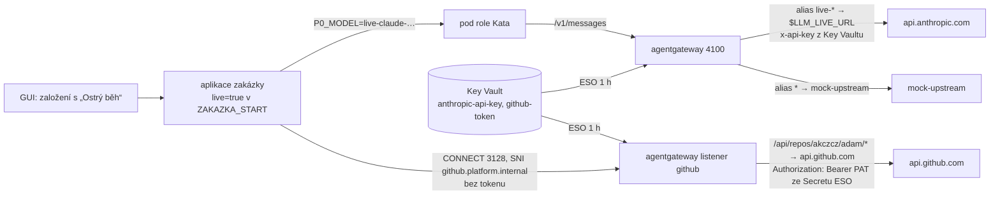

# P4 – provoz

**Závěr:** P3 skončilo uzavřením P3-6 (2026-11-01). P4 nemá pevný checklist – Adam zadává položky po jedné; kandidáti vycházejí
z [p3-zakaznik.md](p3-zakaznik.md) „Co zůstává zjednodušené i v P3“. Postup práce stejný: větev → `measure` s `e2e=p4-n` → PR → merge → cluster `stop`.

## Kroky

| Krok | Co | Stav |
|---|---|---|
| **P4-1** Obnova mandátu z GUI | mandát role = access token člověka (30 min) – role bez HITL před sebou jednala bez mandátu (E2 nález 5); Keycloak `act` nepomůže ani po GA | ✅ 2026-11-01 AKS 79/79 + 14 INFO (`measure` run 41297792885, 4 běhy) |
| **P4-2** Ostrý běh s živým modelem a GitHubem | klíč modelu i PAT jen v Key Vaultu a jen v gateway; zakázka s flagem `live` z GUI; zapojení měřitelné bez tajemství | 🟡 kód 2026-11-01, měření AKS P42_RESULT (`measure` run P42_ID); ostrý běh na vyžádání |
| kandidát | mTLS mesh uvnitř clusteru (zbytek plaintextu mezi službami) | ⬜ |
| kandidát | realm per tenant (vlastní IdP federace zákazníka) | ⬜ |
| kandidát | SLA reporting (smluvní pohled místo timerů) | ⬜ |

## P4-1 Obnova mandátu z GUI

**Rozhodnutí:** mandát („jedná jménem“) zůstává `sub` schvalovatele + `azp` klienta role z Keycloak V2 exchange v podu (P3-6 E2). Co se mění:
aplikace drží **poslední známý mandát** zakázky mimo stav workflow – dá ho založení, každé schválení a **obnova z GUI**; před startem role vybere
ten a vypršelý nepoužije (role běží bez mandátu, ale **viditelně**: ledger `MANDAT missing`, GUI karta „Role bez mandátu“ s tlačítkem). Živý mandát
držitele, který má GUI otevřené, se prodlužuje sám (keepalive každých 30 s, když zbývá < 10 min); **vypršelý mandát obnoví jen člověk kliknutím** –
automatická resuscitace by z přítomnosti v GUI dělala souhlas.

| Varianta | Proč ne / proč ano |
|---|---|
| Keycloak delegace `act` | preview; GA (27.0) nezruší souhlas per session ani 1 actor/login ([identity/keycloak.md](../identity/keycloak.md)) |
| offline / refresh token člověka v aplikaci | aplikace by držela dlouhodobý credential člověka – mandát bez člověka; proti Q6 |
| blokující HITL „obnov mandát“ před každou rolí | zastaví autonomii; degradace s viditelností + obnova z GUI zachová tok, stricter policy může přijít z OPA (high-risk profil → vyžadovat mandát) |
| **poslední známý mandát + obnova/keepalive z GUI** (zvoleno) | token žije jen 30 min, pochází vždy od přihlášeného člověka, GUI = místo, kde člověk je |

Tok: GUI → `POST /agui/threads/<id>/mandat` (token člověka tenanta zakázky; tenant platform 403) → aplikace `subject_set` (soubor 0600 na PVC,
ledger `MANDAT` bez tokenu) → `agent_run` → Secret podu `P0_SUBJECT_TOKEN` → exchange v podu (E2) → paměť `on_behalf_of`, `org.agents.on_behalf_of`.
Měření `tools/harness_p1_k8s --step p4-1` (M1a–c): vypršení se simuluje `POST /_mandat/expire` (plynutí času), ne čekáním 30 min.

Výsledek: **79/79 + 14 INFO** (`measure` run 41297792885, 4 běhy; detail a tabulka běhů v [harness README](../../tools/harness_p1_k8s/README.md#p4-1-m1--obnova-mandátu-z-gui-2026-11-01-aks---step-p4-1--p3-6--m1ac)).
Ověřeno: vypršelý mandát = role bez mandátu **viditelně** (ledger `MANDAT missing`, GUI karta), kliknutí obnoví, keepalive prodlouží jen živý mandát
držitele, další role (architekt) jedná s obnoveným mandátem (`sub` adam v exchange podu, `org.agents.on_behalf_of`).

Nálezy:

- **Stav v modulu aplikace = jedna kopie modulu, jedna replika.** Aplikace běží jako `__main__`, líný `import app` z aktivit rolí vytvořil druhou kopii
  modulu s vlastním slovníkem mandátů a přepsal callbacky AG-UI → obnova z GUI šla jinam, než odkud role čtou (běh 2). Opraveno aliasem
  `sys.modules["app"]`. Důsledek pro návrh: Deployment aplikace má `replicas: 1` (Recreate); škálování aplikace vyžaduje mandát ve sdíleném úložišti
  (Dapr state / Postgres) – kandidát, až bude potřeba víc replik.
- **Registr agentů drží poslední běh role**, ne historii: Account po odpovědi na dialog běží druhé kolo už s obnoveným mandátem → `on_behalf_of` adam.
  Otázka „kdo kdy jednal bez mandátu“ se odpovídá z ledgeru (`MANDAT`, `ROLE_POD`), ne z registru (běh 3).
- Měřicí: Playwright v `measure.yml` jen pro `p3-*` (běh 1), kolize prefixu `data-testid` v GUI (U1b), stará hodnota v GUI prošla kontrolou keepalive
  (M1c), pád port-forwardu aplikace během GUI části (E13b/c, harness ho obnoví) – vše v harness README.

## P4-2 Ostrý běh s živým modelem a GitHubem

**Rozhodnutí:** ostrý běh je **vlastnost zakázky** (flag `live` při založení z GUI, neměnný), ne režim clusteru. Mocky zůstávají pro měření
a ostatní zakázky; živé API modelu i GitHub jsou **jen za gateway** a tajemství (klíč modelu, PAT) vidí **jen gateway** – z Key Vaultu přes ESO,
nikdy aplikace, pod role, Git ani harness. Zapojení se měří bez ostrých tajemství: skutečný upstream odpoví 401 (= cesta, TLS a vložení
tajemství fungují), ostrý běh pak jen vymění hodnoty v Key Vaultu.

| Varianta | Proč ne / proč ano |
|---|---|
| přepnutí celého clusteru (env gateway `LLM_UPSTREAM_URL` → živé API, `P0_GITHUB_API` → api.github.com) | změna v Gitu + Flux na každý ostrý běh; mocky pro měření by zmizely; PAT by musel do aplikace |
| PAT a klíč v aplikaci (Secret z ESO) | aplikace by tajemství mohla zalogovat nebo předat podu; veřejné CA do bundle aplikace; porušuje „tajemství jen v gateway“ (P2-4 git token) |
| ostrý běh z Adamova Macu s env proměnnými (jako 2026-10-24) | tajemství v shellu člověka, mimo platformu; neměřitelné z CI |
| **flag zakázky + alias modelu + routa GitHub v gateway** (zvoleno) | per zakázka, bez redeploye; alias `live-<model>` → `$LLM_LIVE_URL`; listener `github.platform.internal` → `api.github.com` s `backendTLS`, `urlRewrite`, `backendAuth` (PAT ze souboru ESO, watched) a autorizací jen na repozitář platformy (PEP: PAT nejde použít jinde) |

Pody rolí GitHub nepotřebují (PR vzniká z artefaktů přes data API aplikace, git sonda jede dál proti mock gitu), proto `github.platform.internal`
není v `egress_allow` rolí ani v srt. Rozpočty, klíče per role × zakázka a ledger gateway platí pro živý alias stejně jako pro mock –
strop zakázky je i strop ostrého běhu. Měření: `--step p4-2` = p4-1 + **L1a–c** (zapojení bez tajemství, flag viditelně, viditelné selhání
bez klíče), `--step p4-2-live` = **V1a–c** (předletová kontrola 200/200, zakázka z GUI jako člověk, issue/PR/merge ověřené z veřejného
GitHub API, útrata a mandát).

Výsledek měření: **P42_RESULT** (`measure` run P42_ID, P42_RUNS). Nálezy: P42_FINDINGS

### Postup ostrého běhu (jen na vyžádání, platí se)

1. Adam nastaví v Key Vaultu platformy (Terraform `azurerm_key_vault.kv`) ostré hodnoty (portál nebo `az keyvault secret set`, nikdy do Gitu ani do chatu):
   `anthropic-api-key` (klíč workspace s limitem útraty) a `github-token` (fine-grained PAT **jen** na `akczcz/adam`: Contents RW, Issues RW,
   Pull requests RW; platnost 1 den). Terraform je nepřepíše (`ignore_changes`).
2. Synchronizace ESO (do 1 h, nebo vynutit: `kubectl -n platform-data annotate externalsecret agentgateway-secrets agentgateway-github-token
   zakazka-secrets force-sync=$(date +%s) --overwrite`); gateway soubor PAT sleduje (watched), klíč modelu z env Secretu vyžaduje restart podů gateway
   (`rollout restart deploy/agentgateway`).
3. Doporučení pro repozitář: ruleset na `main` „změny jen přes PR“ (merge-executor merguje PR přes API, přímý push PAT nejde) – kontrola na straně GitHubu,
   gateway hlídá jen cesty a metody.
4. `measure` s `e2e=p4-2-live` (cluster běží): V1a předletová kontrola → bez 200/200 se nic nezakládá a neutratí; jinak zakázka `<tag>-live`
   z GUI, HITL H1/H2/H4/H5 schvaluje harness jako adam s důvodem, výsledek = issue, PR a merge v `akczcz/adam` (`zakazky/<id>/NOTES.md`).
5. Po běhu: Adam PAT revokuje a klíč modelu rotuje/omezí; v Key Vaultu vrátí výchozí hodnoty (`mock-github-token`, `sk-ant-harness-mock`),
   aby další měření neplatilo za 1 token předletové kontroly.

## Rizika

| Riziko | Řešení |
|---|---|
| PAT v gateway smí víc než zakázka potřebuje | fine-grained PAT jen na repozitář platformy + autorizace routy gateway (cesta `/repos/akczcz/adam/`, metody GET/POST/PATCH/PUT) + ruleset `main`; revokace po běhu |
| Živý model = útrata; alias `live-*` může použít kdokoli s klíčem role | klíče role × zakázka mají rozpočty (Block 24h/30d), strop zakázky (`zakazka-30d-block`), ledger gateway per request → FinOps; klíč modelu s limitem workspace |
| Předletová kontrola `/_live/model` je placená (1 token) | jen na vyžádání v `p4-2-live` a v L1a (s výchozím klíčem 401, nic se neplatí) |
| Mandát obnoví jiný člověk tenanta než schvalovatel → role jedná jeho jménem | ledger `MANDAT renewed by`, GUI ukazuje držitele; kdo klikne, přebírá odpovědnost (T1) – stejné jako schválení |
| Keepalive = GUI otevřené v zapomenuté záložce drží mandát „navždy“ | jen dokud žije refresh token GUI (Keycloak SSO session); prodlužuje jen živý mandát držitele; zapsat do GUI timeout session (kandidát) |
| Tokeny v souboru aplikace | krátkodobé (30 min), 0600, tytéž tokeny jsou v historii workflow v Postgresu; úklid po 30 dnech |

## Changelog
- 2026-11-01: založeno; P4-1 návrh a kód (obnova mandátu z GUI).
- 2026-11-01: P4-1 hotovo na AKS (79/79 + 14 INFO, 4 běhy) – nálezy: dvojí import `app.py` (stav v modulu ⇒ jedna replika), registr = poslední běh role.
