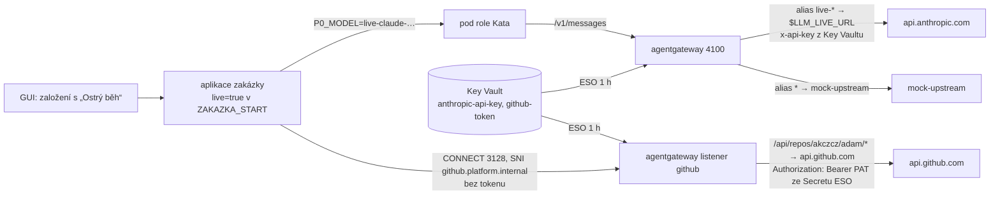

# P4 – provoz

**Závěr:** P3 skončilo uzavřením P3-6 (2026-11-01). P4 nemá pevný checklist – Adam zadává položky po jedné; kandidáti vycházejí
z [p3-zakaznik.md](p3-zakaznik.md) „Co zůstává zjednodušené i v P3“. Postup práce stejný: větev → `measure` s `e2e=p4-n` → PR → merge → cluster `stop`.

## Kroky

| Krok | Co | Stav |
|---|---|---|
| **P4-1** Obnova mandátu z GUI | mandát role = access token člověka (30 min) – role bez HITL před sebou jednala bez mandátu (E2 nález 5); Keycloak `act` nepomůže ani po GA | ✅ 2026-11-01 AKS 79/79 + 14 INFO (`measure` run 41297792885, 4 běhy) |
| **P4-2** Ostrý běh s živým modelem a GitHubem | klíč modelu i PAT jen v Key Vaultu a jen v gateway; zakázka s flagem `live` z GUI; zapojení měřitelné bez tajemství | ✅ kód 2026-11-01, měření AKS 2026-11-02 **82/82 + 15 INFO** (`measure` run 41366091027); ostrý běh `p4-2-live` na vyžádání (ostrá tajemství v Key Vaultu) |
| **P4-3** Připravenost na ostrý provoz (nálezy P4-2) | gateway bez catch-all mocku (neznámý alias → 404), úklid klíčů gateway i pro pozastavené zakázky + obnova při resume, selhání publikace na GitHub jako rozhodovací bod `publikace` místo FAILED | ✅ 2026-11-02 AKS **84/84 + 17 INFO** (`measure` run 41438707088, 4 běhy) |
| **P4-4** Vstup do platformy přes Cloudflare Tunnel | GUI a AG-UI dostupné zvenčí přes sidecar `cloudflared` u aplikace (žádná veřejná IP/LB, egress jen :7844); veřejný listener nese jen GUI + AG-UI; měření přes tunel místo `kubectl port-forward`; Ingress jako záloha | ✅ 2026-11-02 AKS **86/86 + 17 INFO** (`measure` run 41533916279, 8 běhů); quick tunnel pro měření, pojmenovaný tunnel + Access na vyžádání |
| **P4-5** Zabezpečení veřejného vstupu | brute-force detekce Keycloaku, rate limit přihlášení na veřejném listeneru, audit přihlášení s hashem IP, idle odhlášení GUI a keepalive mandátu jen při aktivitě | ✅ 2026-11-03 AKS 89/89 + 18 INFO, 4 běhy |
| **P4-6** Hesla lidí mimo Git | hesla lidí harnessu (adam, bea, platform-admin, probe) z Key Vaultu přes ESO; realm JSON z Gitu nese jen placeholdery `${KC_HUMAN_PW_*}`, běžící realm otočí harness admin API | ✅ 2026-11-04 AKS 90/90 PASS + 19 INFO, 3 běhy |
| **P4-7** Rotace tajemství jako provozní postup | nová verze v Key Vaultu → ESO force-sync → konzument (Keycloak admin API, restart aplikace/paměti/governance); workflow `rotate`, bez dev literálů a bez znalosti starého hesla | ✅ 2026-11-04 AKS 93/93 PASS + 20 INFO, 1 běh |
| **P4-8** Rotace bez restartu | Secrety s hesly DB rolí jako soubory v podech (kubelet je obnoví), aplikace sleduje soubor a dělá ALTER ROLE, paměť a Governance MCP čtou DSN ze souboru při každém spojení | ✅ 2026-11-05 AKS 96/96 PASS + 21 INFO, 4 běhy |
| kandidát | mTLS mesh uvnitř clusteru (zbytek plaintextu mezi službami) | ⬜ |
| kandidát | realm per tenant (vlastní IdP federace zákazníka) | ⬜ |
| kandidát | SLA reporting (smluvní pohled místo timerů) | ⬜ |

## P4-1 Obnova mandátu z GUI

**Rozhodnutí:** mandát („jedná jménem“) zůstává `sub` schvalovatele + `azp` klienta role z Keycloak V2 exchange v podu (P3-6 E2). Co se mění:
aplikace drží **poslední známý mandát** zakázky mimo stav workflow – dá ho založení, každé schválení a **obnova z GUI**; před startem role vybere
ten a vypršelý nepoužije (role běží bez mandátu, ale **viditelně**: ledger `MANDAT missing`, GUI karta „Role bez mandátu“ s tlačítkem). Živý mandát
držitele, který má GUI otevřené, se prodlužuje sám (keepalive každých 30 s, když zbývá < 10 min); **vypršelý mandát obnoví jen člověk kliknutím** –
automatická resuscitace by z přítomnosti v GUI dělala souhlas.

| Varianta | Proč ne / proč ano |
|---|---|
| Keycloak delegace `act` | preview; GA (27.0) nezruší souhlas per session ani 1 actor/login ([identity/keycloak.md](../identity/keycloak.md)) |
| offline / refresh token člověka v aplikaci | aplikace by držela dlouhodobý credential člověka – mandát bez člověka; proti Q6 |
| blokující HITL „obnov mandát“ před každou rolí | zastaví autonomii; degradace s viditelností + obnova z GUI zachová tok, stricter policy může přijít z OPA (high-risk profil → vyžadovat mandát) |
| **poslední známý mandát + obnova/keepalive z GUI** (zvoleno) | token žije jen 30 min, pochází vždy od přihlášeného člověka, GUI = místo, kde člověk je |

Tok: GUI → `POST /agui/threads/<id>/mandat` (token člověka tenanta zakázky; tenant platform 403) → aplikace `subject_set` (soubor 0600 na PVC,
ledger `MANDAT` bez tokenu) → `agent_run` → Secret podu `P0_SUBJECT_TOKEN` → exchange v podu (E2) → paměť `on_behalf_of`, `org.agents.on_behalf_of`.
Měření `tools/harness_p1_k8s --step p4-1` (M1a–c): vypršení se simuluje `POST /_mandat/expire` (plynutí času), ne čekáním 30 min.

Výsledek: **79/79 + 14 INFO** (`measure` run 41297792885, 4 běhy; detail a tabulka běhů v [harness README](../../tools/harness_p1_k8s/README.md#p4-1-m1--obnova-mandátu-z-gui-2026-11-01-aks---step-p4-1--p3-6--m1ac)).
Ověřeno: vypršelý mandát = role bez mandátu **viditelně** (ledger `MANDAT missing`, GUI karta), kliknutí obnoví, keepalive prodlouží jen živý mandát
držitele, další role (architekt) jedná s obnoveným mandátem (`sub` adam v exchange podu, `org.agents.on_behalf_of`).

Nálezy:

- **Stav v modulu aplikace = jedna kopie modulu, jedna replika.** Aplikace běží jako `__main__`, líný `import app` z aktivit rolí vytvořil druhou kopii
  modulu s vlastním slovníkem mandátů a přepsal callbacky AG-UI → obnova z GUI šla jinam, než odkud role čtou (běh 2). Opraveno aliasem
  `sys.modules["app"]`. Důsledek pro návrh: Deployment aplikace má `replicas: 1` (Recreate); škálování aplikace vyžaduje mandát ve sdíleném úložišti
  (Dapr state / Postgres) – kandidát, až bude potřeba víc replik.
- **Registr agentů drží poslední běh role**, ne historii: Account po odpovědi na dialog běží druhé kolo už s obnoveným mandátem → `on_behalf_of` adam.
  Otázka „kdo kdy jednal bez mandátu“ se odpovídá z ledgeru (`MANDAT`, `ROLE_POD`), ne z registru (běh 3).
- Měřicí: Playwright v `measure.yml` jen pro `p3-*` (běh 1), kolize prefixu `data-testid` v GUI (U1b), stará hodnota v GUI prošla kontrolou keepalive
  (M1c), pád port-forwardu aplikace během GUI části (E13b/c, harness ho obnoví) – vše v harness README.

## P4-2 Ostrý běh s živým modelem a GitHubem

**Rozhodnutí:** ostrý běh je **vlastnost zakázky** (flag `live` při založení z GUI, neměnný), ne režim clusteru. Mocky zůstávají pro měření
a ostatní zakázky; živé API modelu i GitHub jsou **jen za gateway** a tajemství (klíč modelu, PAT) vidí **jen gateway** – z Key Vaultu přes ESO,
nikdy aplikace, pod role, Git ani harness. Zapojení se měří bez ostrých tajemství: skutečný upstream odpoví 401 (= cesta, TLS a vložení
tajemství fungují), ostrý běh pak jen vymění hodnoty v Key Vaultu.

| Varianta | Proč ne / proč ano |
|---|---|
| přepnutí celého clusteru (env gateway `LLM_UPSTREAM_URL` → živé API, `P0_GITHUB_API` → api.github.com) | změna v Gitu + Flux na každý ostrý běh; mocky pro měření by zmizely; PAT by musel do aplikace |
| PAT a klíč v aplikaci (Secret z ESO) | aplikace by tajemství mohla zalogovat nebo předat podu; veřejné CA do bundle aplikace; porušuje „tajemství jen v gateway“ (P2-4 git token) |
| ostrý běh z Adamova Macu s env proměnnými (jako 2026-10-24) | tajemství v shellu člověka, mimo platformu; neměřitelné z CI |
| **flag zakázky + alias modelu + routa GitHub v gateway** (zvoleno) | per zakázka, bez redeploye; alias `live-<model>` → `$LLM_LIVE_URL`; listener `github.platform.internal` → `api.github.com` s `backendTLS`, `urlRewrite`, `backendAuth` (PAT ze souboru ESO, watched) a autorizací jen na repozitář platformy (PEP: PAT nejde použít jinde) |

Pody rolí GitHub nepotřebují (PR vzniká z artefaktů přes data API aplikace, git sonda jede dál proti mock gitu), proto `github.platform.internal`
není v `egress_allow` rolí ani v srt. Rozpočty, klíče per role × zakázka a ledger gateway platí pro živý alias stejně jako pro mock –
strop zakázky je i strop ostrého běhu. Měření: `--step p4-2` = p4-1 + **L1a–c** (zapojení bez tajemství, flag viditelně, viditelné selhání
bez klíče), `--step p4-2-live` = **V1a–c** (předletová kontrola 200/200, zakázka z GUI jako člověk, issue/PR/merge ověřené z veřejného
GitHub API, útrata a mandát).

Výsledek měření: **82/82 + 15 INFO** (`measure` run 41366091027, 9 běhů, 2026-11-02). Nálezy (detail v [README harnessu](../../tools/harness_p1_k8s/README.md#p4-2-l1v1--ostrý-běh-s-živým-modelem-a-githubem-2026-11-01-aks---step-p4-2--p4-1--l1ac---step-p4-2-live--p3-1--v1ac)):
(1) autorizace routy musí povolit i `GET /repos/<repo>` bez lomítka (předletová kontrola; cizí repozitář dál 403); (2) bez ostrého PAT skončí zakázka
live po selhání role na `publish_issue` 401 → instance **FAILED** s příčinou ve `failureDetails`, bez retry/HITL – pro ostrý provoz kandidát „publikace
selhala“ jako interrupt; (3) aplikace s ~280 zakázkami v ledgeru stála desítky sekund: `GET /threads` volal pro každou zakázku synchronní gRPC na Dapr
a filtroval celý ledger v async handleru, k tomu harness stahoval celý ledger (desítky MB) při každém dotazu – padala readiness proba, GUI i doručení
výsledku podu role → seznam threadů a stav z Dapru ve vláknech, ledger přírůstkově; architektonicky patří stav instancí do indexu (state store), ne do
N dotazů na Dapr při načtení seznamu; (4) ConfigMap klíčů gateway je u limitu 1 MiB (1365 klíčů, 147 SUSPENDED instancí drží klíče) – kandidát GC i pro pozastavené zakázky;
(5) **alias modelu dvakrát = tichý mock**: pod role dostal `P0_MODEL=live-<model>` a sdílený kód Agent SDK přidal prefix podruhé → gateway alias
`live-live-…` nenašla a request spadl do catch-all `*` = mock upstream; role „uspěla“ a zakázka označená jako ostrý běh by tiše běžela na mocku
(odhalil check L1c, který čekal viditelné selhání na 401). Oprava: prefix idempotentní, `AGENT_RUN.model` = model skutečně poslaný do gateway,
L1c/V1c ho vyžadují u každé role. **Pro ostrý provoz: catch-all `*` → mock do produkční gateway nepatří – neznámý alias má skončit 404.**

### Postup ostrého běhu (jen na vyžádání, platí se)

1. Adam nastaví v Key Vaultu platformy (Terraform `azurerm_key_vault.kv`) ostré hodnoty (portál nebo `az keyvault secret set`, nikdy do Gitu ani do chatu):
   `anthropic-api-key` (klíč workspace s limitem útraty) a `github-token` (fine-grained PAT **jen** na `akczcz/adam`: Contents RW, Issues RW,
   Pull requests RW; platnost 1 den). Terraform je nepřepíše (`ignore_changes`).
2. Synchronizace ESO (do 1 h, nebo vynutit: `kubectl -n platform-data annotate externalsecret agentgateway-secrets agentgateway-github-token
   zakazka-secrets force-sync=$(date +%s) --overwrite`); gateway soubor PAT sleduje (watched), klíč modelu z env Secretu vyžaduje restart podů gateway
   (`rollout restart deploy/agentgateway`).
3. Doporučení pro repozitář: ruleset na `main` „změny jen přes PR“ (merge-executor merguje PR přes API, přímý push PAT nejde) – kontrola na straně GitHubu,
   gateway hlídá jen cesty a metody.
4. `measure` s `e2e=p4-2-live` (cluster běží): V1a předletová kontrola → bez 200/200 se nic nezakládá a neutratí; jinak zakázka `<tag>-live`
   z GUI, HITL H1/H2/H4/H5 schvaluje harness jako adam s důvodem, výsledek = issue, PR a merge v `akczcz/adam` (`zakazky/<id>/NOTES.md`).
5. Po běhu: Adam PAT revokuje a klíč modelu rotuje/omezí; v Key Vaultu vrátí výchozí hodnoty (`mock-github-token`, `sk-ant-harness-mock`),
   aby další měření neplatilo za 1 token předletové kontroly.

### Ostrá zakázka ručně z GUI

Všechno jde z GitHubu (Actions → workflow `cluster`) a z Azure portálu; `kubectl` není potřeba. Scénáře, co zadat a co měřit:
[organization/eval-scenare.md](../organization/eval-scenare.md).

1. **Tajemství před startem clusteru** (Key Vault `kv-platform-dev-<suffix>`, portál → Secrets → *New version*; nikdy do Gitu ani do chatu):
   `anthropic-api-key` = klíč workspace s limitem útraty; `github-token` = fine-grained PAT jen na `akczcz/adam` (Contents RW, Issues RW,
   Pull requests RW, platnost 1 den). Když jsou hodnoty v Key Vaultu **před** startem, pody gateway nabootují s nimi a ESO ani restart netřeba.
   Volitelně `cloudflare-tunnel-token` + `cloudflare-tunnel-hostname` pro stálou adresu (postup výše), jinak quick tunnel.
2. **Start:** Actions → `cluster` → *Run workflow* → `action: start` (≈ 5 min AKS + Postgres, pody platformy dalších 3–5 min).
3. **Adresa a kontrola:** Actions → `cluster` → `action: status` → v *Summary* běhu je `https://<hostname>/gui` a řádky
   `ostrá tajemství: model ok=True`, `github ok=True` (předletová kontrola `/_live`, 1 token). Bez obou `ok=True` zakázku nezakládat – ostrý
   běh by skončil na 401 v rozhodovacím bodě `publikace` nebo u role. Pokud URL chybí, pod aplikace ještě startuje → `status` znovu.
4. **Přihlášení:** uživatel `adam` (tenant acme; `bea` = beta, `platform-admin` = governance), heslo = Key Vault secret
   `kc-user-adam-password` (portál → Secrets → aktuální verze → *Show secret value*). Idle odhlášení 30 min (P4-5).
5. **Nová zakázka:** ID (např. `E1-<datum>`), rozpočet v USD (30 d), poptávka, dotazník K1–K6, zaškrtnout **Ostrý běh** → *Založit a sledovat*.
   Pak jen HITL: dialog Account (pokud se ptá), H1 zadání, H2 návrh, H4 merge, H5 nasazení – každé rozhodnutí s důvodem ≥ 10 znaků.
   Výsledek: issue → PR → merge v `akczcz/adam` (soubory `zakazky/<id>/…`), stav `Dokonceno`; cena v GUI FinOps.
6. **Po práci:** Actions → `cluster` → `action: stop` (jinak se platí uzly; Flexible Server se po 7 dnech sám zapne). PAT revokovat, klíč modelu
   omezit/rotovat, v Key Vaultu vrátit výchozí hodnoty (`mock-github-token`, `sk-ant-harness-mock`). Měření `measure` od P4-8 cluster
   zastaví samo (input `stop`, výchozí true; `false` = nechat běžet pro ruční zakázku).

## P4-3 Připravenost na ostrý provoz

**Rozhodnutí:** před prvním ostrým během (skutečná útrata, zápisy do GitHubu) uzavřít tři nálezy P4-2, které by při ostrém provozu bolely:

| Nález P4-2 | Riziko v ostrém provozu | Řešení (zvoleno) |
|---|---|---|
| (5) catch-all `*` → mock: neznámý alias modelu běžel tiše na mocku | zakázka „ostrý běh“ s překlepem v aliasu „uspěje“ zadarmo a falešně; v produkci by catch-all mířil na živé API s **cizím** nastavením (bez `params.model`, bez stropu per alias) | konfigurace gateway z rolegen má jen explicitní aliasy: `live-<model>` → `$LLM_LIVE_URL`, `<model>` → `$LLM_UPSTREAM_URL` (měřicí); **žádné `*`** – neznámý alias = 404 `model_not_found` (agentgateway 1.6 `model_router.rs`: shoda přesná / `*` / prefix / suffix; ověřeno ve zdrojáku 2026-11-02) |
| (4) ConfigMap klíčů gateway 45 KB pod limitem 1 MiB – 147 SUSPENDED instancí drželo klíče | 422 při vydání klíčů další zakázce = celá platforma přestane spouštět role | GC maže i klíče zakázek **SUSPENDED** starších TTL (pozastavená neutrácí); `issue()` při dalším běhu role (resume) zjistí, že hodnoty v OpenBao existují, ale v ConfigMapě chybí → **znovu zaregistruje** tytéž hodnoty (stejné hashe, rozpočty ze šablony + strop, sonda na všech replikách, ledger `GATEWAY_KEYS_REISSUED`) |
| (2) publikace bez PAT → instance FAILED bez eskalace | v ostrém běhu stačí výpadek GitHubu, vypršelý PAT nebo 422 a zakázka za peníze skončí mrtvá; opakovat jde jen ručně z Dapru | aktivity `publish_issue`/`publish_pr`/merge v `executor` vracejí `{error}` (ledger `PUBLISH_FAILED`) a orchestrátor otevře rozhodovací bod **`publikace`** (interrupt AG-UI, karta „Publikace selhala“ s chybou): schválení s důvodem = opakovat, zamítnutí/timeout = Pozastaveno; token vázaný na hash publikovaného artefaktu; nová verze orchestrátoru (E6 snímek) |

| Varianta (publikace) | Proč ne / proč ano |
|---|---|
| Dapr retry policy na aktivitě | řeší jen přechodný výpadek; 401/422 opakuje naslepo, člověk se nedozví nic |
| automatický retry s backoffem v aktivitě | totéž, navíc skrývá stav před GUI; nesedí k T6 (rozhodnutí s důvodem) |
| **rozhodovací bod `publikace`** (zvoleno) | stejný mechanismus jako `rozpocet` (HITL s důvodem, SLA 4 h, eskalace provozu); opakování = tatáž aktivita, zamítnutí = Pozastaveno; druhé selhání = nový interrupt (`…:1`), ne tichá smyčka |

| Varianta (klíče) | Proč ne / proč ano |
|---|---|
| Secret místo ConfigMap | stejný limit 1 MiB; řeší nic |
| ConfigMap per zakázka / shardování | sidecar merge by četl N ConfigMap; víc zápisů, víc stavů; limit se jen odsune |
| **GC i SUSPENDED + opětovná registrace** (zvoleno) | velikost ConfigMapy ~ aktivní zakázky; pozastavená zakázka nic neztrácí (hodnoty v OpenBao, útrata v budget_usage), při resume ~ 1 min navíc na propagaci |

Měření `--step p4-3` = p4-2 + **L2a–c**; L1c upraveno: bez ostrého PAT skončí zakázka live na bodu `publikace` (GUI: opakovat → znovu 401 →
zamítnout → Pozastaveno), ne FAILED.

Výsledek měření: **84/84 + 17 INFO** (`measure` run 41438707088, 4 běhy, 2026-11-02). Nálezy (detail v [README harnessu](../../tools/harness_p1_k8s/README.md#p4-3-l2--připravenost-na-ostrý-provoz-2026-11-02-aks---step-p4-3--p4-2--l2ac-l1c-upraveno)):
(1) první GC po změně odebral **203 pozastavených zakázek / 1015 klíčů** (ConfigMap z 1 MB na ~290 kB) – pozastavené stopy z měření držely
klíče měsíc; obnova klíčů při dalším běhu role prošla (stejné hashe z OpenBao, sonda 200, role bez 401); (2) snímků orchestrátoru přibývá s každou
změnou (tři) – drain starých verzí je provozní povinnost, harness vybírá testovacího kandidáta podle značky, ne podle abecedy; (3) druhé selhání
publikace nad týmž artefaktem = nový interrupt (`…:1`), jinak run AG-UI po rozhodnutí považuje bod za vyřešený; (4) aktivity publikace vracejí
`{error}` místo výjimky – mírnější kontrakt i pro instance starších verzí (bez bodu `publikace` by pokračovaly); (5) tři pády měřicí cesty, ne
platformy: zakázka z API dostala otázky Account, okno logu gateway 40 min, pasivní čekání GUI bez keepalivu (podruhé – nález 8 P4-2) a potřetí
navigace GUI po dotazech do DB (běh 3) – měřicí cesta runner → `kubectl port-forward` → AKS je nejslabší článek měření, kandidát Ingress s interní CA.

## P4-4 Vstup do platformy přes Cloudflare Tunnel

**Rozhodnutí (Adam, 2026-11-02):** vstup pro lidi (GUI, AG-UI) zvenčí přes **Cloudflare Tunnel** – `cloudflared` jako sidecar u podu aplikace zakázky,
který míří jen na **veřejný listener** aplikace (port 8011: `/gui`, `/agui/*`, `/health`). Interní API aplikace (`/zakazky/*` schvalování bez tokenu,
`/_debug`, `/_live`, `/_wf`, `/_mandat`, `/_gateway_keys`) zůstává na 8010 uvnitř clusteru – veřejný listener je **druhá aplikace FastAPI ve stejném
procesu**, ne proxy s filtrem cest (nic se nedá „zapomenout“ ve filtru). Ingress s veřejnou IP zůstává záložní variantou, kdyby tunnel nešel použít.

| Varianta | Cena a provoz | Bezpečnost | Proč ne / proč ano |
|---|---|---|---|
| **Cloudflare Tunnel sidecar** (zvoleno) | zdarma (Zero Trust Free), bez LB a veřejné IP (~0 Kč/měs. navíc), bez certifikátů (TLS na edge Cloudflare) | žádný otevřený inbound port, egress jen :7844; Cloudflare Access (SSO, service tokeny) před aplikací zdarma do 50 uživatelů | jednoduché, odpovídá „dočasný/dev“ provozu; závislost na Cloudflare, trycloudflare hostname náhodný |
| AKS app routing (managed nginx Ingress) + cert-manager | Standard LB + veřejná IP (jednotky USD/měs.), DNS a certifikát (Let's Encrypt nebo interní CA) | veřejná IP = cíl skenů; WAF a rate limit řešit zvlášť (NGINX, Azure Front Door = další cena) | plná kontrola, žádná třetí strana; víc infrastruktury a nákladů pro dev |
| Private Link / VPN | privátní endpoint + klient VPN | nejbezpečnější | runner GitHubu ani zákazník se nedostanou bez VPN; pro měření nepoužitelné |

**Fakta (Cloudflare docs, zdrojové soubory `cloudflare/cloudflare-docs` na GitHubu, ověřeno 2026-11-02):**
- Cloudflare Tunnel je součást Zero Trust (i Free): limit **1 000 tunelů na účet, 25 aktivních replik na tunel**, publikované aplikace omezené
  jen 1 MB konfigurace (`account-limits.mdx`). Access: 500 aplikací, **50 service tokenů**, 50 IdP (tamtéž). Limit 50 uživatelů Zero Trust Free:
  neověřeno zde (plán Cloudflare, ne docs limitů).
- Egress `cloudflared`: **port 7844 TCP (http2) nebo UDP (quic)** na `region1/region2.v2.argotunnel.com`; port 443 jen pro volitelné funkce
  (update, features) – bez něj loguje chybu, běží dál (`tunnel-with-firewall.mdx`). Sidecar používá `--protocol http2` (TCP; UDP přes
  NetworkPolicy/NAT nejistý).
- Service tokeny Access: hlavičky `CF-Access-Client-Id` / `CF-Access-Client-Secret` (`service-tokens.mdx`) – cesta pro harness, až bude před
  hostname Access policy.
- Quick tunnel (`cloudflared tunnel --url …`, `*.trycloudflare.com`): bez účtu, hostname náhodný per start, bez SLA a bez Access; určený pro test,
  ne provoz – **spekulace/paměť, stránku docs se nepodařilo stáhnout** (zkontrolovat před ostrým použitím).
- Obraz `cloudflare/cloudflared:2026.10.7` (Docker Hub 2026-11-02); oficiální obraz je bez shellu → vlastní obraz `cloudflared` (statická binárka nad
  busyboxem), aby sidecar při startu volil režim podle `TUNNEL_TOKEN` (`quick` → quick tunnel, jinak pojmenovaný tunnel; token jen v env, ne v argumentech).

Tok: člověk → `https://<hostname>` (Cloudflare edge, TLS) → tunnel :7844 → sidecar `cloudflared` → `127.0.0.1:8011` (veřejný listener) → GUI / AG-UI
(přihlášení Keycloak přes aplikaci, tokeny jako dosud). Tajemství: `cloudflare-tunnel-token` a `cloudflare-tunnel-hostname` v Key Vaultu (Terraform
s výchozím `quick`, `ignore_changes`) → ESO → Secret `cloudflare-tunnel` → env sidecaru. Měření (`--step p4-4` = p4-3 + **N1a–b**): veřejná URL ze
Secretu nebo z logu sidecaru, GUI klient harnessu jde přes tunel (všech 14 toků), N1a = hranice veřejného listeneru (GUI 200, AG-UI bez tokenu 401,
interní cesty 404, `cf-ray`), N1b = SSE run přes Cloudflare.

Výsledek měření: **86/86 + 17 INFO** (`measure` run 41533916279, 8 běhů, 2026-11-02). Nálezy (detail v [README harnessu](../../tools/harness_p1_k8s/README.md#p4-4-n1--vstup-přes-cloudflare-tunnel-2026-11-02-aks---step-p4-4--p4-3--n1ab-gui-toky-přes-tunel)):
(1) sidecar bez CA certifikátů padal a **pád sidecaru shodil readiness celého podu aplikace** – pomocný kontejner u kritického podu musí selhávat
měkce (smyčka, žádná readiness proba), jinak je SPOF; (2) quick tunnel dostane **po každém restartu podu nový hostname** – pro měření harness URL
hledá znovu, pro provoz je nutný pojmenovaný tunnel (stálý hostname ze Secretu); (3) hranice veřejného listeneru drží (interní API přes tunel 404,
AG-UI bez tokenu 401); (4) čtení Key Vaultu z runneru jednou naráz selhalo a samo se vrátilo – měřicí cesta runner → Azure není deterministická,
harness teď chyby `az keyvault` loguje; (5) zapomenutá instance Playwrightu po výjimce blokovala další toky – klient si po sobě uklízí;
(6) tunel ukončovaného podu žije po `delete pod` ještě chvíli a odpovídá 200 → URL vždy z nejnovějšího běžícího podu, 5xx od Cloudflare = nová URL;
rolling restart s pojmenovaným tunelem (až 25 replik `cloudflared`) tento problém nemá. Tři ze sedmi neúspěšných běhů byly chyby v obnově URL
v GUI klientovi harnessu, ne platformy – cena za quick tunnel bez stálého hostname.

### Postup pojmenovaného tunelu s Access (až bude Adam chtít stabilní adresu)

1. Cloudflare Zero Trust → Networks → Tunnels → Create tunnel (cloudflared) → zkopírovat **token**; Published application: hostname
   `platforma.<doména>` → `http://127.0.0.1:8011` (doména musí být zóna v účtu Cloudflare, Free plán stačí).
2. Access → Applications → self-hosted na ten hostname; policy Allow pro Adamův e-mail (OTP) a **service token** pro harness.
3. Key Vault: `cloudflare-tunnel-token` = token, `cloudflare-tunnel-hostname` = hostname (portál nebo `az keyvault secret set`, nikdy do Gitu);
   ESO do 1 h nebo `force-sync`; `rollout restart deploy/zakazka` (env sidecaru).
4. Harness: service token do Key Vaultu (`cloudflare-access-client-id/secret`, kandidát) → hlavičky `CF-Access-Client-*` u všech volání GUI/AG-UI.
5. Quick tunnel po tu dobu nepoužívat (hostname bez Access je veřejný, i když náhodný).

## P4-5 Zabezpečení veřejného vstupu

**Rozhodnutí:** jakmile je GUI dostupné z internetu (P4-4), musí přihlášení odolat hádání hesel a zapomenuté relaci i bez Cloudflare Access
(ten přijde s pojmenovaným tunelem). Čtyři vrstvy, každá jiný útok:

| Vrstva | Co | Nastavení | Proti čemu |
|---|---|---|---|
| Keycloak brute-force detekce (realm `p0`, z Gitu přes admin API – `--import-realm` existující realm nemění) | dočasný zámek účtu po selháních, **ne trvalý** (trvalý zámek = DoS na cizí účet) | `failureFactor` 5, `waitIncrementSeconds` 60 → `maxFailureWaitSeconds` 900, okno 12 h, quick login 1 s | hádání hesla jednoho účtu z mnoha IP |
| Rate limit na veřejném listeneru aplikace (`/agui/login`, `/agui/refresh`) | 20 požadavků/min na IP (`CF-Connecting-IP` za Cloudflare), 300/min celkem → 429 + `Retry-After: 60`, ledger `LOGIN_RATE_LIMITED` | jen veřejný listener; interní API bez limitu | sprejování hesel přes mnoho účtů z jedné IP, zahlcení Keycloaku |
| Audit přihlášení | ledger `GUI_LOGIN` s `ok`, `via` (cloudflare/internal), `ip_hash` (sha256, 12 znaků – žádná osobní data) | – | důkaz pro incident, bez uchovávání IP |
| Idle odhlášení GUI + keepalive jen při přítomnosti | bez aktivity člověka (myš, klávesy, dotyk) 30 min → token zahozen, přihlašovací stránka to říká; keepalive mandátu (P4-1) jen při aktivitě posledních 10 min | `sessionStorage.agui_idle_s` = testovací přepsání | zapomenutá záložka na veřejném počítači; riziko P4-1 „záložka drží mandát navždy“ |

Varianty, které nepřišly: Cloudflare WAF/rate limiting (Free: základní pravidla ano, ale neřeší interní vstup a vazbu na audit platformy; doplní
to, ne nahradí); trvalý zámek účtu (útočník zamkne správného uživatele); limit v Keycloaku místo v aplikaci (Keycloak neumí per-IP limit bez
proxy). Měření `--step p4-5` = p4-4 + **N2a–c** (účet `probe` jen pro zámek – lidé harnessu se zamykat nesmí; `kc_ensure` zámky na začátku běhu maže).

Výsledek měření: **89/89 PASS + 18 INFO** (`measure` run 41694231750, 2026-11-03, 4 běhy). Nálezy (detail v README harnessu):

1. **Admin token Keycloaku žije 60 s** – operátorské skripty si berou čerstvý token na každé volání admin API, ne jeden na začátku.
2. **Rate limit platí i pro vlastní měření** – všechna přihlášení GUI toků jdou přes tunel z jedné IP runneru; harness drží pod limitem a čeká na čisté okno.
3. **Quick-login zámek je rychlejší než `failureFactor`** – selhání < 1 s po sobě zamknou účet už po 2. pokusu (`quickLoginCheckMilliSeconds`),
   další pokusy na zamčeném účtu se nepočítají; rychlá dávka je tedy samostatná ochrana, pomalé hádání chytí `failureFactor` 5.
4. **Resume tenanta z GUI přes tunel jednou selhal rychlou HTTP chybou** (přechodná chyba cesty) a strhl s sebou dva další checky, protože
   tenant zůstal stopped – harness po 5xx/429 opakuje a při selhání dělá resume přes API; provozně: operace z GUI musí být idempotentní a opakovatelné.
5. **Ledger z gateway (ClickHouse) je eventually consistent** proti `budget_usage` gateway (řád desítek sekund) – FinOps reporty nad ledgerem
   mají číst s odstupem, rovnost s rozpočty platí až po doběhnutí exportu.

## P4-6 Hesla lidí mimo Git

**Rozhodnutí:** poslední literály hesel z Gitu – účty lidí harnessu (`adam/adam`, `bea/bea`, `platform-admin/…`, `probe/probe` v `realm-p0.json`) –
jdou stejnou cestou jako admin Keycloaku a DB role v P3-6 E9: Terraform `random_password` → Key Vault `kc-user-<jméno>-password` → ESO Secret
`keycloak-humans`. Od P4-4 je GUI na veřejné URL a hesla z Gitu by stačila komukoli, kdo repozitář přečte.

| Kdo heslo potřebuje | Odkud ho bere |
|---|---|
| Keycloak při importu realmu (prázdná DB: nový cluster, kind) | realm JSON nese `"value": "${KC_HUMAN_PW_ADAM}"` …; import dosadí env Keycloaku z `keycloak-humans` (`secretKeyRef`, optional) |
| Keycloak s existujícím realmem (AKS dnes) | import existující realm **nemění** → harness jako operátor: login heslem ze Secretu, jinak dev literál → `reset-password` admin API (jako admin v E9) |
| Harness a promo (přihlášení lidí v měření, GUI) | Secret `keycloak-humans.P0_HUMAN_PASSWORDS` přes kubectl; bez Secretu (kind, lokální fixture) dev literál = jméno |
| kind | base Secret `keycloak-humans` s dev hodnotami (jen kind; overlay AKS ho maže) |

Fakta (ověřeno 2026-11-03 ze zdroje `keycloak/keycloak` tag 26.8.1, `docs/guides/server/importExport.adoc` a
`AbstractFileBasedImportProvider.java`): realm import umí placeholdery `${NÁZEV}` pro libovolnou hodnotu realm JSON, řeší je z **env proměnných**
(`System.getenv`), bez omezení názvů; `--import-realm` existující realm přeskočí. Flux `postBuild.substitute` by `${…}` vyprázdnil – ConfigMap
`keycloak-realm` má od P2-1 anotaci `kustomize.toolkit.fluxcd.io/substitute: disabled` (ověřeno ze zdroje `fluxcd/pkg` 2026-11-03: nedefinovaná
proměnná v nestriktním režimu → prázdný řetězec, escape `$${…}`).

Varianty, které nepřišly: hesla nastavuje aplikace při startu jako DB role (dala by aplikaci práva realm-admina – zbytečně široké); Keycloak vault
SPI `${vault.…}` (jen pro client secrety, LDAP, SMTP – ne pro credentials uživatelů); účty lidí mimo realm z Gitu (federace zákazníkova IdP – kandidát
„realm per tenant"). Měření `--step p4-6` = p4-5 + **Q1a–b**.

Výsledek měření: **90/90 PASS + 19 INFO** (`measure` run 41789164120, 2026-11-04, 3 běhy: 1 pád na kontrole lokálních binárek (krok chyběl v seznamu), 2 Flux neaplikoval – overlay AKS patchuje env Keycloaku podle indexu a nové env položky indexy posunuly (Deployment invalid), 3 vše PASS; ~83 min). Nálezy (detail v README harnessu):

1. **Jeden neplatný objekt zastaví celou Flux kustomizaci** – overlay AKS patchuje env Keycloaku podle indexu, vložené env položky indexy
   posunuly a Flux přestal aplikovat vše (dry-run). Nové env na konec; patche podle indexu nahradit patchi podle jména (kandidát).
2. **Migrace hesel běžícího realmu je jednorázová** (harness otočí jen dev literál → Secret); rotaci už nasazeného hesla z Key Vaultu harness
   neumí, protože staré heslo nezná – řešení = idempotentní reset z hodnoty Secretu při každém běhu, nebo Job v clusteru po změně Secretu (kandidát).
3. Keycloak 26 vrací špatnému heslu 400 `invalid_grant` i pro uživatele realmu (ne 401); checky rozhodují „bez tokenu“.

## P4-7 Rotace tajemství jako provozní postup

**Rozhodnutí:** každé tajemství platformy má jeden postup rotace: **nová verze v Key Vaultu** (operátor – člověk `az keyvault secret set`, nebo
workflow `rotate`), **ESO force-sync** (jinak obnova do 1 h) a **krok konzumenta**. Nikdo nepotřebuje starou hodnotu ani dev literál: hesla
v Keycloaku nastavuje admin API idempotentně, admin sám se obnoví předchozí verzí tajemství z Key Vaultu (verze zná jen Key Vault), DB role
nastaví aplikace při startu. Terraform hodnoty po založení nepřepisuje (`ignore_changes`), aby rotaci nevracel.

| Tajemství (Key Vault) | Konzument | Krok konzumenta po force-sync | Výpadek | Automatizace |
|---|---|---|---|---|
| `kc-user-<jméno>-password` (lidé harnessu) | Keycloak realm p0, harness, promo | admin API `reset-password` (harness `kc_humans_sync`, idempotentní) | žádný (běžící relace platí do vypršení tokenu) | `rotate` group `keycloak-humans`, R1a |
| `keycloak-admin-password` | Keycloak realm master, harness jako operátor | přihlášení **předchozí verzí z Key Vaultu** → `reset-password`; `bootstrap-admin` CLI jen při zastaveném Keycloaku (poslední záchrana) | žádný | `rotate` group `keycloak-admin`, R1c |
| `pg-memory-app/org-reader/org-writer-password` (RLS role) | aplikace (`ALTER ROLE` při startu), paměť, Governance MCP (DSN z env) | nové pody aplikace → `DB_ROLES_SYNC` → nové pody paměti a governance | sekundy až desítky sekund (readiness) | `rotate` group `db-roles`, R1b |
| `pg-platform-password` (admin Flexible Serveru) | Terraform (heslo serveru), Keycloak, gateway, Dapr, aplikace | `terraform apply -replace=random_password.pg` (server + Key Vault naráz) → force-sync → restart všech konzumentů | minuty (restart platformy) | ruční postup (kandidát) |
| `anthropic-api-key`, `github-token`, `cloudflare-tunnel-*` | gateway / sidecar (env, soubor) | nová hodnota od Adama v Key Vaultu → force-sync → nové pody gateway / aplikace | sekundy | ruční postup (hodnoty mimo Terraform) |
| `openbao-init` (root token, recovery) | nikdo za běhu (E10 scoped operátor) | nerotuje se; rotace root tokenu = `generate-root` (kandidát) | – | – |

Fakta: Keycloak 26.8.1 `bootstrap-admin user` vyžaduje zastavené všechny uzly serveru (`docs/guides/server/bootstrap-admin-recovery.adoc`,
ověřeno 2026-11-04 ze zdroje tag 26.8.1) – za běhu je cesta „předchozí verze z Key Vaultu“ jediná bez výpadku. ESO obnoví Secret na anotaci
`force-sync` ihned (jinak `refreshInterval: 1h`). Měření `--step p4-7` = p4-6 + **R1a–d** (rotace běží až na konci běhu, restartuje aplikaci,
paměť a governance).

Varianty, které nepřišly: rotace Terraformem (`-replace` random_password) – vrací stav do Gitu/stavu Terraformu a vyžaduje `infra apply` s právy
na celou infrastrukturu; CronJob v clusteru s admin právy Keycloaku (další držitel admin hesla); dev literál jako záchrana (P4-6 ho odstranilo).

Výsledek měření: **93/93 PASS + 20 INFO** (`measure` run 41882561599, 2026-11-04, 1 běh; ~82 min, R1 ~8 min). Nálezy (detail v README harnessu):

1. **Okno rotace určuje restart aplikace** (334 s nové pody aplikace, paměť a governance 10 s; Key Vault → Secret 0,5–17 s) – rotace DB rolí
   je ~6 min bez obsluhy GUI; kandidát: nové heslo bez restartu (mount Secretu + reload) nebo dvě repliky s PDB.
2. **Předchozí verze tajemství v Key Vaultu je legitimní zdroj pro „starou hodnotu“** – admin Keycloaku se obnoví sám, bez dev literálu
   a bez odstávky; `bootstrap-admin` CLI (zastavený server) jen po ztrátě historie verzí.
3. Rotace lidí a admina je bez výpadku (běžící tokeny platí do vypršení, 30 min).

## P4-8 Rotace bez restartu

**Rozhodnutí:** okno rotace DB rolí (P4-7: ~6 min, z toho 334 s nové pody aplikace) zmizí, když konzumenti čtou tajemství **ze souboru**, ne z env:
Secrety `zakazka-finops`, `memory-db`, `governance-db` jsou v podech mountované (bez `subPath` – jinak kubelet soubor neobnoví), kubelet je po
změně obnoví do ~1 min. Aplikace sleduje soubor (poll 20 s) a při změně provede `ALTER ROLE` (ledger `DB_ROLES_SYNC trigger=file`), paměť
a Governance MCP čtou DSN ze souboru při každém spojení a při selhání (nové heslo ještě není v DB) použijí poslední funkční DSN. Env zůstává
jako záloha (kind, lokální fixture). Workflow `rotate` group `db-roles` je od P4-8 bez restartu (`restart=true` = postup P4-7).

Varianty, které nepřišly: Reloader/`stakater` operátor (rollout při změně Secretu – restart zůstává); `kubectl rollout restart` ve workflow
(totéž); Secret přes env s restartem (P4-7). Fakta: kubelet obnovuje soubory z Secretu u mountů bez `subPath` (Kubernetes docs „Mounted Secrets
are updated automatically“, zpoždění = sync period kubeletu + cache; env proměnné se neobnovují) – ověřit v měření R2 (čas Key Vault → soubor).
Měření `--step p4-8` = p4-7 + **R2a–c** (druhá rotace DB rolí v témže běhu, tentokrát bez restartu; R1b s restartem zůstává jako regrese).

**Retence ClickHouse (nález běhu 3):** PVC 4 Gi byl plný ze systémových logů ClickHouse (`trace_log` 2,3 GB; otel spany jen 20 MB) →
`NOT_ENOUGH_SPACE` → Collector po 60 s retry spany zahazoval (ledger bez 1–3 requestů). Rozhodnutí: systémové logy ClickHouse vypnuté
(`query_log` 3 dny), otel tabulky TTL 7 dní (exporter `ttl: 168h`, u starších tabulek `MODIFY TTL` z harnessu na startu běhu), kontrola E4d
(volné místo, TTL, žádné zahazování v logu Collectoru) a operátorská akce `cluster.yml clickhouse-retention`. Kandidáti: větší PVC
(managed-csi umí expanzi), Altinity operator, alert na volné místo disku. Diagnostika telemetrie bez kubectl: `cluster.yml diag`.

Výsledek měření: **96/96 PASS + 21 INFO** (`measure` run 42061788722, 4 běhy – nálezy níže). Nálezy (detail v README harnessu):

1. **Okno rotace DB rolí bez restartu 77–123 s** (aplikace 43–95 s = kubelet obnoví soubor + poll 20 s; konzumenti 0–41 s) proti ~6 min
   v P4-7 – rotace je za běhu provozu neviditelná (paměť a governance 200 po celou dobu).
2. **Strop tenanta sčítal útratu od založení** (dev tenant beta vyčerpal 20 USD po ~2 měsících) → okno 30 dní jako u klíčů gateway; každý
   strop potřebuje okno.
3. **Plný disk ClickHouse ztrácel spany tiše** (Collector „Dropping data“, bez restartu, bez alertu) – ledger FinOps je jen tak důvěryhodný,
   jak je zdravý jeho sklad; retence + E4d výše.

## Rizika

| Riziko | Řešení |
|---|---|
| PAT v gateway smí víc než zakázka potřebuje | fine-grained PAT jen na repozitář platformy + autorizace routy gateway (cesta `/repos/akczcz/adam/`, metody GET/POST/PATCH/PUT) + ruleset `main`; revokace po běhu |
| Živý model = útrata; alias `live-*` může použít kdokoli s klíčem role | klíče role × zakázka mají rozpočty (Block 24h/30d), strop zakázky (`zakazka-30d-block`), ledger gateway per request → FinOps; klíč modelu s limitem workspace |
| Neznámý alias modelu (překlep, dvojí prefix) spadne do catch-all `*` = mock a zakázka „live“ běží tiše na mocku | `AGENT_RUN.model` v ledgeru + check L1c/V1c; ~~catch-all odstranit~~ **P4-3**: konfigurace bez `*`, neznámý alias → 404 (L2a) |
| Veřejná URL GUI (quick tunnel) bez Access: kdokoli s adresou může zkoušet přihlášení | hostname náhodný per start podu a jen po dobu měření; veřejný listener nese jen GUI + AG-UI (interní API ne); ~~brute-force detection kandidát~~ **P4-5**: zámek účtu po 5 selháních, 20 loginů/min/IP, audit s hashem IP, idle odhlášení; pro stálý provoz pojmenovaný tunnel + Access (P4-4 postup) |
| Dev hesla lidí harnessu (`adam/adam`, `bea/bea`, `platform-admin/…`) v realmu z Gitu na veřejné URL | ~~jen po dobu měření na náhodném hostname; hesla do Key Vaultu – kandidát~~ **P4-6**: hesla z Key Vaultu (ESO `keycloak-humans`), realm z Gitu jen s placeholdery, harness čte hesla ze Secretu |
| Závislost na Cloudflare (výpadek edge, změna podmínek Free plánu) | Ingress s veřejnou IP jako záložní varianta (rozhodnutí P4-4); aplikace uvnitř clusteru běží dál, tunnel bez readiness proby nic neshodí |
| Selhání publikace na GitHub (výpadek, vypršelý PAT, 422) v ostrém běhu | ~~instance FAILED bez eskalace~~ **P4-3**: rozhodovací bod `publikace` (opakovat / pozastavit), ledger `PUBLISH_FAILED`, SLA 4 h → eskalace provozu |
| Předletová kontrola `/_live/model` je placená (1 token) | jen na vyžádání v `p4-2-live` a v L1a (s výchozím klíčem 401, nic se neplatí) |
| Mandát obnoví jiný člověk tenanta než schvalovatel → role jedná jeho jménem | ledger `MANDAT renewed by`, GUI ukazuje držitele; kdo klikne, přebírá odpovědnost (T1) – stejné jako schválení |
| Keepalive = GUI otevřené v zapomenuté záložce drží mandát „navždy“ | jen dokud žije refresh token GUI (Keycloak SSO session); prodlužuje jen živý mandát držitele; ~~zapsat do GUI timeout session (kandidát)~~ **P4-5**: idle odhlášení 30 min, keepalive jen při aktivitě posledních 10 min |
| Tokeny v souboru aplikace | krátkodobé (30 min), 0600, tytéž tokeny jsou v historii workflow v Postgresu; úklid po 30 dnech |

## Changelog
- 2026-11-05: P4-8 hotovo na AKS (96/96 PASS + 21 INFO, 4 běhy) – rotace hesel DB rolí bez restartu: Secrety jako soubory v podech, aplikace
  watcher → `ALTER ROLE`, paměť a Governance MCP DSN ze souboru per spojení; okno 77–123 s místo ~6 min. Nálezy: strop tenanta bez okna
  (→ 30 d), plný PVC ClickHouse tiše zahazoval spany ledgeru (→ systémové logy vypnuté, TTL 7 d, E4d, akce `diag` a `clickhouse-retention`).
- 2026-11-04: P4-7 hotovo na AKS (93/93 PASS + 20 INFO, 1 běh) – rotace tajemství jako provozní postup: nová verze v Key Vaultu → ESO force-sync → konzument
  (lidé a admin Keycloaku admin API, admin obnoven předchozí verzí z Key Vaultu; DB role restart aplikace → paměť + governance); workflow `rotate`,
  Terraform hodnoty po založení nepřepisuje. Nálezy: okno rotace = restart aplikace (~6 min), verze KV jako zdroj staré hodnoty.
- 2026-11-04: P4-6 hotovo na AKS (90/90 PASS + 19 INFO, 3 běhy) – hesla lidí harnessu (adam, bea, platform-admin, probe) z Key Vaultu (Terraform
  `random_password`) přes ESO Secret `keycloak-humans`; realm JSON z Gitu nese jen placeholdery `${KC_HUMAN_PW_*}` (Keycloak je při importu
  dosadí z env), běžící realm otočil harness admin API; harness a promo čtou hesla ze Secretu. Nálezy: patche env podle indexu zastavily Flux,
  migrace jednorázová (rotace = kandidát), Keycloak 400 `invalid_grant`.
- 2026-11-03: P4-5 hotovo na AKS (89/89 + 18 INFO, 4 běhy) – brute-force detekce Keycloaku (dočasný zámek 5 selhání → 60 s … 15 min, realm
  z Gitu přes admin API), rate limit `/agui/login` + `/agui/refresh` na veřejném listeneru (20/min/IP, 300/min, 429 + Retry-After), audit
  `GUI_LOGIN` s `via` a hashem IP, idle odhlášení GUI 30 min a keepalive mandátu jen při aktivitě. Nálezy: admin token 60 s, quick-login zámek,
  resume z GUI přes tunel opakovat, ledger gateway eventually consistent.
- 2026-11-02: P4-4 hotovo na AKS (86/86 + 17 INFO, 8 běhů) – vstup do GUI/AG-UI přes Cloudflare Tunnel (sidecar `cloudflared`, veřejný listener
  jen GUI + AG-UI + /health, žádná veřejná IP ani LB, egress :7844); měření přes tunel místo `kubectl port-forward`; quick tunnel bez účtu pro
  měření, pojmenovaný tunnel + Access (token a hostname v Key Vaultu) pro stálou adresu. Nálezy: sidecar musí selhávat měkce (CA certifikáty,
  smyčka), quick tunnel mění hostname s každým restartem podu, tunel ukončovaného podu chvíli přežívá.
- 2026-11-02: P4-3 hotovo na AKS (84/84 + 17 INFO, 4 běhy) – gateway bez catch-all mocku (neznámý alias → 404), GC klíčů i pro pozastavené zakázky
  (první úklid 203 zakázek / 1015 klíčů) s obnovou klíčů při resume, selhání publikace na GitHub jako rozhodovací bod `publikace` (opakovat / pozastavit)
  místo FAILED; tři ze čtyř běhů padly na tunel port-forward měřicí cesty. Promo video (`tools/promo`, workflow `promo`) natočeno na témže clusteru.
- 2026-11-01: založeno; P4-1 návrh a kód (obnova mandátu z GUI).
- 2026-11-01: P4-1 hotovo na AKS (79/79 + 14 INFO, 4 běhy) – nálezy: dvojí import `app.py` (stav v modulu ⇒ jedna replika), registr = poslední běh role.
- 2026-11-02: P4-2 hotovo na AKS (82/82 + 15 INFO, 9 běhů) – živý model i GitHub jen přes gateway, klíč i PAT jen v Key Vaultu, flag `live` zakázky z GUI, zapojení měřené bez tajemství (401 z obou upstreamů); nálezy: dvojí prefix aliasu = tichý mock (catch-all `*` pro ostré prostředí odstranit), výkon `GET /threads` při stovkách zakázek, ConfigMap klíčů u limitu, tunel port-forward v harnessu. Ostrý běh `p4-2-live` čeká na ostrá tajemství v Key Vaultu a Adamův pokyn.
