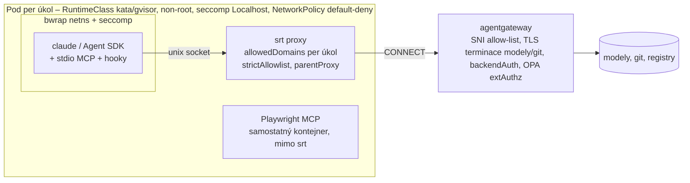

# Anthropic sandboxing: srt, Claude Code, Agent SDK

## Závěr

srt = procesový sandbox se sdíleným kernelem (bubblewrap + seccomp + síť jen přes Unix socket → proxy). V platformě
je to **S2/S3 vrstva uvnitř S1 podu (Kata/gVisor)**, nikdy jediná hranice. Nejlepší tvar: `srt claude` v podu,
`network.allowedDomains` per úkol + `strictAllowlist` + `parentProxy` = agentgateway CONNECT, NetworkPolicy default-deny.
Harness S1 (2026-10-23, [`tools/harness_sandbox_s1/`](../../tools/harness_sandbox_s1/README.md)) potvrdil lokálně:
vlastní síťový namespace, seccomp, default-deny egress, metadata endpointy blokované, `parentProxy` → agentgateway,
`credentials.deny`, povinné deny `.git/hooks`. Pasti: neprivilegovaný pod s `RuntimeDefault` seccomp srt nespustí;
root potřebuje `CAP_SETFCAP`; beta s breaking změnami každé 2–3 týdny; Linux deny-list stavěný při startu z cwd;
Chromium sandbox vs. `allowNestedUserNamespaces`.

## Repo, verze, stav (2026-10-23)

- Kanonické repo **`anthropics/sandbox-runtime`** (`anthropic-experimental/…` je redirect; staré npm verze nesou starou URL).
  Apache-2.0, „Beta Research Preview“, 5,7k★, 885 commitů, 129 issues / 163 PR, maintainer Anthropic.
- npm `@anthropic-ai/sandbox-runtime` 0.0.81 (2026-10-20); ≈ týdenní kadence (0.0.72 2026-08-13 → 0.0.81).
  `engines >=22.12.0` (od 0.0.79), `bin: srt`; deps zod, commander, node-forge, @pondwader/socks5-server – **bez telemetrie**.
- Breaking: 0.0.80 (ask callback jen `true`; Linux příkaz nesmí tvořit user/mount ns → `allowNestedUserNamespaces`;
  `denyWrite` > `allowWrite`; `ambiguousRequestTarget: refuse`; seccomp helper rebuild), 0.0.79 (`FilesystemPathEntry`,
  Node 22.12). Nové v 0.0.80: `srt proxy` + binár `srt-proxy` s externím deciderem, in-process `tlsTerminate`,
  `registerCommandNetworkLists`. 0.0.77: root bez `CAP_SETFCAP` odmítnut při startu.
- Otevřené issues bez odpovědi maintainera: #417 (`uid_map` EPERM v Dockeru bez CAP_SYS_ADMIN i s weaker módem),
  #498 (`--cap-drop ALL` vyprázdní bounding set → nested userns helperu nic nedá), #429 (AppArmor Ubuntu),
  #605 (žádost o gVisor backend).

## Linux mechanismus (z `src/sandbox/linux-sandbox-utils.ts`, main)

- bwrap: `--ro-bind / /` + `--bind` pro `allowWrite`, `--tmpfs` pro `denyRead`, `--dev /dev`, `--proc /proc` (**jen bez**
  `enableWeakerNestedSandbox`; s ním `--bind /proc /proc`), `--unshare-pid`, `--unshare-user --cap-drop ALL`
  (+ `--cap-add CAP_SETFCAP` jen když euid 0), `--unshare-net`, `--disable-userns` když chybí seccomp helper (bwrap ≥ 0.8.0),
  `--new-session --die-with-parent`. Plně podporovaný bwrap ≥ 0.5.0.
- seccomp: statický `vendor/seccomp/{x64,arm64}/apply-seccomp` (filtr `unix` = `socket(AF_UNIX)` → EPERM + io_uring;
  filtr `namespaces` = blok user/mount ns, od 0.0.80); helper si bere `CAP_SYS_ADMIN` nested user namespacem →
  vyžaduje unprivileged userns na hostu. **Bez helperu tichá degradace** („Unix socket blocking disabled“), `checkDependencies` OK.
- Síť: host-side `socat UNIX-LISTEN:$TMPDIR/claude-http-<id>.sock ↔ TCP:localhost:<muxPort>`; uvnitř `socat TCP4-LISTEN:3128 … UNIX-CONNECT`.
  Jeden mux server (HTTP + SOCKS), náhodný port, auth token `randomBytes(16)`; username `srt.<encodedCommand>` = atribuce per příkaz.
  **Odstranění proxy env proměnné = ztráta konektivity, ne bypass** (namespace nemá síť).
- Env: `HTTP_PROXY/HTTPS_PROXY/ALL_PROXY=http://srt.<cmd>:<token>@localhost:3128`, `GRPC_PROXY`, `GIT_CONFIG_PARAMETERS`,
  `GIT_SSH_COMMAND` (socat ProxyCommand), `DOCKER_*_PROXY`, `CLOUDSDK_PROXY_*`;
  **`NO_PROXY=localhost,127.0.0.1,::1,169.254.0.0/16,10.0.0.0/8,172.16.0.0/12,192.168.0.0/16`** → IP literály v těchto
  rozsazích jdou mimo proxy a v namespace nikam (harness S1c: `169.254.169.254` → exit 7). S CA: `SSL_CERT_FILE`,
  `CURL_CA_BUNDLE`, `GIT_SSL_CAINFO`, `NODE_EXTRA_CA_CERTS`, `PIP_CERT`, `DENO_CERT`, …
- Resolved-address check (přímý dial): loopback, link-local, metadata (vč. `168.63.129.16`), **adresy hosta** denied;
  IP literál v `allowedDomains` je carve-out. **S `parentProxy` se check neprovádí** – dělá ho upstream (agentgateway).
- Mandatory deny (Linux, **stavěno při startu z cwd procesu srt**): `.git/hooks`, `.git/config`, `.mcp.json`,
  `.claude/commands|agents`, shell rc; `ripgrep` do hloubky `mandatoryDenySearchDepth` (3). Nekryje `git clone` během běhu.
- Violations: seccomp `USER_NOTIF` observer → `SandboxViolationEvent {line: "deny <syscall> <path>", command, timestamp}`;
  kód: „diagnostic hints and must never gate a policy decision“; store max 100; **CLI loguje jen pod `SRT_DEBUG`**,
  `<sandbox_violations>` pro model skládá knihovna (`annotateStderrWithSandboxFailures`) – v Claude Code.

## K8s pod: co musí platit

| Požadavek | Proč | Zdroj |
|---|---|---|
| seccomp profil povolující `clone`/`unshare` s ns flagy, `mount`, `pivot_root` (Localhost profil nebo `Unconfined` uvnitř Kata) | containerd default: bez `CAP_SYS_ADMIN` `clone` jen s `(flags & 0x7e020000)==0`, `clone3`→ENOSYS, `unshare/setns/mount` jen s CAP_SYS_ADMIN → **bwrap pod RuntimeDefault neprojde** | `seccomp_default.go` main |
| unprivileged userns v guestu (`user.max_user_namespaces>0`, bez AppArmor restrikce Ubuntu 24.04) | bwrap `--unshare-user` + helper nested userns | README, docs |
| non-root uid v kontejneru | root self-map vyžaduje `CAP_SETFCAP` (kernel `verify_root_map`, #417); `--dangerously-skip-permissions` jako root odmítnut; harness S1a: root volající → plná `CapEff` v sandboxu | #417, docs |
| `enableWeakerNestedSandbox: true` (dokud není ověřen `procMount: Unmasked` + `hostUsers: false`) | čerstvý `/proc` v neprivilegovaném kontejneru neprojde | docs sandboxing, kód |
| Kata guest kernel: `CONFIG_USER_NS=y`, `CONFIG_SECCOMP_FILTER=y` (upstream fragments) – Azure Linux guest neověřen | – | kata fragments main |
| gVisor: podpora userns + seccomp USER_NOTIF neověřena | – | otevřeno (#605) |

## Konfigurace srt (`~/.srt-settings.json` / `--settings`, schéma `src/sandbox/sandbox-config.ts`)

Top-level: `network` (povinné), `filesystem` (povinné), `credentials?`, `ignoreViolations?`, `enableWeakerNestedSandbox?`,
`allowNestedUserNamespaces?`, `ripgrep?`, `mandatoryDenySearchDepth?` (1–10), `seccomp?`, `bwrapPath?`, `socatPath?`, `git?`.
`network`: `allowedDomains` (povinné; wildcard, `:port`), `deniedDomains` (**povinné i prázdné** – jinak exit 1), `deniedDomainReasons?`,
`strictAllowlist?`, `deniedResolvedAddresses?`, `allowAllUnixSockets?`, `httpProxyPort?`/`socksProxyPort?` (vlastní proxy →
srt listy neplatí), **`parentProxy? {http?, https?, noProxy?}`** (objekt, ne string), `mitmProxy?`, `tlsTerminate? {caCertPath?,
caKeyPath?, excludeDomains?, maxTunnels?}`, `refuseOpaqueTunnels?`, `ambiguousRequestTarget?`.
`filesystem`: `denyRead` (povinné), `allowRead?`, `allowWrite` (povinné), `denyWrite` (povinné), `allowGitConfig?`;
write allow-only (`denyWrite` vítězí), read deny-then-allow (`allowRead` vítězí).
`credentials`: `files[]`/`envVars[] {path|name, mode: deny|mask, injectHosts?}`, `awsPairs[]`, `sigv4`. `mask` vyžaduje `tlsTerminate`.
`--control-fd <fd≥3>`: JSON řádek = celý nový config; `parentProxy` se po startu nemění.

## `srt proxy` a decider (docs/srt-proxy.md, 0.0.80)

- Flags: `--listen-fd`, `--decider-fd`, `--lifeline-fd`, `--ca-fd` (**bez něj každý CONNECT odmítnut** – vše se terminuje), `--listen host:port`.
- Protokol v1: rámec 4 B délka + JSON; `hello` ↔ `hello{allowedDomains, deniedDomains}`; `req{id, method, host, port, sni?, path, headers}` →
  `verdict{action: allow|deny|need_body, setHeaders?, removeHeaders?, cred?, status, reason?}`; timeout 5 s → 503 `decider_unavailable`;
  odmítnutí s `X-Deny-Reason` (host_not_allowed, decider, address_not_allowed, opaque_tunnel, …).
- OPA adaptér je možný (proces na fd), ale proxy-only mód **nemá parent proxy a odmítá privátní cíle** → před in-cluster
  agentgateway dnes nepoužitelný. Wrapper mód s `parentProxy` ano. **Doporučení: OPA jen v gateway (extAuthz), srt bez decideru.**
- Knihovna: `SandboxManager.initialize(config, askCallback?)`, `wrapWithSandbox(command, …, {commandId})`, `getViolationsForCommand(key)`,
  `annotateStderrWithSandboxFailures`, `registerCommandNetworkLists(commandId, {allowedDomains})` (id ≥ 128 bit náhody), `checkDependencies()`.

## Claude Code `sandbox.*`

Klíče: `enabled`, `autoAllowBashIfSandboxed` (default true), `failIfUnavailable` (default **false** – bez závislostí běží nesandboxovaně),
`allowUnsandboxedCommands` (default true → `dangerouslyDisableSandbox` retry), `excludedCommands[]`, `ignoreViolations`,
`enableWeakerNestedSandbox`, `allowNestedUserNamespaces` (CC ≥ 2.1.305), `ripgrep`, `bwrapPath`/`socatPath` (**managed only**),
`network.{allowedDomains, deniedDomains, strictAllowlist, allowManagedDomainsOnly (managed), httpProxyPort, socksProxyPort, tlsTerminate}`,
`filesystem.{disabled, allowWrite, denyWrite, denyRead, allowRead, allowManagedReadPathsOnly (managed)}`, `credentials.*`.
**Managed vzor pro platformu:** `{"sandbox":{"enabled":true,"failIfUnavailable":true,"allowUnsandboxedCommands":false,"network":{"strictAllowlist":true}}}`.
Kryje: Bash, PowerShell, Monitor + děti. **Nekryje:** Read/Edit/Write/WebFetch (permission rules), hooky, stdio MCP, LSP, `apiKeyHelper`.
`srt claude` obalí celý proces vč. MCP a hooků (docs sandbox-environments). `--dangerously-skip-permissions` = hosty mimo allow-list
povoleny bez promptu (ledaže `strictAllowlist`); jako root CC odmítne start. Vlastní `httpProxyPort`: „your proxy is responsible for filtering everything“.
Env: `CLAUDE_CODE_SUBPROCESS_ENV_SCRUB=1` (strip credentials z Bash/hooků/stdio MCP), `CLAUDE_CODE_DISABLE_AUTO_MEMORY=1`,
`CLAUDE_CODE_DISABLE_NONESSENTIAL_TRAFFIC=1`, `CLAUDE_CODE_PROPAGATE_TRACEPARENT=1`; `ANTHROPIC_BASE_URL` = agentgateway;
`skipWebFetchPreflight: true` (jinak volá api.anthropic.com); `claude.ai`/`platform.claude.com` jen pro OAuth.

## Agent SDK (oprava síta kolo 1)

- `ClaudeAgentOptions.sandbox: SandboxSettings` **existuje v Pythonu i TS** = Bash sandbox CC, ne srt wrapper.
  TS: `enabled, failIfUnavailable (default true), autoAllowBashIfSandboxed, excludedCommands, allowUnsandboxedCommands (default true),
  network {…}, filesystem {…}, ignoreViolations, enableWeakerNestedSandbox, allowNestedUserNamespaces, ripgrep`.
  **Python default: nedostupný sandbox → běží nesandboxovaně s varováním**; TS → `error_during_execution`.
- `allowManagedDomainsOnly` z options nic nedělá → jen `managedSettings` (TS). Další cesty: `settings` (inline), `settingSources`.
- `can_use_tool`: `tool == "Bash" && input.dangerouslyDisableSandbox` → deny. Docs: `bypassPermissions` + `allowUnsandboxedCommands` = tichý únik.
- secure-deployment: srt „Good“, Docker „setup dependent“, gVisor/VM „Excellent“; hardened `docker run --cap-drop ALL --network none
  --user 1000:1000 -v /var/run/proxy.sock:ro`; Node `fetch()` ignoruje proxy env → `NODE_USE_ENV_PROXY=1` (Node 24+).

## Platformní vzor (návrh)

## Nález z O-2 live (2026-10-24): agent runtime je součást hranice sandboxu

Živý `claude-haiku-4-5` přes Claude Agent SDK (`permission_mode="bypassPermissions"`, jen `allowed_tools` na MCP nástroje
harnessu) použil **vestavěný Bash Claude Code 11× mimo sandbox** – `git init`, `commit`, `pytest` běžely přímo na Macu
v `/tmp`; navíc CLI načetlo `.mcp.json` repa a volalo cizí MCP server (`mcp__adam-knowledge__search_knowledge`).
`allowed_tools` nic **neomezuje** (jen předschvaluje), v `bypassPermissions` má CLI Bash/Write/Edit/WebFetch na hostu procesu.

| Co platí | Důsledek pro platformu |
|---|---|
| Vestavěné nástroje CLI běží v procesu agenta, ne v `sandboxed_bash` | sandbox profil role musí buď **obalit celý proces** (`srt claude`, Kata pod s CNP), nebo vestavěné nástroje vypnout |
| Agent SDK: `tools=[]` + `strict_mcp_config=True` + `setting_sources=[]` + `cwd` mimo repo platformy | role dostane jen MCP nástroje platformy (O-2 app.py opraveno 2026-10-24) |
| CC sandbox (`sandbox.*`) kryje jen Bash/PowerShell/Monitor – ne Write/Edit/WebFetch, MCP, hooky | stejný závěr jako dřív, teď změřený: hranice = S1 pod + srt celý proces + CNP, ne nastavení CLI |
| Push do main by i z hostu skončil na gateway (SNI allow-list), exfil na skutečný host z hostu **projde** | egress musí být síťový na úrovni podu (CNP), ne jen v nástroji |

Zapsáno do `kriteria.md` B3, `roles/*.yaml` (`sandbox.agent_sdk`) a `role.md`.

## Co ověřit dál

- [ ] srt 0.0.81 v Kata podu (AKS `kata-vm-isolation`) a gVisor podu: `RuntimeDefault` → očekávané selhání; Localhost profil / Unconfined;
  non-root bez weaker módu (`unshare -U true` EPERM, `socket(AF_UNIX)` EPERM, `Can't mount proc`); `procMount: Unmasked` + `hostUsers: false` – skript `tools/harness_sandbox_s1/aks/`.
- [ ] Issue #498 vs. skutečnost na 0.0.81 (bounding set v nested userns, `--cap-drop ALL` v podu).
- [ ] gVisor: userns + seccomp `USER_NOTIF` podpora.
- [ ] Python SDK: které klíče `sandbox` skutečně forwarduje (`strictAllowlist`, `allowNestedUserNamespaces`).
- [ ] Export violations + proxy verdictů do OTEL (adaptér), formát spanů.

## Changelog
- 2026-10-24: nález O-2 live – vestavěné nástroje CLI mimo sandbox; `tools=[]`, `strict_mcp_config`, `setting_sources=[]`, cwd mimo repo.
- 2026-10-23: první verze – kolo 2 srt/CC/Agent SDK z primárních zdrojů (repo main, npm 0.0.81, docs) + nálezy harnessu S1.
