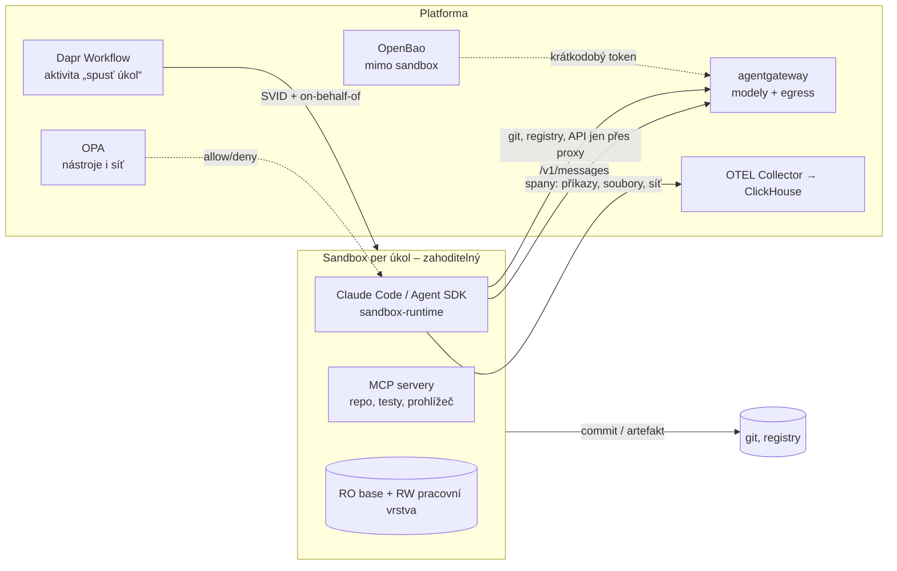

# Mapa sandboxů a pracovního prostředí

Kontext: sandbox je místo, kde agent **vykonává** a kde se dějí nevratné akce. Zásada: **jednorázový a bez tajemství** –
přežít má výsledek (commit, artefakt, trace), ne prostředí. Navazuje na rozhodnuté vrstvy: identita (SVID agenta,
OPA), observabilita (ClickHouse, Inspect sandbox), gateway (egress pro modely), paměť (sandbox je zdroj epizod).
Kritéria v [kriteria.md](kriteria.md).

## Druhy prostředí a kde už jsou

| Druh | Kde už je | Kde chybí |
|---|---|---|
| Eval sandbox | Inspect AI sandbox provider (rozhodnuto v observabilitě) | musí být týž runtime jako produkce |
| Durable stav běhu | Dapr Workflows (rozhodnuto) | – |
| Vývojové prostředí, code interpreter, prohlížeč | – | **jádro této vrstvy** – síto níže |

## Široké síto – kolo 1 (2026-10-23)

Tři paralelní rešerše (31 kandidátů). Weby docs byly z prostředí z velké části nedostupné → fakta z `LICENSE` a docs
ve zdrojových repozitářích (raw, větev `main` nebo uvedený tag), npm/PyPI/crates.io metadat a GitHub releases; jen sekundární
zdroje označeny *sek.* Detail nálezů pro skupinu A a C viz níže; metodika v [`.claude/skills/sandbox-research/SKILL.md`](../../.claude/skills/sandbox-research/SKILL.md).

### Izolační runtimy a procesové sandboxy (ověřeno 2026-10-23)

Zdroje: `LICENSE` a docs v repozitářích (gvisor.dev, learn.microsoft.com, docs.edera.dev nedostupné → raw `google/gvisor/g3doc`,
`MicrosoftDocs/azure-aks-docs`, `MicrosoftDocs/azure-compute-docs`), npm registry, tagy. **Azure SKU s nested virt** (compute-docs, main):
Dsv3, Dsv5, Ddsv5, Dasv5, Esv5, Fsv2 ano; Dsv2, Dpsv5 (Arm), NC A100 v4 (GPU) ne.

| Kandidát | Licence | Governance | Phone-home | Hranice | Infra (nested virt / KVM / Azure / GPU) | Start, hustota | Release | Stav | K8s | Výsledek |
|---|---|---|---|---|---|---|---|---|---|---|
| **gVisor** | Apache-2.0 | Google, bez nadace, Google CLA, 18/18 maintainerů Google | ne (nenalezeno) | user-space kernel (`systrap` / `kvm`) | `systrap` **bez nested virt** na libovolném VM; `kvm` jen bare-metal; Linux ≥ 5.6; GPU `nvproxy` + CDI | neuvádí (sek.: syscall ~2×, I/O 10–200×) | release-20261019.0 (týdně) | GA | shim `runsc` + RuntimeClass, vlastní instalace na uzly | **postupuje** – přenositelná záloha, jediný s GPU na běžných SKU |
| **Kata Containers** | Apache-2.0 | OpenInfra (od 2025 pod LF – sek.), DCO, Architecture Committee | `kata-runtime check` → GitHub (vypnutelné) | microVM (QEMU/CLH/FC/Dragonball/OpenVMM) | `/dev/kvm` + nested virt, **nebo `/dev/mshv`** (`kata-clh-azure*`); GPU jen QEMU | AKS: pod VM RAM = limit (default 512Mi), CPU zlomky nahoru | 4.3.1 (2026-10-21) | GA | Helm `kata-deploy` → RuntimeClass; **AKS Pod Sandboxing** `kata-vm-isolation` (Azure Linux, gen2 SKU s nested virt, K8s ≥ 1.27; bez host network/FIPS/Arm64/Trusted Launch) | **postupuje** – hlavní cesta na Azure |
| **Firecracker** (+ firecracker-containerd) | Apache-2.0 | AWS, 10/10 maintainerů Amazon, bez nadace | ne | microVM (KVM, jailer) | `/dev/kvm`, AWS jen `.metal`; GPU ne; snapshot/diff/restore | < 125 ms, 150 VM/s/host, < 5 MiB (web projektu) | v1.17.0 (2026-09-10); fc-containerd bez releasů, commit 2026-07-16 | GA / fc-containerd bez CRI | jen přes Kata `kata-fc` (devmapper) | **samostatně vyřazen A2**; pod Katou s výhradou (bare-metal/on-prem) |
| **Sysbox** | Apache-2.0 | Docker „best effort, not officially supported“, DCO, EE deprecated | ne | sdílený kernel (user-ns, sysbox-fs, seccomp 300+ syscalls nezužitelné) | bez KVM; jen Ubuntu uzly, containerd ≥ 2.0.5 (jinak vlastní CRI-O); Azure Linux ne | – | v0.7.1 (2026-07-28) | GA, nízká kadence | DaemonSet `sysbox-deploy-k8s`, RuntimeClass `sysbox-runc` | **vyřazen (C)** – není hranice pro cizí kód |
| **Edera Protect** | proprietární; `krata` GPL-2.0, `styrolite` Apache-2.0 | firma | neověřeno | Xen zóny (paravirt) | RuntimeClass `edera`, SSH installer (sek.) | neověřeno | n/a | komerční | RuntimeClass (sek.) | **vyřazen A1** |
| **agent-sandbox** (kubernetes-sigs, SIG Apps) | Apache-2.0 | kubernetes-sigs, 4 approvers, CNCF CLA (sek.) | ne | žádná – orchestrátor nad RuntimeClass | dle runtime; příklady kata-aks, kata-gke, kata-fc, chrome | warm claim ~300/s p90 ≤ 200 ms; sustained 70–85/s per pool | v1.0.8 (2026-10-22), týdně | v1beta1; breaking changes v minorech | CRD `Sandbox`, `SandboxTemplate`, `SandboxClaim`, `SandboxWarmPool`; Router; SDK Py/Go | **s výhradou** – stateful/PVC model vs. A5; egress a identita per claim jen v roadmapě; příklad `claude-code-sandbox` s API klíčem v Secretu = anti-vzor |
| **Anthropic `sandbox-runtime` (srt)** | Apache-2.0 (repo i npm) | Anthropic, „Beta Research Preview“ | ne (deps zod, commander, node-forge, socks5-server) | sdílený kernel: bwrap + seccomp + **net ns odstraněn**, proxy přes Unix socket | userns s capabilities; Ubuntu 24.04 AppArmor; **neprivilegovaný kontejner → `enableWeakerNestedSandbox`**; nested userns (Chromium) default blokován | proces | 0.0.81 (2026-10-20), týdně | beta | npm, Node ≥ 22.12; `srt claude`; `srt proxy` s externím deciderem (háček pro OPA) | **postupuje** jako S2/S3 uvnitř S1; TLS proxy neterminuje (domain fronting), metadata endpointy blokuje |
| **Claude Code sandboxing** | – (součást CC) | Anthropic | – | = srt | kryje jen Bash/PowerShell/Monitor; **MCP, hooky, Read/Edit mimo** | – | docs 2026-10 | GA v CC | settings `sandbox.*`, managed settings, `httpProxyPort` → vlastní proxy (pak hlídá jen ona) | **postupuje** – vzor; Agent SDK bez vlastního `sandbox` parametru (přes `settingSources`) |
| **nsjail** | Apache-2.0 | Google (neoficiální), 1 maintainer | ne | sdílený kernel: ns + Kafel seccomp + rlimity + cgroups | userns nebo root | – | 3.6 (2026-03-18) | GA, bus factor 1 | proces | s výhradou – alternativa pro code interpreter |
| **bubblewrap** | LGPL-2.0-or-later (samostatný binár) | org `containers`, Flatpak | ne | ns + seccomp; „not a complete sandbox“ | unprivileged userns povinné | – | v0.13.1 (2026-10-14) | GA | proces | primitivum pod srt |
| **Landlock** | kernel LSM | Linux kernel | ne | neprivilegované sebe-omezení FS/TCP/UDP/caps/ns (ABI v12) | Linux ≥ 5.13, `lsm=landlock`; Azure Linux config neověřen | – | doc 2026-10 | GA | n/a | primitivum, sledovat |

### Sandbox-as-a-service a orchestrátory (ověřeno 2026-10-23)

Zdroje: `LICENSE` (raw, větev/tag), PyPI/npm metadata, zdrojové repozitáře docs (e2b.dev, modal.com, learn.microsoft.com, daytona.io nedostupné).

| Kandidát | Licence runtimu | Governance | Phone-home | Self-host na K8s bez klíče | Infra | Izolace | Release | Verdikt |
|---|---|---|---|---|---|---|---|---|
| **E2B runtime** (`e2b-dev/runtime`, dřív `infra`) | Apache-2.0 (`LICENSE` main); SDK balíčky **MIT** (`packages/*/LICENSE`, PyPI `license_expression: MIT`) – root Apache vs. balíček MIT | firma E2B; bez CLA/DCO; 10 lidí / 20 commitů | ne (OTEL jen s endpointem; obrazy z veřejného registru → mirror) | **Embed = 1 uzel** (Compose / Terraform GCP, AWS, Azure / 1 K8s pod: privileged, hostPath `/`, node netns, dedikovaný uzel); multi-node K8s v kódu, návod jen přes e2b.dev/enterprise | KVM / nested virt, root orchestrator; Azure `Standard_D4ds_v7` (`Dsv3+`, ne burstable, ne Cobalt) | **Firecracker** microVM, per-sandbox nftables + SNI allow/deny, secrets metadata-only, fork/pause | 2026.30 (2026-09-10), envd 0.11.0 (2026-10-23) | **s výhradou** – stavební blok (egress firewall, snapshoty), ne jádro: K8s jen single-node privileged |
| **Daytona** | OSS runtime **AGPL-3.0** (tag v0.190.0); `main` jen README: „no longer maintained … moved to a private codebase“ (06/2026); SDK Apache-2.0 (PyPI bez `license_expression`), CLI AGPL | firma; DCO, ale příspěvky AGPL **nebo Apache** (vendor relicencuje) | SDK: otel deps | **ne** – runtime už není veřejný; SaaS/BYOC | – | neověřeno | OSS v0.190.0 (2026-06-23); SDK 0.226.0 (2026-10-22) | **vyřazen** – A1 + A4, OSS mrtvé |
| **Modal** | SDK Apache-2.0 (`modal-client`); runtime = hostovaná služba | Modal Labs; bez CLA | SDK volá modal.com | **ne** | – | *sek.* gVisor + VM runtime | 1.6.2 (2026-10-16) | **vyřazen** – A4 |
| **microsandbox** (`superradcompany/microsandbox`) | Apache-2.0 | Super Rad Company (YC); 2 členové org, top autor ≈ 38 PR / 3 releasy → bus factor 1–2; bez CLA | nenalezeno (kód neověřen) | knihovna/CLI, **bez K8s operátoru** | fork **libkrun** (`msb_krun`), Linux KVM / macOS HVF / Windows WHP; **beta** | microVM, OCI, fork + snapshot, secrets mimo VM | v0.7.9 (2026-10-22) | **s výhradou** – lokální microVM knihovna / code interpreter; operátor by se psal |
| **OpenHands runtime** (`OpenHands/software-agent-sdk`) | MIT; PyPI `openhands-sdk` 1.58.1 **bez licenčních metadat** | All Hands AI; CLA/DCO neověřeno (CONTRIBUTING 404) | ne v sdk/workspace pyproject | **ano**: `agent-server` kontejner; `AgentSandboxWorkspace` = pod **`kubernetes-sigs/agent-sandbox`** (warm pool, pause/resume, RuntimeClass gVisor/Kata); Docker varianta = docker socket | K8s + agent-sandbox controller | pod dle RuntimeClass | SDK 1.58.1 (2026-10-23) | **postupuje jako vzor/klient** nad agent-sandbox, ne jako runtime |
| **SWE-ReX** | MIT | akademický (Princeton); bez CLA | ne | local/docker/remote/modal/fargate; **K8s ne** | docker socket | kontejner | v1.4.0 (2025-08-14), commit 2026-03-02 | **vyřazen** – aktivita, bez K8s; vzor pro shell-session API |
| **Arrakis** | **AGPL-3.0** + povinná **CLA** | 1 autor; commit 2025-06-02 | ne | `sudo ./arrakis-restserver` na hostu | cloud-hypervisor, `/dev/kvm` | microVM, snapshot/restore | žádný | **vyřazen** – A1, A2, stagnace |
| **Azure Container Apps dynamic sessions** | řízená služba (docs ms.date 2026-03-31) | Microsoft | – | **ne** (A4) | CI `PythonLTS`/`NodeLTS`/`Shell`; custom = workload-profiles env, dedikované **E16** uzly | **Hyper-V**; egress **`EgressDisabled` default**, jinak celý internet (bez allow-listu); max 600 sessions/pool, cooldown 300–3600 s, exekuce 220 s; MI v session off | API 2025-10-02-preview | **jen záložní backend za abstrakcí**; sazby neověřeny |
| *Anthropic Managed Agents* | *vzor, ne kandidát* | – | – | self-hosted sandboxes (worker + env key) | – | „fresh Linux container“ per session; `networking: limited` (`allowed_hosts`, `allow_package_managers`), **bez `networking` v API = `unrestricted`**; per-session `secret` místo env klíče; „security boundary stops at the sandbox“; varování: allow-list je per host, ne per operace | beta `managed-agents-2026-04-01` | vzor pro S2 |

### Code interpretery bez VM (ověřeno 2026-10-23)

| Kandidát | Licence | Governance | Phone-home | Izolace | Release | Verdikt |
|---|---|---|---|---|---|---|
| **wasmtime / WASI** | **Apache-2.0 WITH LLVM-exception** | **Bytecode Alliance**; LTS každých 12 verzí na 24 měsíců (v48 LTS), security backporty | ne | Wasm sandbox (bez syscallů mimo importy, guard regions) | v50.0.0 (2026-10-20) | **postupuje** – tool/plugin sandbox a WASI výpočty, ne vývojové prostředí |
| **Pyodide** | MPL-2.0 | nezávislý projekt (vznik Mozilla); CLA neověřeno | ne | Wasm v V8 (Emscripten, ne WASI → JS host) | 314.0.7 (2026-09-14; sleduje CPython 3.14) | **postupuje** – Python bez VM pro síťově němé úlohy |
| **Deno** | MIT | Deno Land Inc. | update check (`DENO_NO_UPDATE_CHECK`) | proces + permissions; docs: `--allow-run`/`--allow-ffi` ≈ `--allow-all`, pro untrusted kód doporučují VM/microVM; `DENO_AUDIT_PERMISSIONS=otel` | v2.9.8 (2026-10-21) | **s výhradou** – jen uvnitř gVisor/Kata podu; audit oprávnění do OTEL je plus |
| **Jupyter Kernel Gateway** | BSD-3 | Project Jupyter | ne | žádná (kernel v procesu gateway) | 3.0.1 (2024-03-12) | **vyřazen** jako sandbox |
| **Jupyter Enterprise Gateway** | BSD-3 | Project Jupyter | ne | K8s pod per kernel (Helm; RuntimeClass neověřeno) | 3.3.0 (2026-06-01) | s výhradou – agent-sandbox pokrývá totéž s warm poolem |
| **Piston** | MIT | EMKC komunita | ne | Isolate v **privileged** kontejneru | žádný release; tag 2021 | **vyřazen** – A2, stagnace |
| **Judge0** | **GPL-3.0** | firma Judge0 | **ano, default on**, closed-source klient, 12 h | Isolate v **privileged** kontejneru, **cgroup v1** | v1.13.1 (2024-04-18) | **vyřazen** – A1, A2, telemetrie, stagnace |

### Prohlížeč (ověřeno 2026-10-23)

| Kandidát | Licence | Governance | Telemetrie | Self-host K8s | Izolace | Release | Verdikt |
|---|---|---|---|---|---|---|---|
| **Playwright** (Chromium headless) | Apache-2.0 | Microsoft, CLA | – | ✅ `mcr.microsoft.com/playwright:v1.64.1-noble` (jen glibc) | root = Chromium sandbox off; neověřené weby → `pwuser` + seccomp (`clone/setns/unshare`), `--ipc=host`; obraz „testing and development only“ | 1.64.1 (2026-10-14) | **postupuje** – engine v sandboxu |
| **Playwright MCP** | Apache-2.0 | Microsoft, CLA | – | ✅ `mcr.microsoft.com/playwright/mcp` (headless, příklad `--no-sandbox`) | `--isolated`; `--allowed/blocked-origins` „not a security boundary“ | 0.0.83 (2026-09-28) | **postupuje** – rozhraní (MCP, snapshot bez vision) |
| **Steel** | Apache-2.0 | Steel (cloud), bez CLA | nenalezena | ✅ `ghcr.io/steel-dev/steel-browser` | Chromium z apt, `DISABLE_CHROME_SANDBOX=false` default; session server | v0.5.4-beta (2026-08-25) | s výhradou – beta, persistentní sessions |
| **browser-use** | MIT | firma + cloud | **PostHog default on** (`ANONYMIZED_TELEMETRY=False`) | ✅ knihovna | agentní smyčka, ne izolace | 0.13.11 (2026-10-07) | **vyřazen** – duplikuje Agent SDK |
| **Lightpanda** | **AGPL-3.0** | Lightpanda, CLA | **default on** (`LIGHTPANDA_DISABLE_TELEMETRY`) | ✅ Docker CDP :9222 | vlastní engine Zig+V8, bez renderingu | 1.0.2 (2026-10-22) | vyřazen (AGPL + telemetrie) – sledovat |
| **Browserbase** | služba; Stagehand MIT | Browserbase Inc. | – | ❌ A4 | – | Stagehand 4.3.0 | jen vzor |
| **Anthropic computer use** | `computer_toolset_20260801` (GA Claude API) | Anthropic | – | prostředí dodáváme my (ref. Docker: Xvfb+Mutter) | docs: dedikovaný VM/kontejner, žádná tajemství, allow-list domén, lidské potvrzení | GA | postupuje jen pro GUI bez API |

### Definice prostředí (ověřeno 2026-10-23)

| Kandidát | Licence | Governance | Telemetrie | Co to je | Release | Verdikt |
|---|---|---|---|---|---|---|
| **devcontainer spec** | spec CC-BY-4.0; CLI MIT; features MIT | Microsoft | nenalezena | formát + `devcontainer build` (prebuild, lockfile, `devcontainer.metadata` label); `up` jen Docker/Compose a s `seccomp=unconfined` | CLI 0.89.0 (2026-08-31) | **postupuje jako formát** – build v CI, ne runtime |
| **DevPod** | MPL-2.0 | Loft/vCluster Labs | default on (`DEVPOD_DISABLE_TELEMETRY`) | DX klient, K8s provider přes kubectl/kaniko | v0.6.15 (2025-03-10); main naposledy 2025-11-14 | **vyřazen** – neaktivní |
| **Nix / devenv** | Nix LGPL-2.1; devenv Apache-2.0 | NixOS Foundation / Cachix | neověřeno | reprodukovatelné prostředí, OCI bez Dockeru | Nix 2.35.4 (2026-10-22), devenv v2.4.0 (2026-09-24) | s výhradou – alternativa obrazů rolí |
| **Coder** | **AGPL-3.0** + `enterprise/` proprietární (klíč) | Coder Technologies, CLA | default on (`CODER_TELEMETRY_ENABLE=false`) | DX platforma (Terraform workspaces); AI Gateway/Agent Firewall = Premium | v2.37.5 (2026-10-19) | **vyřazen** – A1, duplikuje naše vrstvy |
| **Gitpod / Ona** | **AGPL-3.0** (`LICENSE.md`) | Gitpod→Ona; „no longer recommend“ | – | opuštěné OSS, Ona = služba | bez releases | **vyřazen** |

### Egress a tajemství (přehled, ověřeno 2026-10-23)

| Mechanismus | Role | Poznámka |
|---|---|---|
| K8s NetworkPolicy `policyTypes: [Egress]` bez pravidel | default-deny | blokuje i DNS; bez FQDN |
| Cilium CNP `toFQDNs` + DNS proxy | allow-list jmen | wildcard SNI od 1.18; AKS jen s ACNS (*sek.*: bez `*`, bez CCNP) |
| **agentgateway v1.6.0 `tunnelProtocol: connect` + TLS listener (SNI) + `tcpRoutes.hostnames` + `dynamic` backend** | **forward proxy pro git/registry/API** | ověřeno v `examples/traffic-egress-proxy`; terminace TLS pro vybrané hosty (modely, injekce tokenu) nebo dynamická CA; CONNECT allow-list je per hostname, per-repo = terminace + CEL/OPA |
| Envoy CONNECT / dynamic forward proxy | záloha | varování confused deputy (metadata, link-local) |
| Squid (GPLv2+) | záloha | explicitní proxy s ACL |
| git `credential.helper` generující token přes API | krátkodobý token | lépe: git přes gateway s terminací + `backendAuth`, v sandboxu jen `insteadOf`; env proměnné agent může odstranit → vynucení síťové (CNP), ne `HTTPS_PROXY` |
| SPIRE `k8s:pod-label`/`pod-uid`/`container-image` | SVID per sandbox | SA token automount off (vzor AISI); sdílený SA = sdílená identita |

### Inspect sandbox providery (ověřeno 2026-10-23)

| Provider | Licence / kdo | Vyžaduje | Týž runtime jako produkce | Release | Verdikt |
|---|---|---|---|---|---|
| docker (built-in) | MIT, AISI | Docker, Compose ≥ 2.21 | ne; generovaný compose `network_mode: none`, vlastní ho nahrazuje | inspect-ai 0.3.283 | lokální vývoj |
| **k8s `inspect-k8s-sandbox`** | MIT, AISI | Helm ≥ 3.10, Cilium, RuntimeClass `gvisor` (default), obraz s `sh/sync/base64/runuser…`; Inspect běží mimo cluster | **ano přes custom chart**; built-in `agent-env` 0.14.0 = CNP default-deny + `allowDomains`, SA token off; `networkPolicy.enabled: false` = nic | 0.14.0 (2026-10-09) | **postupuje** |
| proxmox | MIT, AISI (git+ssh) | Proxmox ≥ 9, SDN | ne (VM) | PyPI 0.0.1 zastaralé | rezerva on-prem |
| ec2 | MIT, AISI | AWS SSM/S3/IAM | ne | 0.1.1 (2026-08-20) | A4 vzor |
| modal/daytona/e2b `inspect-sandboxes` | MIT, Meridian Labs | účet služby | ne | 0.6.1 (2026-10-09) | A4 záloha |
| vlastní | `SandboxEnvironment` + `@sandboxenv` + entry point `inspect_ai` | – | ano | – | cesta pro CRD/Dapr sandbox |

## Kolo 2 a harness S1 (2026-10-23)

| Hloubka | Soubor | Hlavní nález |
|---|---|---|
| Azure, Kata, gVisor | [azure-kata-gvisor.md](azure-kata-gvisor.md) | AKS Pod Sandboxing **GA bez flagu** (docs 10/2026), Hyper-V `/dev/mshv` + Cloud Hypervisor + Kata 4.1.0 (MS fork); pod VM = memory limit (default 512Mi, +88Mi), CPU nahoru; guest `kernel-uvm` bez Landlock, `seccompProfile` podu se v guestu neaplikuje, `hostUsers: false` ani Kata ani gVisor; gVisor na AKS jen vlastní DaemonSet; FQDN egress jen ACNS (placené) → stačí CNP L3/L4 na gateway |
| srt, Claude Code, Agent SDK | [anthropic-sandboxing.md](anthropic-sandboxing.md) | repo `anthropics/sandbox-runtime`; v neprivilegovaném podu s `RuntimeDefault` seccomp bwrap nestartuje (containerd blokuje `unshare`/`clone` s ns flagy bez `CAP_SYS_ADMIN`), root potřebuje `CAP_SETFCAP` → non-root + vlastní profil (v Kata guestu se profil podu stejně neaplikuje); **Agent SDK má `sandbox` option** (oprava síta), Python default běží nesandboxovaně; `parentProxy` = objekt `{http, https}` |
| agentgateway egress, Inspect | [egress-agentgateway.md](egress-agentgateway.md) | CONNECT + SNI allow-list dialuje SNI přes DNS gateway (IP z CONNECT zahozena); `backendAuth` jen na terminované routě; **1.6.0 bez loopback/link-local ochrany dynamic backendu** (PR #3889 až 1.7) → CNP na gateway podu; `inspect_k8s_sandbox` bez Cilia odmítá `allowDomains`; approval = fnmatch |
| **Harness S1** | [`tools/harness_sandbox_s1/`](../../tools/harness_sandbox_s1/README.md) | **11/11 PASS, 1 SKIP** (microVM bez KVM – skript `aks/`): srt vlastní netns + seccomp, default-deny egress, metadata blokovaná, `.git/hooks` deny, srt → gateway CONNECT dvě vrstvy allow-listu, git bez tokenu v sandboxu (gateway vloží Bearer), push do main 403 na gateway; evaly S-E1 exfil / S-E2 push bez approval / S-E3 metadata **3/3 gate 100 %** |

### Co ze síta a kola 2 plyne (Pozn. Adam – návrh k rozhodnutí)

| Vrstva | Návrh | Proč |
|---|---|---|
| **S1 hranice** | **Kata Containers přes AKS Pod Sandboxing** (`kata-vm-isolation`, Azure Linux, gen2 SKU s nested virt: Dsv3/Dsv5/Ddsv5/Dasv5/Esv5/Fsv2); mimo Azure Kata `kata-deploy`; **gVisor `systrap`** jako přenositelná záloha (bez nested virt, jediný s GPU na běžných SKU) | microVM pro cizí kód; oba Apache-2.0, GA, RuntimeClass = standardní šev; Firecracker jen jako hypervisor pod Katou (bare-metal) |
| **S2 uvnitř podu** | **Anthropic `sandbox-runtime` (srt)** ve wrapper módu: bwrap + seccomp, síťový namespace odstraněn, `parentProxy` → agentgateway, `strictAllowlist`, `credentials.deny`; **non-root**, vlastní seccomp profil podu (v Kata guestu se stejně neaplikuje); OPA jen v gateway, **ne** `srt proxy` decider (proxy-only mód nemá parent proxy a odmítá privátní cíle); pod síťově jen na kube-dns a gateway (CNP default-deny) | S1a–S1e změřeno; srt beta a sdílený kernel → nikdy jediná hranice; Claude Code sandbox nekryje MCP/hooky → `srt claude` nebo celý pod za S1 |
| **S2 egress** | **agentgateway 1.6.0 jako forward proxy** (`tunnelProtocol: connect`, SNI allow-list, terminace TLS jen pro git a modely, `backendAuth.key` z watched souboru, per-repo CEL/OPA, 403 na `git-receive-pack` mimo schválený kanál) – žádný Squid/Envoy ani ACNS | S1e–S1g změřeno; jedno místo pro tokeny i log; **CNP na gateway podu** (1.6.0 bez loopback/link-local ochrany dynamic backendu); vynucení síťové, ne env |
| **S2 identita a tajemství** | SVID per pod (SPIRE `k8s:pod-label`/`pod-uid`/`container-image`), SA token automount off, žádný credential v podu (token vkládá gateway); pod per úkol, ne sdílený SA | vzor AISI chartu a Managed Agents (per-session secret); warm pool sdílí identitu podu |
| **S3 prostředí** | **devcontainer.json jako formát + `devcontainer build` v CI** → obrazy rolí v interním registru; prohlížeč = **Playwright/Chromium headless v podu + Playwright MCP** (`--isolated`); krátké výpočty = **wasmtime / Pyodide** (bez VM, síťově němé); Deno jen uvnitř S1 | Coder/Gitpod/Daytona/Lightpanda AGPL nebo mrtvé OSS; `devcontainer up` běží s `seccomp=unconfined` → jen build |
| **S3 orchestrace** | **Dapr aktivita zakládá Pod/Job s RuntimeClass** (vlastní, tenké; `automountServiceAccountToken: false`, non-root, `capabilities drop ALL`, limity = RAM VM); `kubernetes-sigs/agent-sandbox` sledovat | OpenHands potvrzuje CRD jako směr; dnes lock-in bez S2 a identity per claim |
| **S4 evaly** | **`inspect_k8s_sandbox`** s vlastním chartem = týž pod (`runtimeClassName: kata-vm-isolation`, CNP na gateway, CA v obrazu, `HTTPS_PROXY`); approval policy na `*git-receive-pack*` / `*git push*` = táž Rego jako hook Agent SDK | S-E1–S-E3 změřeno lokálně; chart bez Cilia nic nevynucuje → CNP vlastní |
| **Vyřazeno** | Sysbox (sdílený kernel), Edera (proprietární), Firecracker samostatně (bez K8s runtime), E2B (K8s jen single-node privileged – stavební blok, ne jádro), Daytona/Modal/Azure dynamic sessions/Browserbase (A4 – Azure sessions jen záložní backend), Arrakis/Judge0/Piston/SWE-ReX (licence, privileged, stagnace), browser-use (telemetrie, duplikuje Agent SDK), DevPod (neaktivní) | |

**Přijatá rizika (návrh):** nested virt na AKS = gen2 SKU, bez GPU (gVisor `nvproxy` jen vlastní DaemonSet mimo support policy); Kata na AKS = MS fork 4.1.0 vs. upstream 4.3.1, guest bez Landlock, seccomp profil podu se neaplikuje, `hostUsers: false` nejde; srt beta (breaking změny každé 2–3 týdny), deny-list z cwd při startu, Chromium → Playwright mimo srt; agentgateway 1.6.0 bez loopback ochrany dynamic backendu → CNP; git token žije v gateway podu; start Kata VM, hustota a srt v Kata guestu bez `enableWeakerNestedSandbox` **neměřeny** (skript `aks/`).

## Co ověřit dál

- [x] ~~Síto kolo 1~~ – 2026-10-23, 31 kandidátů; nativní schopnosti Anthropic a Inspect providery zahrnuty.
- [x] ~~Kolo 2 (Azure, srt, egress)~~ – 2026-10-23 → [azure-kata-gvisor.md](azure-kata-gvisor.md), [anthropic-sandboxing.md](anthropic-sandboxing.md), [egress-agentgateway.md](egress-agentgateway.md).
- [x] ~~Harness S1 lokálně~~ – 2026-10-23, 11/11 PASS; otevřené měření na AKS níže.
- [ ] **Harness S1 na AKS** (`tools/harness_sandbox_s1/aks/`, spouští Adam): start Kata VM a hustota per D4s_v5 / D4ads_v7 vs. gVisor systrap; srt v Kata guestu bez `enableWeakerNestedSandbox` a jako non-root (`unshare -U` EPERM, `socket(AF_UNIX)` EPERM, mount `/proc`); `seccompProfile` v guestu; `hostUsers: false` fail/ignore; emptyDir na hostu; Chromium sandbox; CNP default-deny + IMDS.
- [ ] agentgateway 1.7: `allowDynamicLoopback`/link-local, PR #2162 chybová těla vs. kontrakt Anthropic (přeměřit G1); mTLS/SPIFFE na CONNECT bindu → `source.identity`.
- [ ] Ceny z `prices.azure.com` (D4s_v5, D4ads_v7, ACNS, dynamic sessions); Pod Sandboxing + Azure CNI powered by Cilium.
- [ ] SPIRE workload attestation v Kata podu; identita při warm-pool claimu (agent-sandbox roadmap); OpenHands CLA/DCO a licenční metadata `openhands-sdk`; Landlock v Azure Linux kernelu; Kata po přesunu OpenInfra → LF.
- [ ] Export srt violations a verdictů gateway do OTEL/ClickHouse (adaptér, formát spanů); SPIRE k8s attestor v Kata podu.

## Changelog
- 2026-10-27 (P3-5 na AKS): stop zakázky/tenanta uprostřed běžící role = DELETE podu s grace 20 s → `role_runner` na SIGTERM nahraje checkpoint (artifacts/work sync-up do aplikace) a vrátí `stopped`; po resume workflow roli spustí znovu od checkpointu (autonomie.md stop: „nové sandboxy z posledního commitu“ – zde z posledního sync-upu, git push větve při stopu zatím ne). Viz `tools/harness_p1_k8s/README.md` O3b/O3c.
- 2026-10-26 (P2-4 na AKS): egress podu role přes agentgateway CONNECT změřen 21/21 (git terminace + backendAuth, mirror, cizí SNI/HTTP:80 neprojdou, NetworkPolicy egressu gateway). **srt 0.0.81 bez `ripgrep` nestartuje** (`Sandbox dependencies not available`) – v podech rolí od P1-6 tiše padal; po opravě vynucuje `filesystem.allowWrite` i ve weaker nested módu na Katě, emptyDir `/work` v Kata guestu pro uid 1000 nezapisovatelný (otevřeno). Viz `knowledge/platforma/p2-role.md`, `infra/README.md`.
- 2026-10-23: **rozhodnuto (Adam)** podle návrhu – zapsáno v `platforma/cilova-architektura.md`.
- 2026-10-23: kolo 2 (Azure/Kata/gVisor, srt/Agent SDK, agentgateway egress/Inspect) + harness S1 11/11 PASS; návrh zpřesněn.
- 2026-10-23: síto kolo 1 – 31 kandidátů ve 3 skupinách; návrh Kata (AKS Pod Sandboxing) / gVisor + srt + agentgateway egress + devcontainer + Playwright MCP + wasmtime; Inspect k8s sandbox.
- 2026-10-23: první verze – kostra, druhy prostředí, skupiny kandidátů, otevřeno síto.
