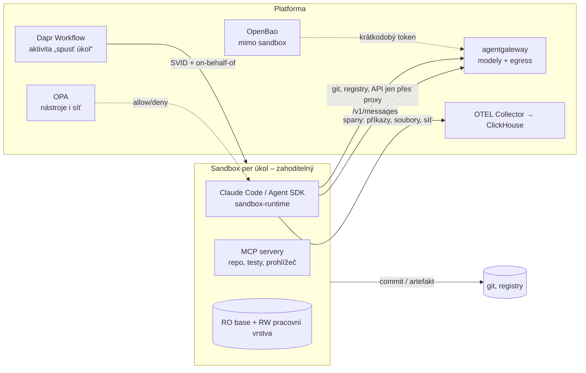

# Mapa sandboxů a pracovního prostředí

Kontext: sandbox je místo, kde agent **vykonává** a kde se dějí nevratné akce. Zásada: **jednorázový a bez tajemství** –
přežít má výsledek (commit, artefakt, trace), ne prostředí. Navazuje na rozhodnuté vrstvy: identita (SVID agenta,
OPA), observabilita (ClickHouse, Inspect sandbox), gateway (egress pro modely), paměť (sandbox je zdroj epizod).
Kritéria v [kriteria.md](kriteria.md).

## Druhy prostředí a kde už jsou

| Druh | Kde už je | Kde chybí |
|---|---|---|
| Eval sandbox | Inspect AI sandbox provider (rozhodnuto v observabilitě) | musí být týž runtime jako produkce |
| Durable stav běhu | Dapr Workflows (rozhodnuto) | – |
| Vývojové prostředí, code interpreter, prohlížeč | – | **jádro této vrstvy** – síto níže |

## Široké síto – kolo 1

*Běží (2026-10-23). Kandidáti k prověření – rozděleni podle toho, co izolují:*

| Skupina | Kandidáti |
|---|---|
| Izolační runtime na K8s | gVisor, Kata Containers, Firecracker (+ firecracker-containerd), Sysbox, Edera, Kubernetes `agent-sandbox` (sig) |
| Procesový sandbox (uvnitř kontejneru) | Anthropic `sandbox-runtime` (bubblewrap/seatbelt + proxy), nsjail, bubblewrap, Landlock |
| Sandbox-as-a-service / orchestrátory | E2B (OSS infra?), Daytona, Modal, microsandbox, OpenHands runtime, SWE-ReX, Arrakis, Azure Container Apps dynamic sessions (A4) |
| Code interpreter bez VM | Pyodide/Wasm (wasmtime, WASI), Deno, Jupyter kernel gateway, Piston, Judge0 |
| Prohlížeč | Playwright/Chromium headless, Steel, browser-use, Lightpanda, Browserbase (A4) |
| Definice prostředí | devcontainer spec, DevPod, Nix/devenv, Coder, Gitpod/Ona |
| Egress a tajemství | agentgateway jako egress, Envoy/Squid proxy, Cilium NetworkPolicy, OpenBao + SPIRE (rozhodnuto) |

## Co ověřit dál

- [ ] Síto kolo 1 – tabulka kandidátů s licencí, nadací, izolací, K8s požadavky (nested virt na Azure SKU), telemetrií.
- [ ] Co dává Anthropic nativně: Claude Code sandboxing a `sandbox-runtime`, Agent SDK sandbox, Managed Agents (jen vzor).
- [ ] Jak Inspect AI sandbox providers (docker, k8s) sedí na zvolený runtime.
- [ ] Harness S1: sandbox per úkol s default-deny egress přes agentgateway, bez tajemství, SVID identita, spany příkazů do ClickHouse; evaly S-E1 (exfil klíče z promptu selže), S-E2 (push do main bez approval selže).

## Changelog
- 2026-10-23: první verze – kostra, druhy prostředí, skupiny kandidátů, otevřeno síto.
